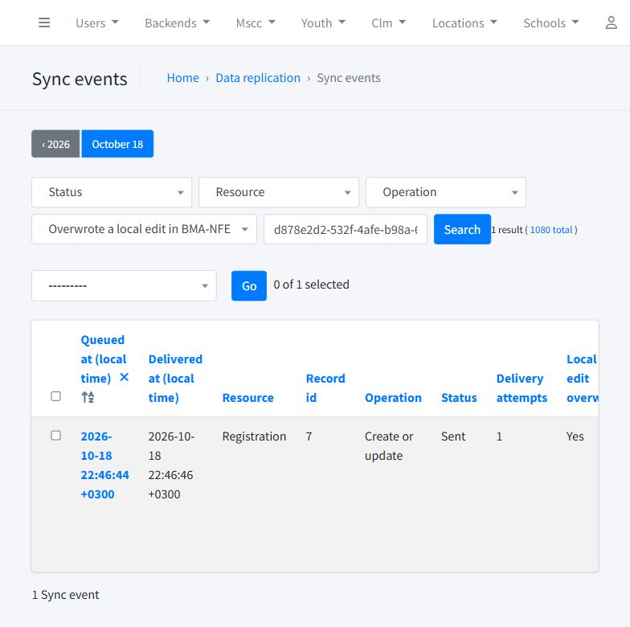

# Local sync integration test report

Date: 2026-10-18, Asia/Beirut. Result: all listed scenarios passed after the shared-child query fix.

The run used the original Compiler and BMA-NFE clones, separate synthetic children,
real Django admin forms, browser interactions, HTTP requests, Celery worker/beat,
PostgreSQL and local image storage. Compiler Azure storage configuration was unchanged.

## Issue found and corrected

Multiple registrations for one child could falsely report conflicting `student_old`
links even when every registration referenced the same Student. Registration default
ordering (`-id`) added its primary key to SQL DISTINCT selection. The same behavior
could enumerate one child twice and queue duplicate registration updates.

Both queries now clear ordering before selecting distinct IDs. Three database
regression checks cover shared Student links, genuinely conflicting links and
exactly one queued update per registration. The two affected live test events were
requeued and applied successfully. A Student save then queued exactly two events
for its two registrations, with the existing image reused.

## Bulk measurements

| Scenario | Events | Seconds | Uploaded image bytes | HTTP POSTs | Peak concurrent POSTs |
|---|---:|---:|---:|---:|---:|
| First transfer of distinct photos | 250 | 30.35 | 18,475,523 | 250 | 4 |
| Unchanged registrations | 250 | 28.25 | 0 | 250 | 4 |
| Changed source photos | 25 | 7.33 | 56,725 | 25 | 4 |
| NFE files modified in place | 25 | 14.17 | 1,360,305 | 50 | 4 |
| NFE files deleted | 25 | 12.28 | 1,360,272 | 50 | 4 |
| Three overlapping dispatchers plus worker | 250 | 45.12 | 0 | 250 | 4 |

These phases exercised 825 registration updates over 250 distinct photos. Every
destination checksum was checked; no duplicate child/registration records were
created. Formats included JPEG, PNG and WebP. The largest initial photo was
4,923,513 bytes, below the default 5 MiB limit.

Overlapping bulk runs remained correct but were slower than one normal sweep due
to work/lock contention. Keep one periodic scheduler; the shared slot limit still
protects the receiver when deliveries overlap.

## Admin and recovery checks

- All nine resource types were delivered, including new round/center/partner
  references, teacher, registration/child, education service/assessment/grading,
  referral and attendance with its child row.
- Browser photo replacement arrived with identical bytes. An unchanged browser
  save uploaded zero image bytes.
- A local NFE address edit was overwritten without reuploading the unchanged photo.
- A local NFE photo edit was restored by the same source event and one attempt;
  the admin showed Sent, attempt 1, overwrite Yes and local +0300 timestamps.
- Browser photo clearing removed the NFE reference; restoring a source photo
  restored display. Source admin rejected a non-image without creating an event.
- Stopping NFE preserved committed source saves and queued events. The same
  event recovered automatically after restart (three attempts in the outage case).
- Simulated storage unavailability rolled back destination metadata and photo
  changes; unchanged photos were not uploaded unnecessarily. Recovery reused
  the same event. Removing/restoring the synthetic source file also recovered.
- Bad checksum, invalid image bytes, an over-limit file and a missing attachment
  were rejected while existing metadata/photo bytes stayed intact.
- Missing/wrong authentication was rejected. A stale event could not clear the
  latest image.
- Forty concurrent duplicate replays preserved original IDs and overwrite flags,
  including an older overwrite receipt after newer updates. Latest data stayed intact.
- BMA mapping was verified with different source/destination primary keys:
  source child 258 mapped to NFE child 259; source registrations 258 and 259 mapped
  to NFE registrations 259 and 260, both pointing at that same NFE child.

## Final checks and evidence

- 161 combined receiver/sender-contract/transport/concurrency tests passed after the fix.
- 24 source photo/outbox checks passed, including the three new database regressions.
- All 840 registration events in this run were Sent at final inspection.
- Four intentionally rejected API test events remain in NFE audit logs. These are
  the malformed-request tests, not outstanding source synchronization failures.
- Outage switches were cleared and both local apps and the worker were restored.

## Deployment limits

These are local results, not Azure throughput measurements. The source used
local filesystem test overrides; the deployed Azure image backend was not contacted.
The provided VM/share mount, permissions, HTTPS, production media serving and
historical Compiler migration upgrade still require verification in SIT.
Storage failure was simulated locally. Lookup data and school/center mappings
were prepared; external identity services were disabled for the synthetic fixtures.
Apply the Compiler fingerprint migration and restart its processes when deploying
the optimized sender; the query correction itself requires no new migration.
