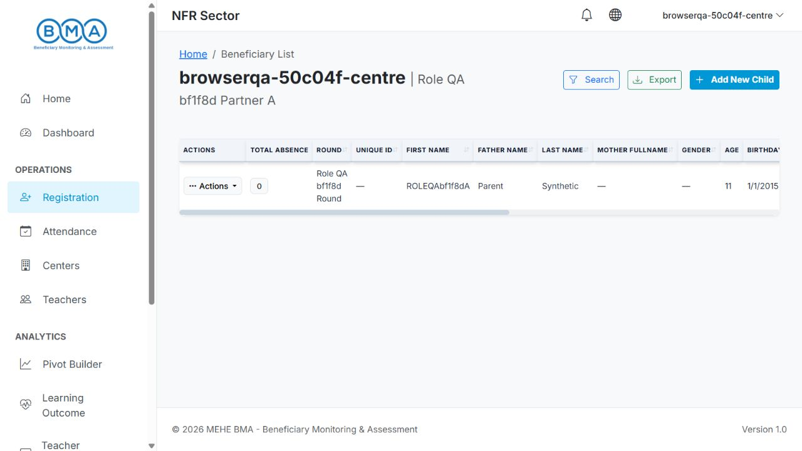
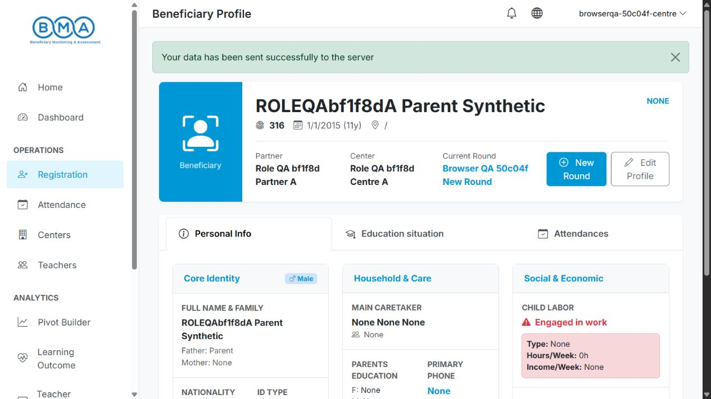
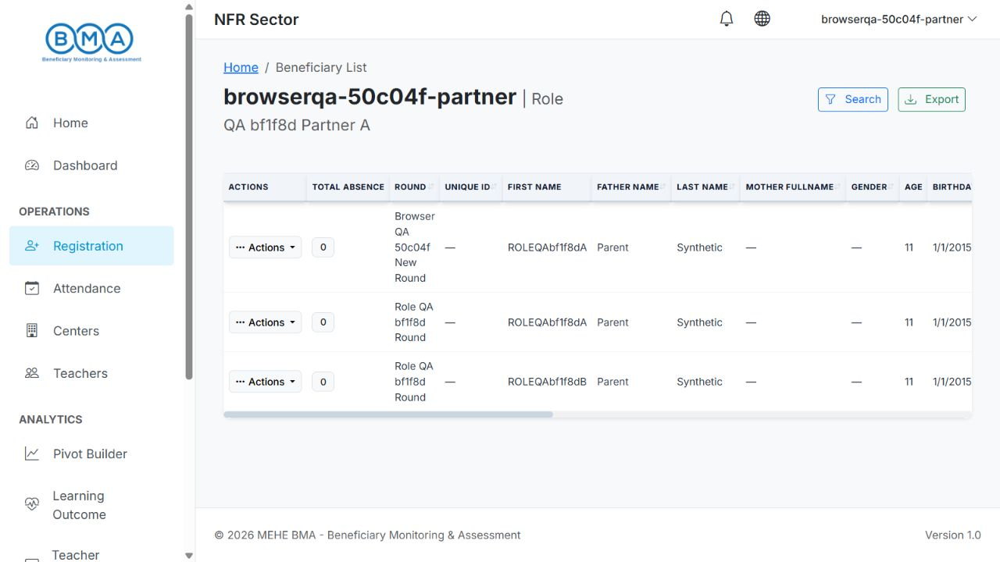
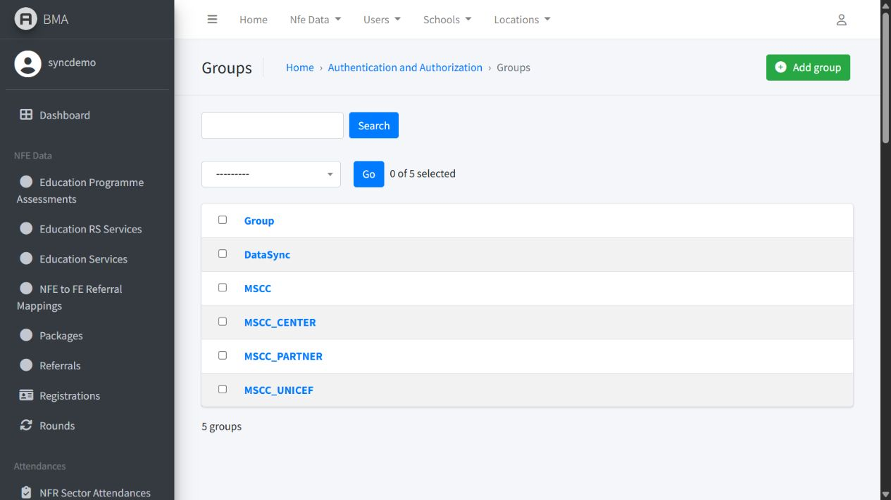

# MSCC_FULL retirement - 26 October 2026

`MSCC_FULL` was a legacy Django group, rather than a separate Django model
permission. The current registration list already uses `MSCC_UNICEF`,
`MSCC_PARTNER` and `MSCC_CENTER` to determine its data scope. The old claim
that `MSCC_FULL` bypassed those filters was no longer true.

The group still added redundant checks to Add New Child and New Round and
selected a fallback table for users with no data scope. Those checks have
been removed. Existing list filters and view-level group requirements stay
in place:

- Add New Child requires `MSCC_CENTER` and an assigned centre and partner.
- New Round uses its existing view roles: `MSCC` or `MSCC_CENTER`, with the
  existing superuser bypass. Its modal follows the same rule as its button.
- Membership in a viewer group alone does not enable New Round.
- `MSCC` module membership alone does not grant a list data scope.

Testing also exposed incompatible Django/braces permission-denial callbacks
on the list and New Round views. Both now return 403 for authenticated users
who lack the required role and redirect anonymous users to login.

## Database cleanup

Deploy the code and run:

```text
python manage.py migrate
```

The new `users.0002_remove_mscc_full_group` migration removes the legacy group
and its memberships. It does not remove users, their centre/partner assignments,
other groups or existing direct permissions. If the old group carries custom
Django model-permission grants, those grants are copied to its existing members
as direct permissions before the group is removed. No broader replacement role
is assigned, and no other group's permissions change.

The migration safely handles an absent group and repeated execution. It is
intentionally irreversible because deleted group memberships cannot be
reconstructed on rollback. Restore from a database backup if that historical
membership data is ever needed.

## Verification

The final combined MSCC and receiver suite passed **158 tests**, including
**17 new role/access/migration regression tests**. Those tests check data
scopes, button visibility, direct route authorization, anonymous redirects,
group removal, permission preservation and repeat cleanup.

Nine live checks then called the running local NFE app using synthetic role
accounts and real HTTP requests:

1. The retired group is absent after migration.
2. A centre user sees only its own centre and can access Add New Child without
   the legacy group.
3. The existing centre role can open New Round without the legacy group.
4. A partner user sees only its own partner and has no centre-only registration
   button.
5. UNICEF visibility across partners still works.
6. A centre role without assignments gains neither records nor a registration
   button.
7. A viewer role alone cannot start New Round or bypass the list module gate;
   denial returns 403.
8. Anonymous list and New Round requests redirect to login.
9. These workflows do not recreate the retired group.

The migration was applied successfully to the isolated local NFE database.
`makemigrations users --check --dry-run` reported no model changes. No production
database was accessed. Changes are saved in the original BMA-NFE clone on
`claude-api-connection`; nothing was committed, pushed or deployed.

## Follow-up browser verification

On the requested follow-up, the automated suite was run first: **158 tests passed**. This was followed by the manual browser checks below using five fresh synthetic role accounts. No test account belonged to `MSCC_FULL`.

1. Centre sign-in and list scope without MSCC_FULL.
2. Add New Child opens the registration modal without MSCC_FULL.
3. Add New Child Start opens the ordinary registration form.
4. Empty child registration stays on Identity and displays required-field errors.
5. View Profile opens from centre Actions.
6. New Round button and confirmation open the enrollment form.
7. New Round form saves successfully without MSCC_FULL and opens the new registration profile.
8. Saved enrollment shows the chosen program, round, section and date in the Education tab.
9. Partner sign-in shows both assigned centres and excludes the other partner.
10. Partner has no centre-only Add New Child button.
11. Sorting the partner list preserves its data scope.
12. UNICEF sign-in shows current records across both partners without MSCC_FULL.
13. UNICEF has no centre-only Add New Child button.
14. Unassigned centre user sees an empty list, assignment warnings, and no Add New Child button.
15. Viewer profile hides New Round.
16. Viewer direct New Round URL returns 403 Forbidden.
17. Viewer cannot bypass the list module role through a direct URL.
18. Signed-out list request redirects to the sign-in form.
19. Signed-out New Round request redirects to the sign-in form.
20. Administrator Groups page contains the remaining roles and no MSCC_FULL.

The New Round form was submitted successfully through the browser, creating registration `321` for the existing child. Independent database checks confirmed the same child, centre and partner, the selected new round, exactly one education service, program `BLN Level 1`, section `A`, and registration date `2026-10-26`. The original registration and its round were retained.

The child-creation checks covered the button, modal, registration form and required-field validation. A complete new-child submission was not performed in this follow-up. No new application defect was found in these checks and no further application code change was needed. These are local tests, not a validation of deployed Azure infrastructure.

After testing, the five synthetic accounts were disabled and their passwords made unusable. The browser was restored to the local administrator session.

### Browser evidence









