

# دليل المستخدم – وحدة برنامج التعليم المسرّع (ALP)

**منصة BMA – برنامج التعليم المسرّع**

_آخر تحديث: 26 October 2026_

يشرح هذا الدليل خطوةً بخطوة كيفية استخدام **وحدة برنامج التعليم المسرّع (ALP)** في منصة BMA. وهو موجّه لنقاط الاتصال في المدارس الذين يسجّلون طلاب البرنامج، ويسجّلون الحضور اليومي للطلاب والمعلّمين، ويدخلون الدرجات، ويحدّثون ملف المدرسة، ويطّلعون على لوحات المعلومات.

سجلات البرنامج تابعة **للمدرسة**. حسابك مرتبط بمدرسة واحدة ولا ترى أو تعدّل إلا بيانات تلك المدرسة. إذا بقيت القوائم فارغة وظهر تنبيه، فهذا يعني أن حسابك غير مرتبط بمدرسة بعد: اطلب ذلك من المدير.

كل خطوة مرفقة بلقطة شاشة مأخوذة من النظام. البيانات الظاهرة هي بيانات تجريبية فقط.

## المحتويات

1. البدء – تسجيل الدخول والتنقّل
2. قائمة الطلاب
3. تسجيل طالب
4. ملف الطالب
5. حضور الطلاب
6. حضور المعلّمين
7. المعلّمون
8. الدرجات
9. ملف المدرسة
10. لوحات المعلومات
11. حسابك
12. الأسئلة الشائعة

## 1. البدء – تسجيل الدخول والتنقّل

افتح متصفّح Google Chrome أو Mozilla Firefox وادخل إلى عنوان المنصة الذي زوّدك به المنسّق. يُنشئ مدير النظام الحسابات؛ لا يوجد تسجيل ذاتي.

1. افتح صفحة تسجيل الدخول وأدخل **اسم المستخدم** و**كلمة المرور**.

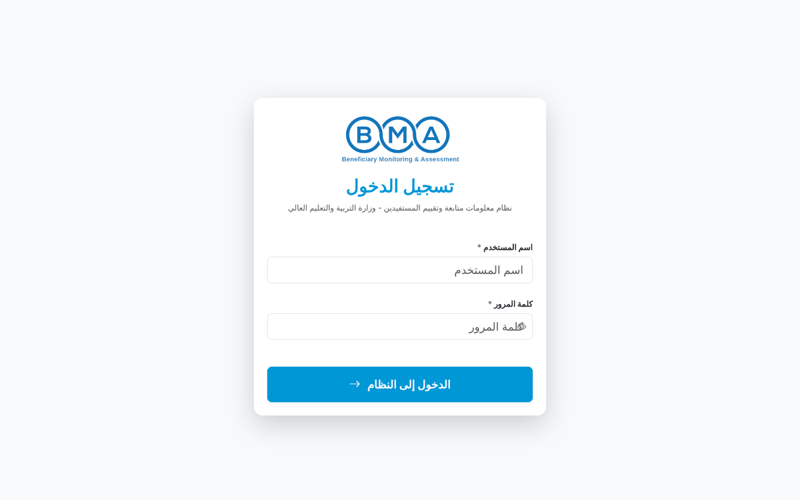

*الشكل 1 – صفحة تسجيل الدخول*

2. اضغط **تسجيل الدخول**. يُنقل مستخدمو البرنامج مباشرة إلى **الصفحة الرئيسية للبرنامج**.

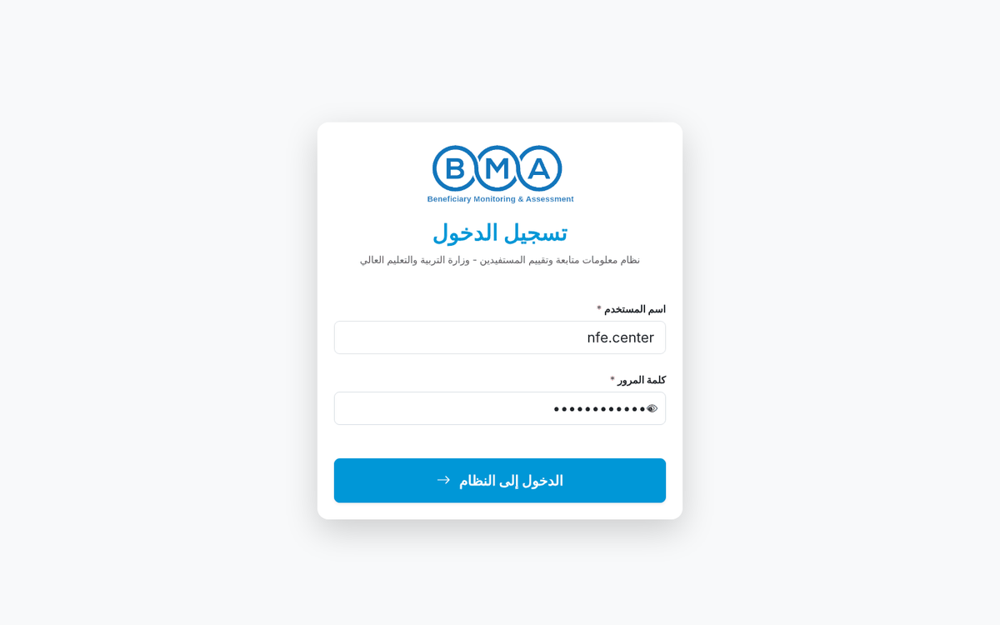

*الشكل 2 – نموذج تسجيل الدخول بعد تعبئته*

3. تعرض الصفحة الرئيسية تسجيلات اليوم وهذا الأسبوع، والمدارس التي ترسل بيانات، ومعدّل الحضور الشهري، ومنحنى التسجيلات خلال 14 يوماً، وعمليات التصدير الأخيرة. بطاقات الإجراءات السريعة تفتح **تسجيل جديد** و**قائمة المستفيدين** و**متابعة الحضور**.

*الشكل 3 – الصفحة الرئيسية للبرنامج*

4. لتغيير اللغة اضغط **أيقونة الكرة الأرضية** في الشريط العلوي واختر **العربية** أو **English**.

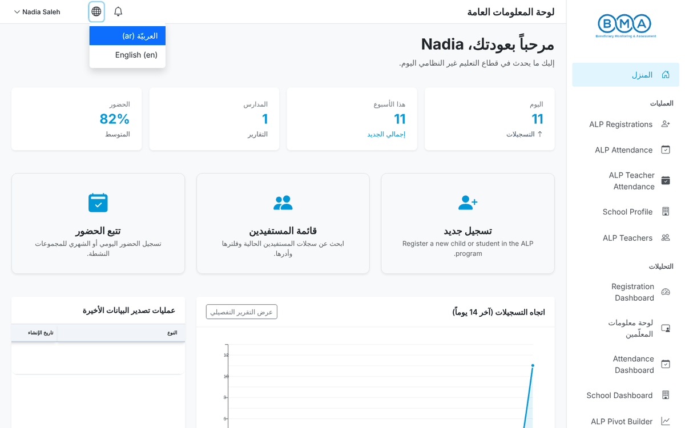

*الشكل 4 – قائمة اللغة*

5. اضغط على **اسمك** في أعلى الصفحة للوصول إلى **الملف الشخصي** و**تغيير كلمة المرور** و**تسجيل الخروج**.

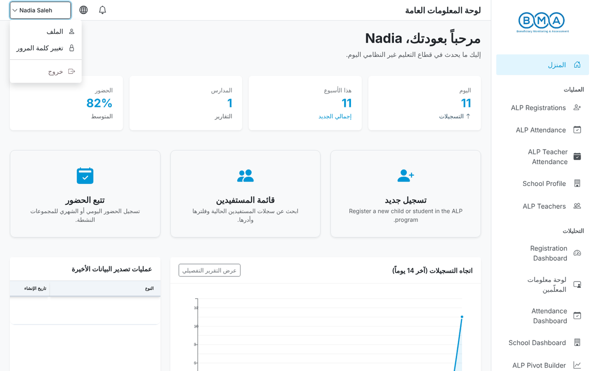

*الشكل 5 – قائمة المستخدم*

| عنصر القائمة | ما يفتحه |
|---|---|
| المنزل | الصفحة الرئيسية للبرنامج |
| تسجيلات ALP | قائمة الطلاب ونموذج التسجيل وملفات الطلاب |
| حضور ALP | الحضور اليومي للطلاب |
| حضور معلّمي ALP | الحضور اليومي للمعلّمين |
| ملف المدرسة | سجل مدرستك |
| معلّمو ALP | قائمة المعلّمين ونموذج المعلّم |
| لوحة معلومات التسجيل | أعداد التسجيلات ومخرجات التعلّم |
| لوحة معلومات المعلّمين | بيانات المعلّمين وتكليفاتهم وتدريبهم |
| لوحة معلومات الحضور | الخريطة الحرارية للحضور على مدار السنة |
| لوحة معلومات المدارس | خريطة مدارس البرنامج |
| منشئ الجداول المحورية | بناء جداولك المتقاطعة الخاصة |
| دليل المستخدم | التوثيق داخل النظام |

> **ملاحظة:** يُخرجك النظام تلقائياً بعد فترة من عدم النشاط. احفظ عملك بانتظام.

## 2. قائمة الطلاب

افتح **تسجيلات ALP** من القائمة الجانبية. تعرض القائمة كل طالب مسجّل في مدرستك.

1. يعرض كل سطر رقم التسجيل والأسماء والمدرسة والسنة الدراسية (الدورة) والبرنامج والشعبة. اضغط على عنوان العمود للفرز. الأيقونات الثلاث في عمود **الإجراءات** تفتح **الملف**، أو **تعدّل** التسجيل، أو **تحذفه**.

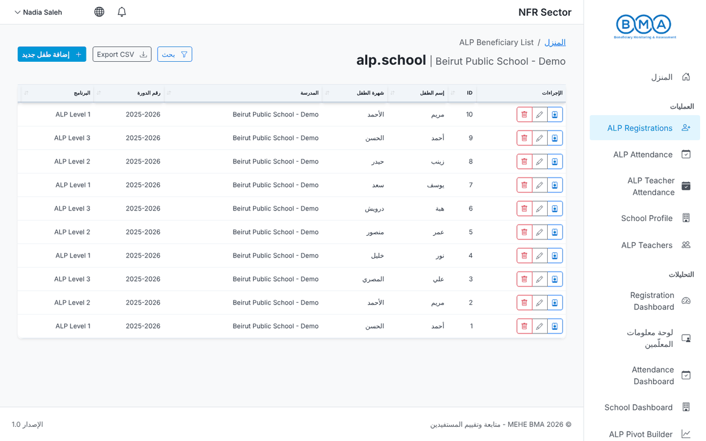

*الشكل 6 – قائمة طلاب البرنامج*

2. اضغط **بحث** للتصفية بحسب الاسم أو السنة الدراسية أو البرنامج أو الشعبة أو التاريخ، ثم **تطبيق الفلاتر**.

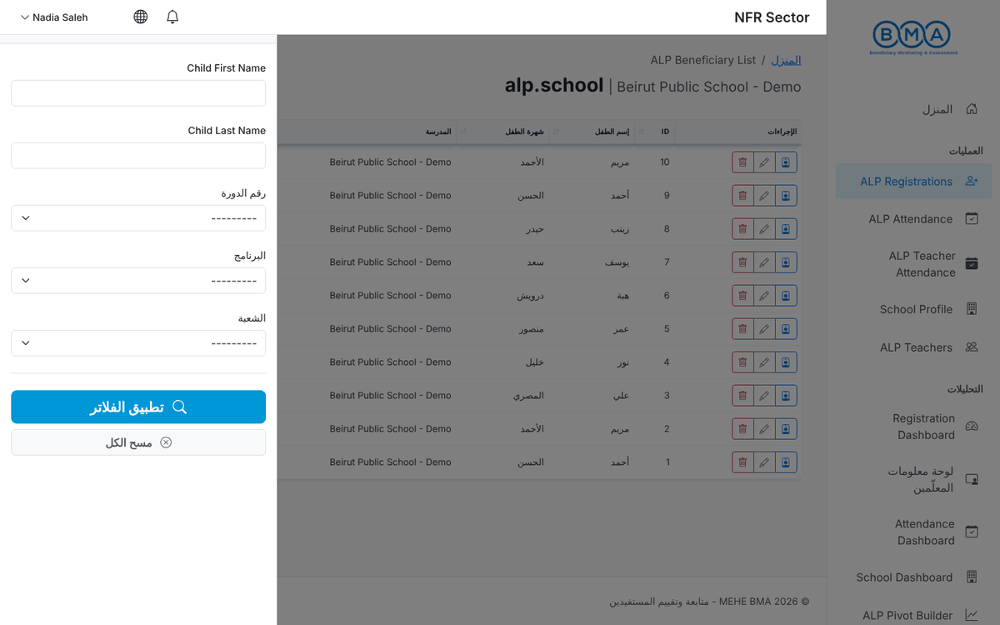

*الشكل 7 – لوحة البحث*

3. **تصدير CSV** يحمّل القائمة الحالية كملف CSV (بترميز UTF-8، تُفتح الأسماء العربية بشكل صحيح في Excel). **إضافة طفل جديد** يفتح نموذج التسجيل.

## 3. تسجيل طالب

يستخدم التسجيل **معالجاً من 3 خطوات**: الهوية، مقدّمو الرعاية، الالتحاق بالبرنامج. لا يُحفظ الطالب إلا عند الضغط على **إكمال التسجيل** في الخطوة الأخيرة. الحقول المعلَّمة بنجمة حمراء (*) إلزامية. يجب كتابة الأسماء **بالأحرف العربية**.

أثناء كتابة الاسم وتاريخ الولادة تتحقّق لوحة **مطابقات محتملة** من وجود طفل مسجّل سابقاً. إذا ظهرت مطابقة راجعها قبل المتابعة بدلاً من إنشاء سجل مكرّر.

1. املأ **معلومات الهوية الأساسية**: الصورة (اختيارية)، الاسم الأول واسم الأب واسم العائلة، تاريخ الولادة، الجنس، اسم الأم الكامل والجنسية.

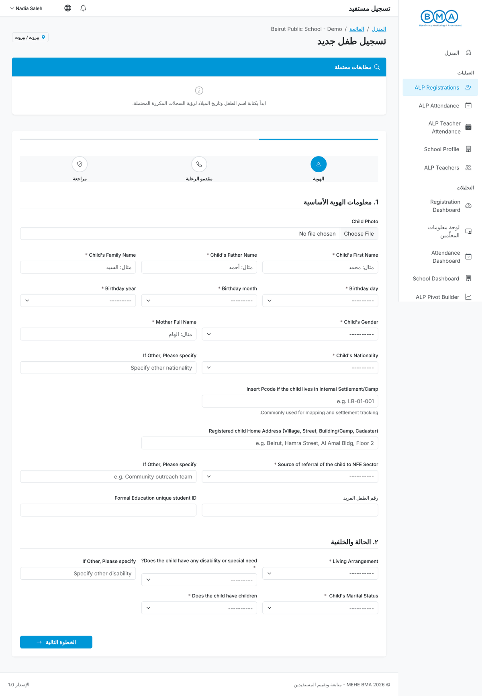

*الشكل 8 – الخطوة 1 – الهوية*

2. املأ **الوضع والخلفية**: الرمز الجغرافي وعنوان المنزل (اختياريان)، **مصدر الإحالة** إلى قطاع التعليم غير النظامي، رقم الطفل الفريد، الرقم الفريد في التعليم النظامي، **ترتيب السكن**، **الإعاقة**، **الحالة الزوجية** وما إذا كان لدى الطفل أطفال. ثم اضغط **الخطوة التالية**.

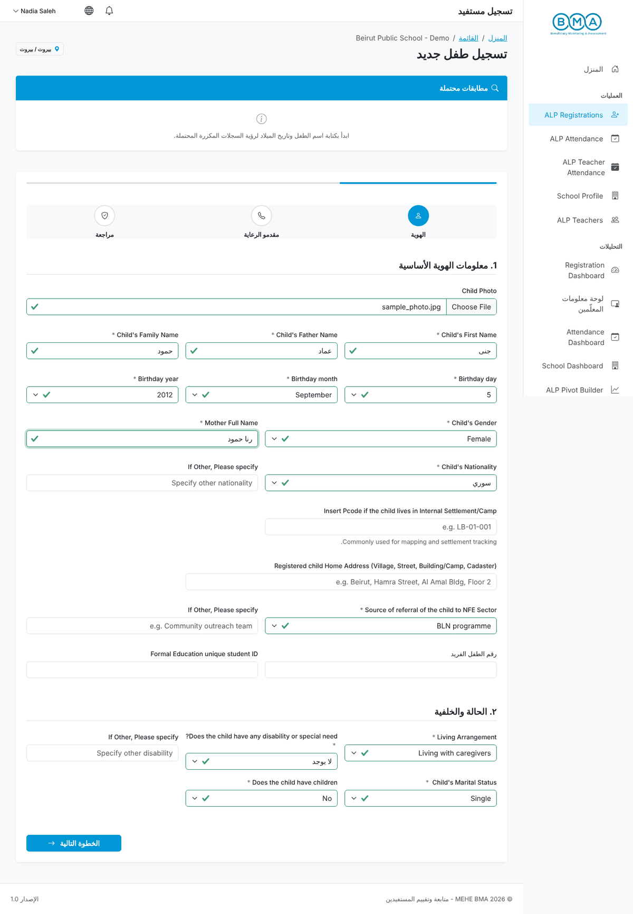

*الشكل 9 – الخطوة 1 بعد التعبئة*

1. أجب عن أسئلة الأسرة (الإخوة، إخوة من ذوي الإعاقة، حمل الأم)، و**المستوى التعليمي للوالدين**، و**رقم الهاتف الأساسي** (بالصيغة XX-XXXXXX) مع تأكيده ومن يجيب عليه، وعدد الأطفال دون 18 سنة، و**مقدّم الرعاية الأساسي** وأسماءه وجنسيته.

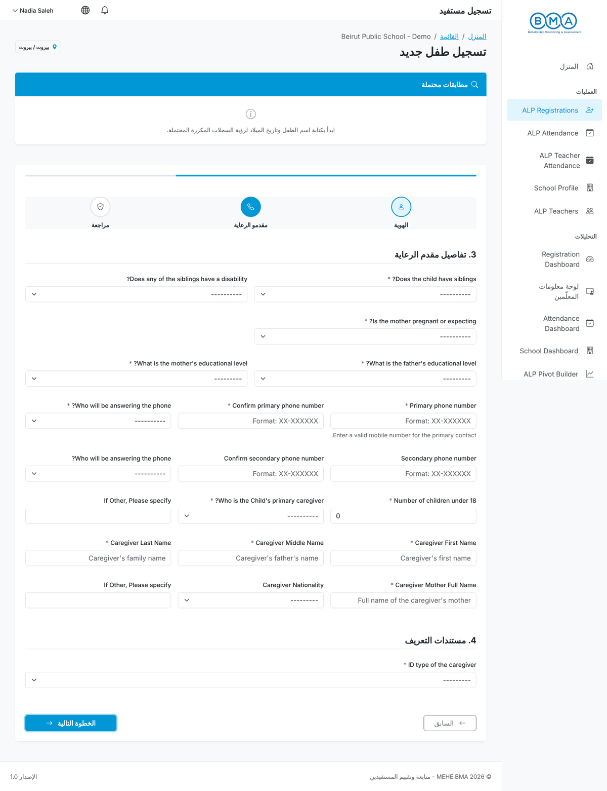

*الشكل 10 – الخطوة 2 – بيانات مقدّم الرعاية*

2. اختر **نوع هوية مقدّم الرعاية**. تظهر حقول الوثائق الخاصة بهذا النوع: اكتب كل رقم وأكّده (مثلاً رقم ملف المفوضية، الأرقام الفردية ورقم الباركود). اتّبع الصيغة الظاهرة تحت كل حقل ثم اضغط **الخطوة التالية**.

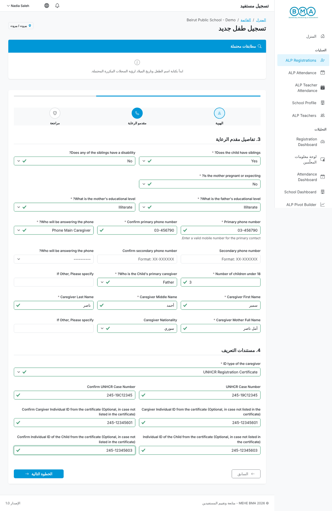

*الشكل 11 – الخطوة 2 بعد التعبئة*

1. أدخل **تاريخ التسجيل** و**السنة الدراسية (الدورة)** و**البرنامج** (مستوى ALP) و**الشعبة**. ارفع نسخة ممسوحة أو صورة واضحة لنموذج **الموافقة** الموقّع (PDF أو صورة).

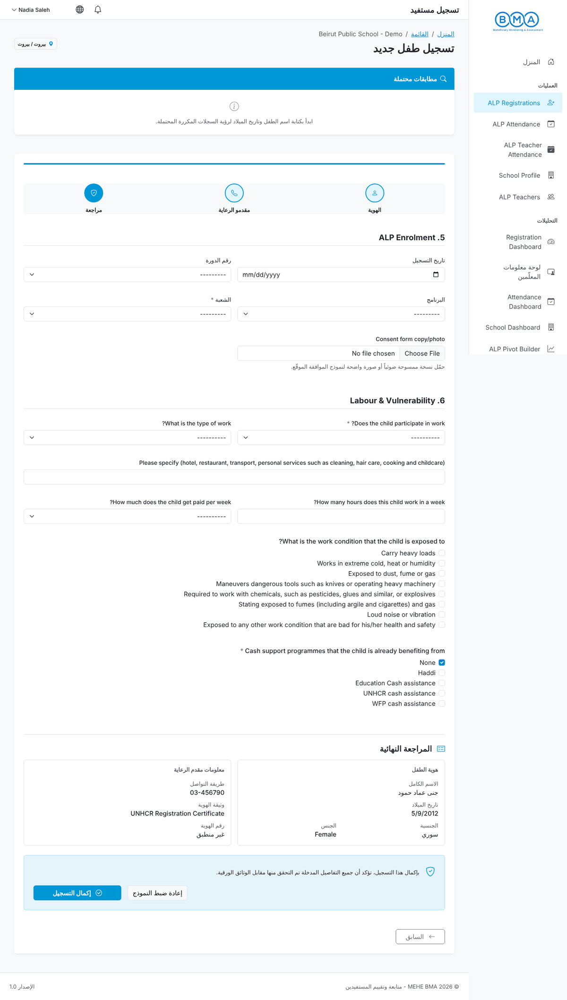

*الشكل 12 – الخطوة 3 – الالتحاق بالبرنامج*

2. أجب عن سؤال **هل يشارك الطفل في عمل؟** (إلزامي). إذا كانت الإجابة نعم تظهر حقول نوع العمل وساعات الأسبوع والدخل الأسبوعي وظروف العمل. علّم **برامج الدعم النقدي** التي تتلقّاها الأسرة ثم اضغط **إكمال التسجيل**.

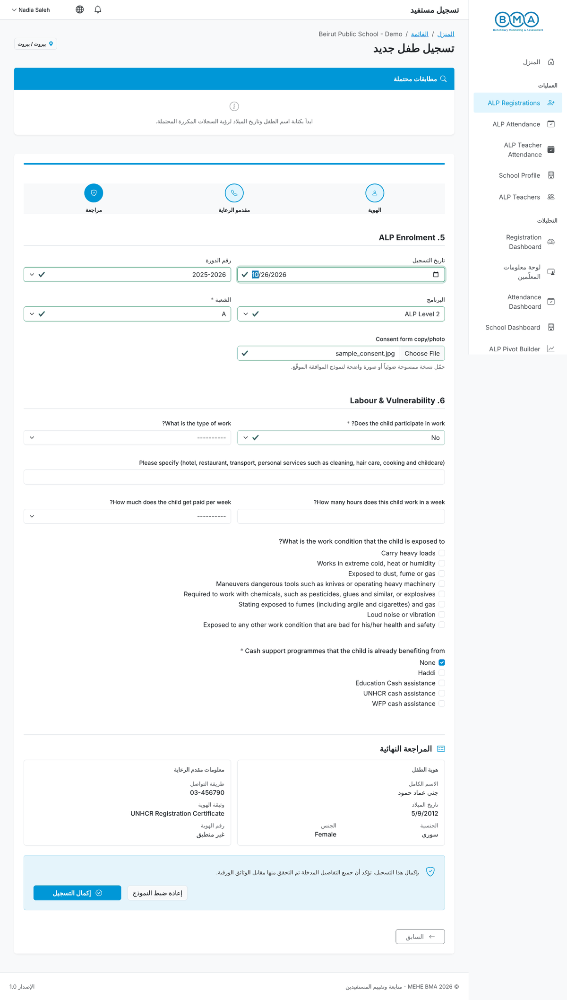

*الشكل 13 – الخطوة 3 بعد التعبئة*

3. تؤكّد رسالة "تم إرسال البيانات بنجاح" التسجيل ويُفتح **ملف الطالب**.

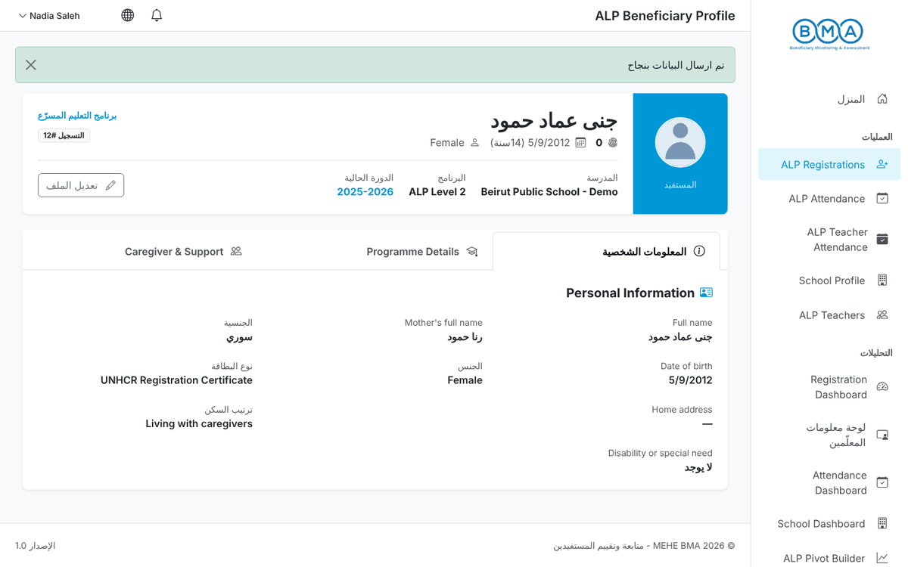

*الشكل 14 – الملف مباشرة بعد التسجيل*

> **ملاحظة:** لا تظهر المدرسة في النموذج: تُحدَّد تلقائياً من المدرسة المرتبطة بحسابك.

## 4. ملف الطالب

1. يعرض رأس الصفحة الصورة والاسم الكامل والرقم الفريد وتاريخ الولادة والعمر والمدرسة والبرنامج والدورة الحالية ورقم التسجيل. **تعديل الملف** يعيد فتح نموذج التسجيل.

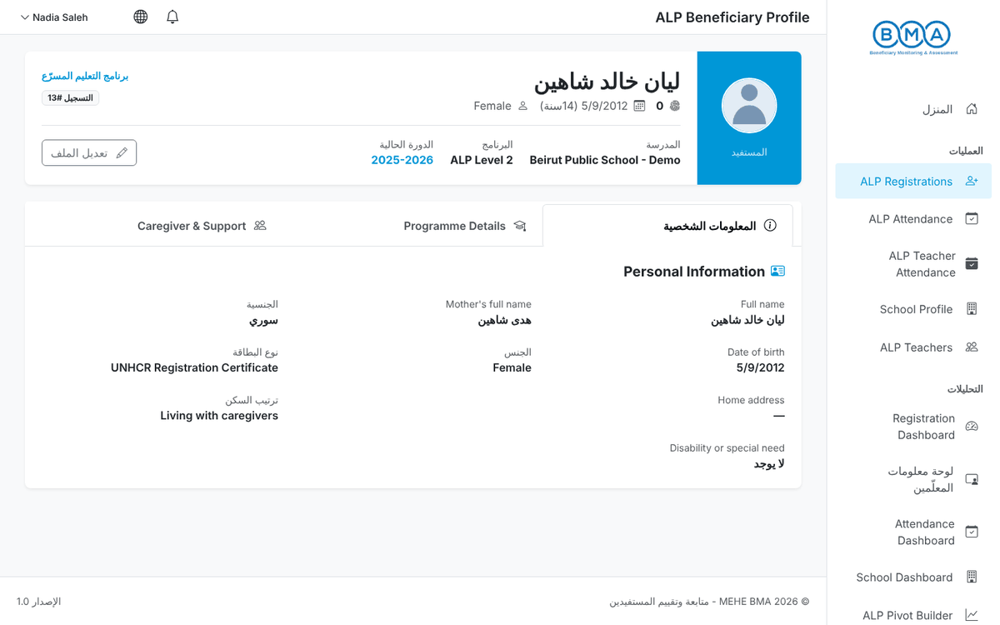

*الشكل 15 – رأس الملف وتبويبة المعلومات الشخصية*

2. تعرض تبويبة **تفاصيل البرنامج** تسجيل ALP: المدرسة، البرنامج، الدورة، تاريخ التسجيل، رقم الطفل الفريد، مصدر الإحالة وإجابات عمالة الأطفال.

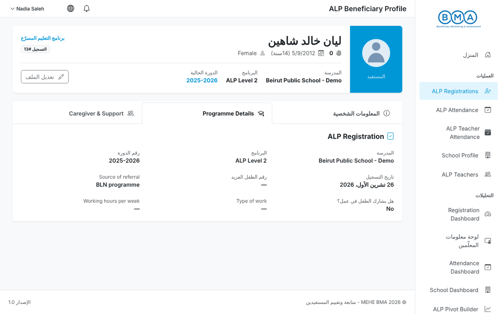

*الشكل 16 – تبويبة تفاصيل البرنامج*

3. تعرض تبويبة **مقدّم الرعاية والدعم** مقدّم الرعاية وأرقام الهاتف ووثائق الهوية وبرامج الدعم النقدي.

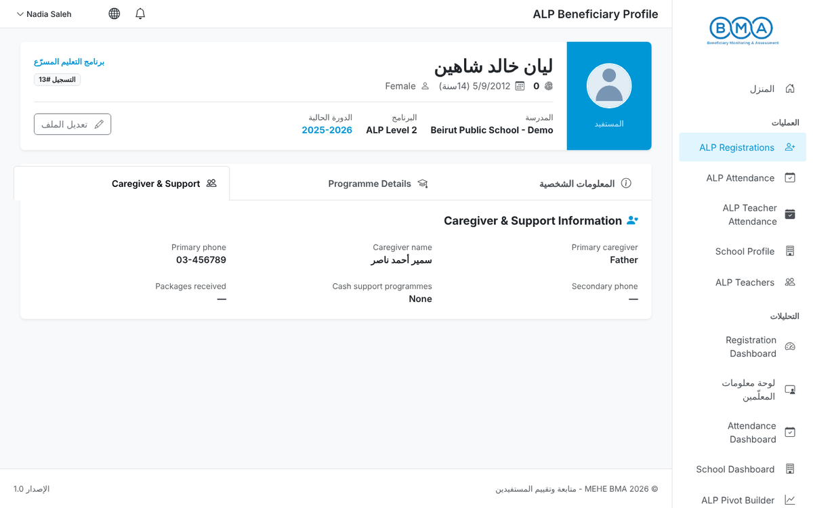

*الشكل 17 – تبويبة مقدّم الرعاية والدعم*

4. لتصحيح تسجيل اضغط **تعديل الملف** (أو أيقونة القلم في القائمة)، حدّث القيم عبر الخطوات الثلاث واضغط **إكمال التسجيل**.

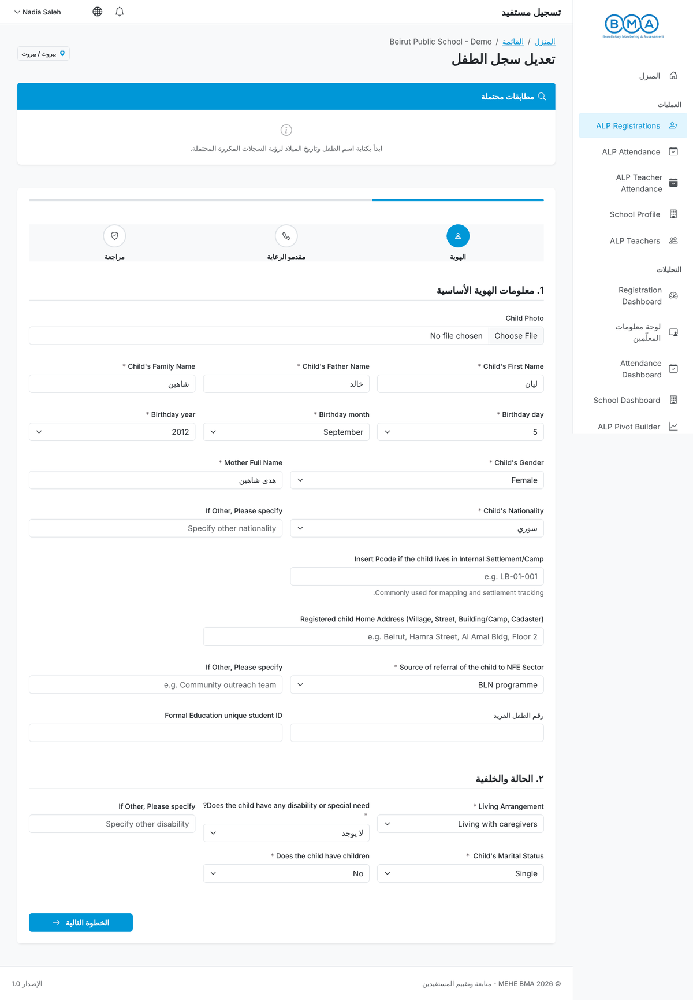

*الشكل 18 – تعديل تسجيل*

5. لحذف تسجيل اضغط أيقونة سلة المهملات الحمراء في القائمة وأكّد بالضغط على **حذف**. لا يمكن التراجع عن الحذف.

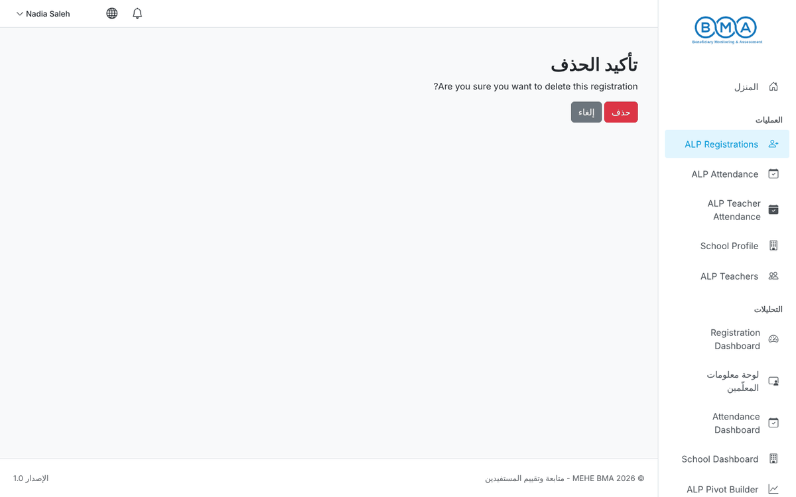

*الشكل 19 – تأكيد الحذف*

## 5. حضور الطلاب

يُسجَّل الحضور لكل يوم وبرنامج ودورة وشعبة. افتح **حضور ALP** من القائمة الجانبية.

1. التاريخ الافتراضي هو اليوم. اختر **البرنامج** و**الدورة** و**الشعبة**.

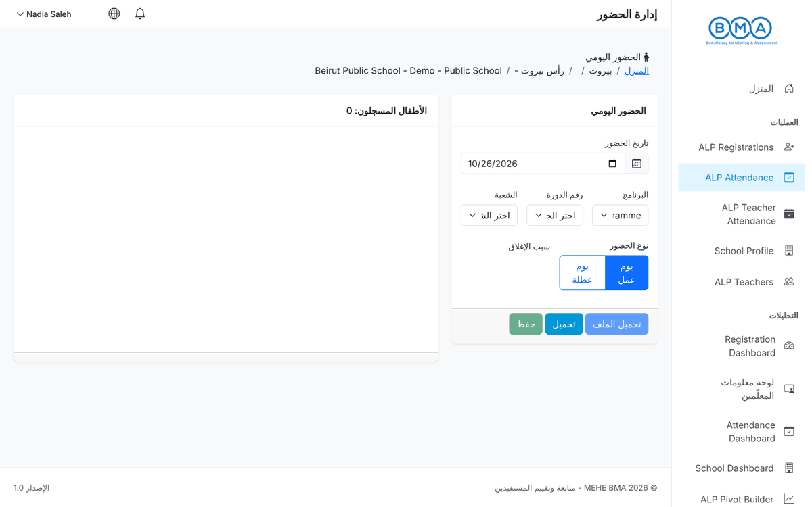

*الشكل 20 – صفحة الحضور*

2. اضغط **تحميل**. يظهر طلاب هذا الصف مع زرّي **حضر** و**غائب**.

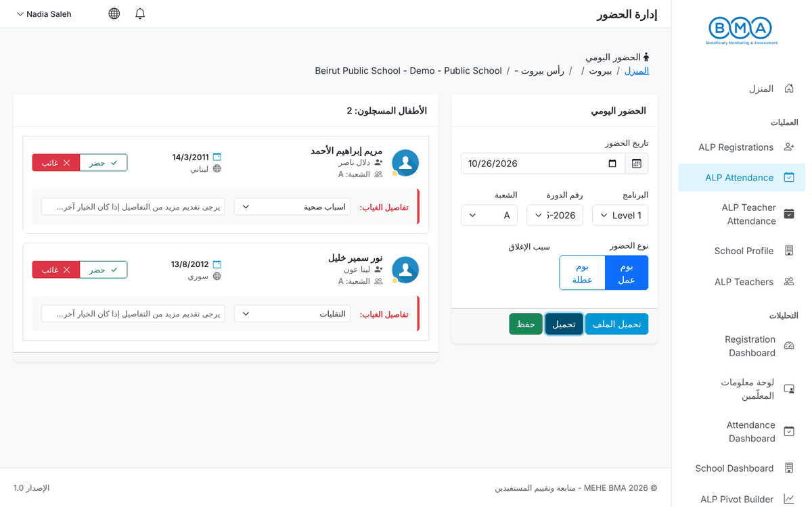

*الشكل 21 – الطلاب المحمَّلون*

3. لكل طالب غائب اضغط **غائب** واختر **سبب الغياب** (مرض، نقل، أو غير ذلك مع وصف).

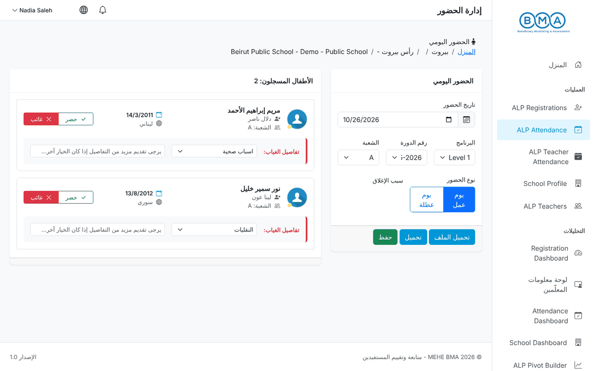

*الشكل 22 – الغياب معلَّم*

4. اضغط **حفظ**. تؤكّد رسالة **نجاح** الحفظ.

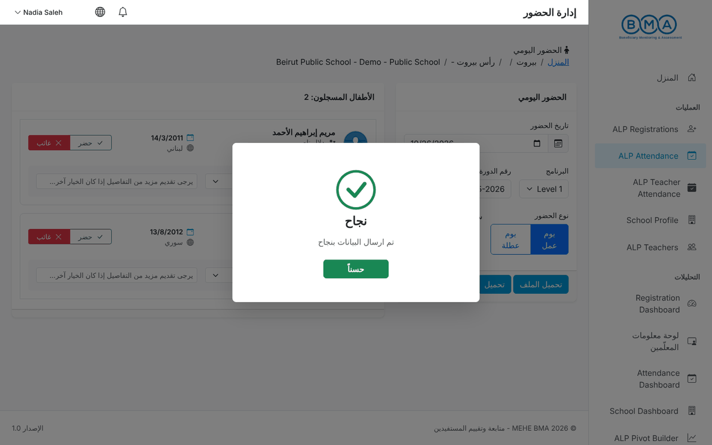

*الشكل 23 – تم حفظ الحضور*

5. إذا كانت المدرسة مغلقة اختر **يوم عطلة** وحدّد **سبب الإغلاق** واحفظ بدلاً من تعليم الطلاب.

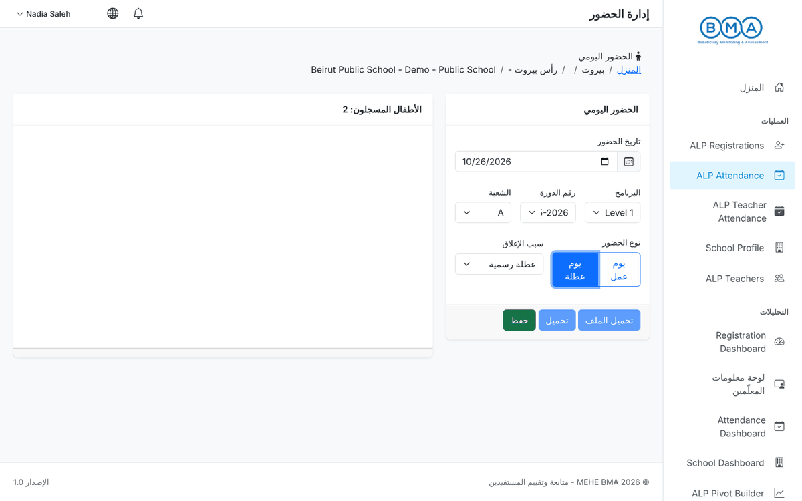

*الشكل 24 – تسجيل يوم عطلة*

- التواريخ المستقبلية مرفوضة؛ يمكن تصحيح التواريخ السابقة بإعادة تحميلها.
- **تحميل الملف** يعطي ملف CSV لما هو محمَّل على الشاشة بالضبط. يجب اختيار التاريخ والدورة والبرنامج أولاً.

## 6. حضور المعلّمين

1. افتح **حضور معلّمي ALP**، اختر **التاريخ** واضغط **تحميل**.

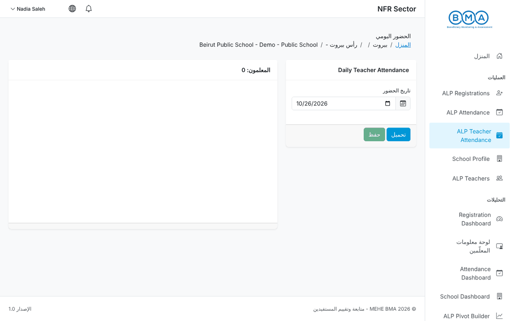

*الشكل 25 – صفحة حضور المعلّمين*

2. يظهر معلّمو مدرستك مع زرّي **حاضر** و**غائب**.

*الشكل 26 – المعلّمون المحمَّلون*

3. علّم حالة كل معلّم ثم اضغط **حفظ**.

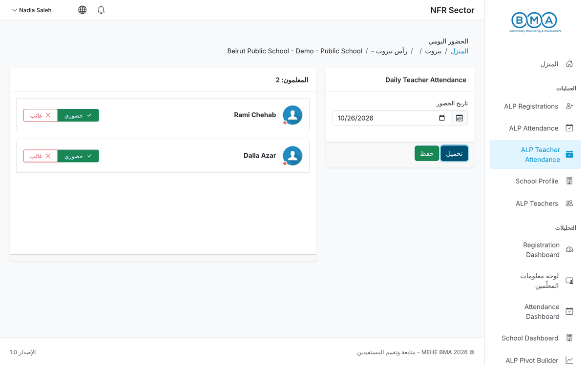

*الشكل 27 – حالة المعلّمين معلَّمة*

4. تظهر رسالة التأكيد؛ تُحفظ القائمة كاملة في إجراء واحد.

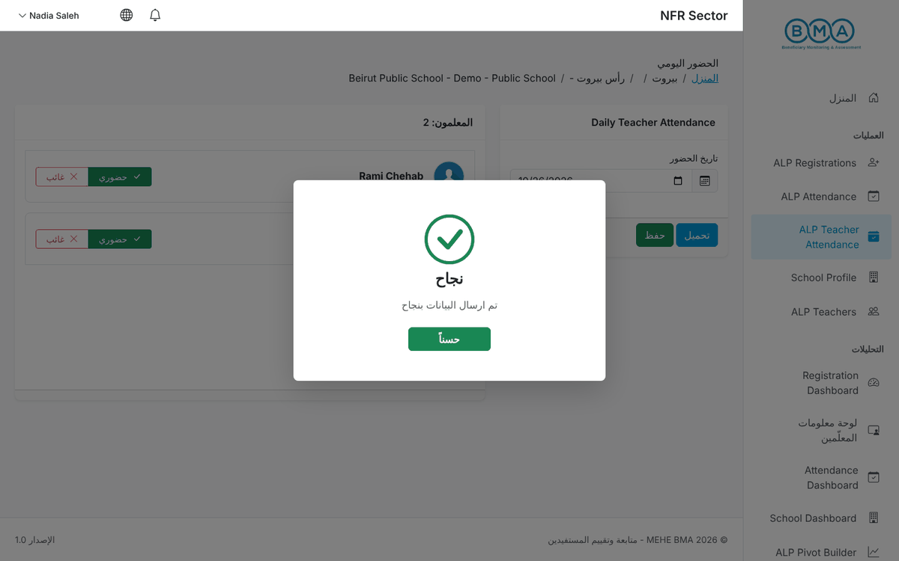

*الشكل 28 – تم حفظ حضور المعلّمين*

## 7. المعلّمون

افتح **معلّمو ALP** من القائمة الجانبية لإدارة معلّمي مدرستك.

1. تعرض القائمة معلّمي مدرستك مع بيانات الاتصال والدورة. اضغط **إضافة معلّم**.

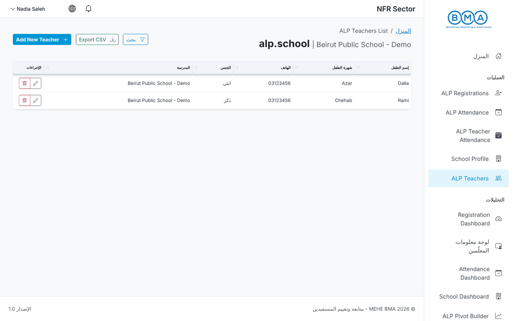

*الشكل 29 – قائمة معلّمي البرنامج*

2. املأ **الهوية والاتصال** (الأسماء بالأحرف العربية، الجنس، تاريخ الولادة، الجنسية، الهاتف بالصيغة XX-XXXXXX، البريد الإلكتروني).

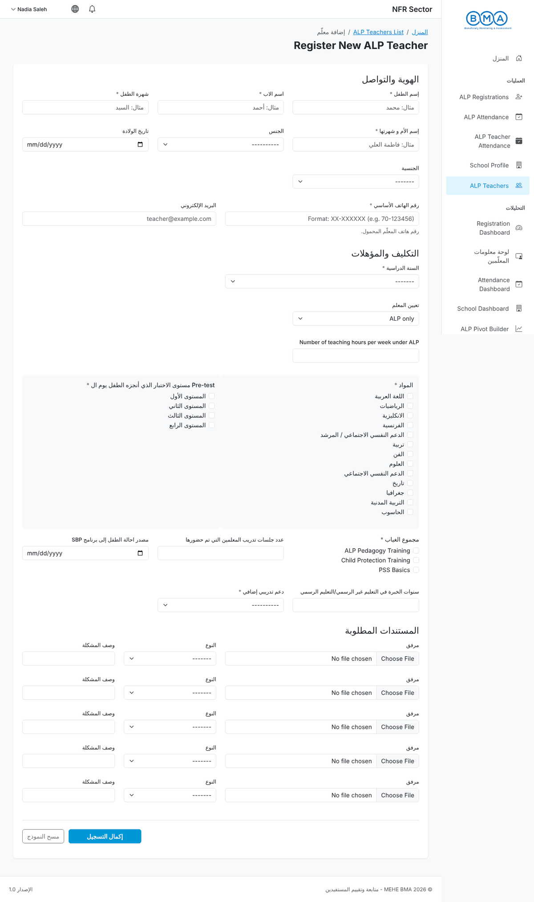

*الشكل 30 – نموذج المعلّم*

3. املأ **التكليف والمؤهّلات**: السنة الدراسية، التكليف، ساعات التدريس الأسبوعية في البرنامج، المواد، المستويات، مواضيع التدريب، سنوات الخبرة والتدريب الإضافي. أرفق حتى خمس وثائق داعمة مع نوعها ووصفها.

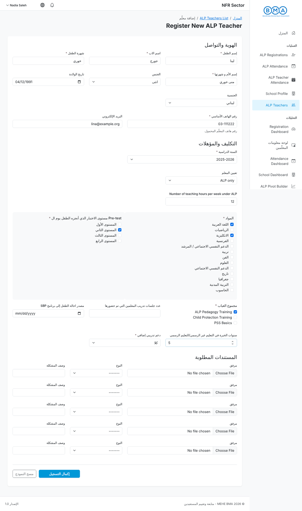

*الشكل 31 – نموذج المعلّم بعد التعبئة*

4. اضغط **إكمال التسجيل**. يظهر المعلّم في القائمة.

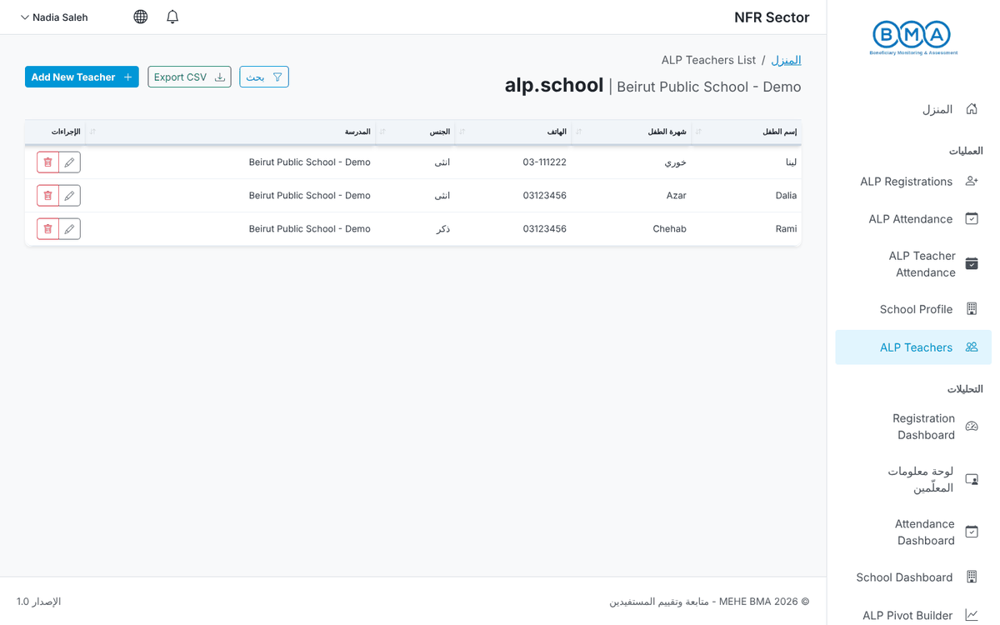

*الشكل 32 – تم حفظ المعلّم*

5. استخدم إجراءات السطر **لتعديل** أو **حذف** معلّم.

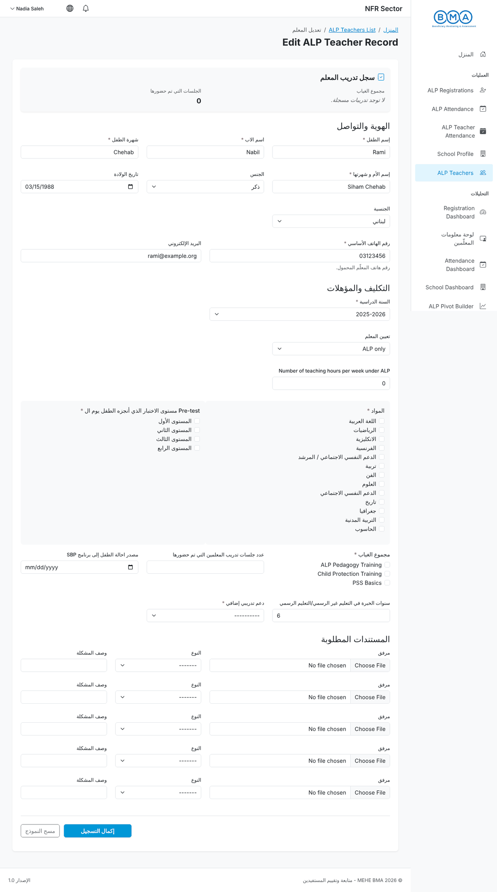

*الشكل 33 – تعديل معلّم*

## 8. الدرجات

تُدخل الدرجات لكل تسجيل طالب. يحدّد المدير المواد والنطاقات المسموح بها.

1. افتح نموذج الدرجات من قائمة الطلاب (**الإجراءات**) أو من العنوان **ALP ← الدرجات ← إضافة**. اختر **تسجيل** الطالب.

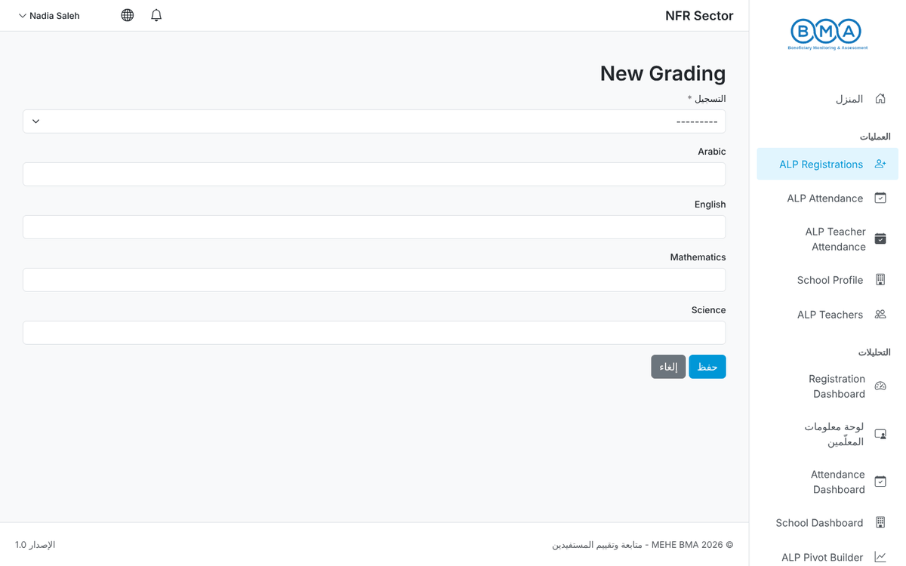

*الشكل 34 – نموذج الدرجات*

2. أدخل قيمة لكل مادة. تُرفض أي قيمة خارج النطاق المسموح.

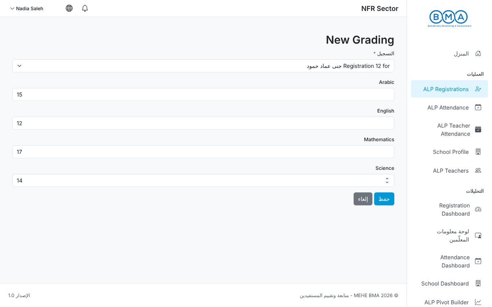

*الشكل 35 – الدرجات بعد الإدخال*

3. اضغط **حفظ**. تُخزَّن الدرجات مع التسجيل وتغذّي قسم **مخرجات التعلّم** في لوحة معلومات التسجيل. يمكن تعديلها لاحقاً.

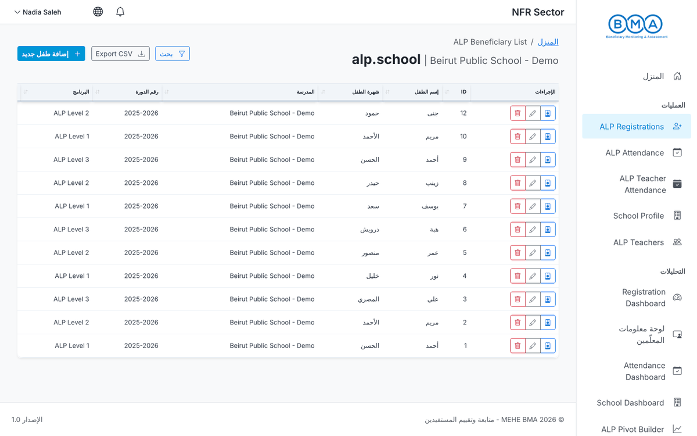

*الشكل 36 – العودة إلى قائمة الطلاب بعد الحفظ*

## 9. ملف المدرسة

1. افتح **ملف المدرسة**. حدّث **معلومات المدرسة** (النوع، الدوام، مدير البرنامج، الهاتف، البريد الإلكتروني)، و**الموقع** (المحافظة، القضاء، المنطقة العقارية، الإحداثيات)، و**الخدمات المقدَّمة** (الحزم، التعلّم الرقمي، المركز الرقمي، عدد موظفي البرنامج، مركز الرعاية الصحية الأولية القريب).

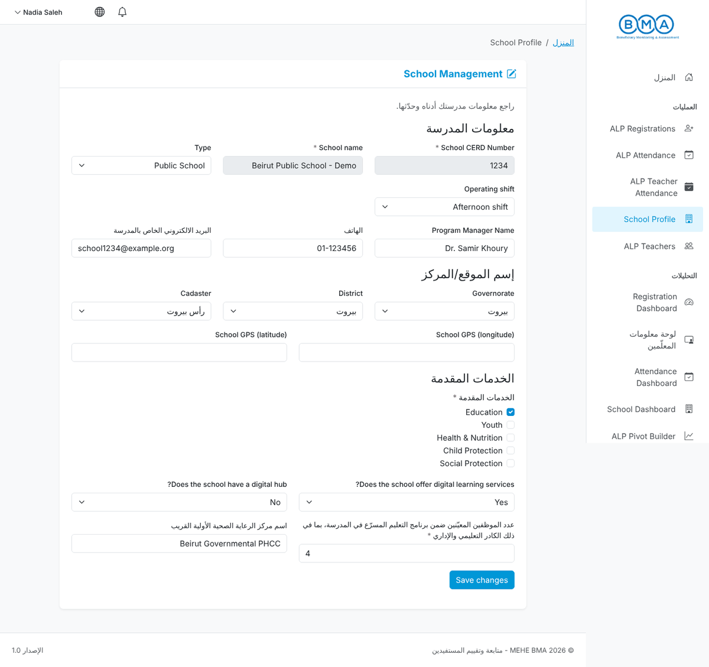

*الشكل 37 – نموذج ملف المدرسة*

2. اضغط **حفظ التغييرات**. يظهر التأكيد في أعلى الصفحة.

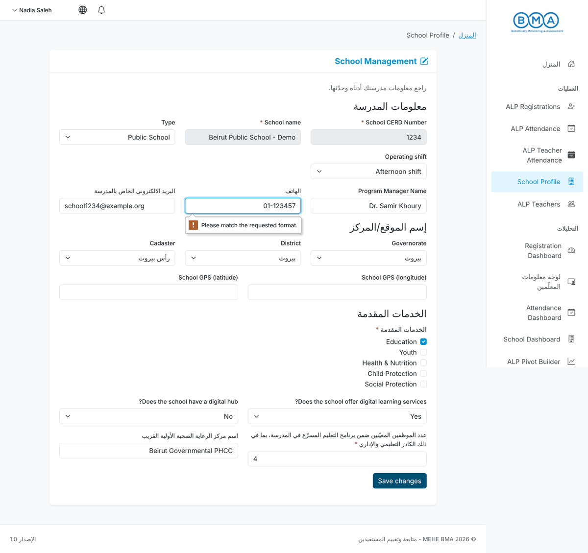

*الشكل 38 – تم حفظ ملف المدرسة*

> **ملاحظة:** حافظ على دقّة الإحداثيات: فهي تحدّد موقع مدرستك على خريطة لوحة معلومات المدارس.

## 10. لوحات المعلومات

جميع لوحات المعلومات محصورة بمدرستك.

1. **لوحة معلومات التسجيل** – إجمالي التسجيلات والدورات وكتلة **مخرجات التعلّم** (الأطفال المقيَّمون، متوسط التحصيل، التقدّم، التحصيل بحسب المادة)، تليها رسوم بيانية عن الجنس والجنسية ومصدر التعريف والهشاشة.

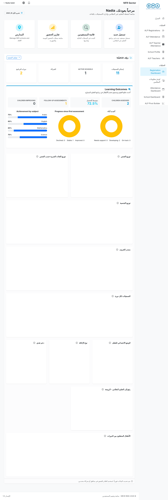

*الشكل 39 – لوحة معلومات التسجيل*

2. **لوحة معلومات المعلّمين** – عدد المعلّمين والجنس والجنسية والتكليفات والمواد والتدريب.

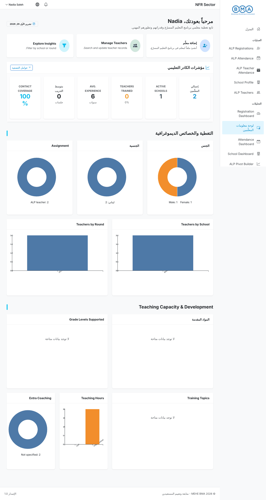

*الشكل 40 – لوحة معلومات المعلّمين*

3. **لوحة معلومات الحضور** – خريطة حرارية بمربّع لكل يوم، إجمالاً ولكل مستوى من مستويات البرنامج. الأخضر الداكن يعني حضوراً مرتفعاً.

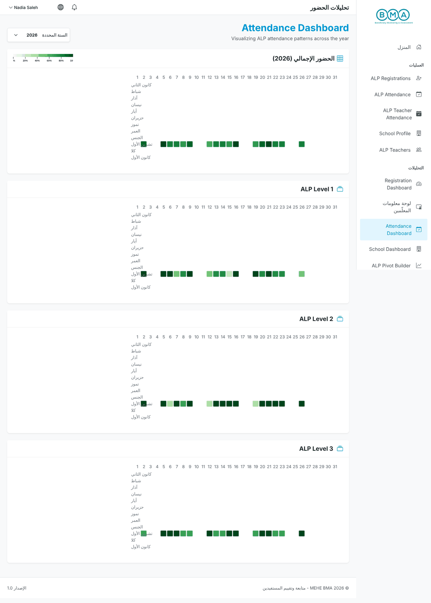

*الشكل 41 – لوحة معلومات الحضور*

4. **لوحة معلومات المدارس** – مدارس البرنامج على خريطة مع طلابها ومعلّميها. المدارس من دون إحداثيات لا تظهر على الخريطة.

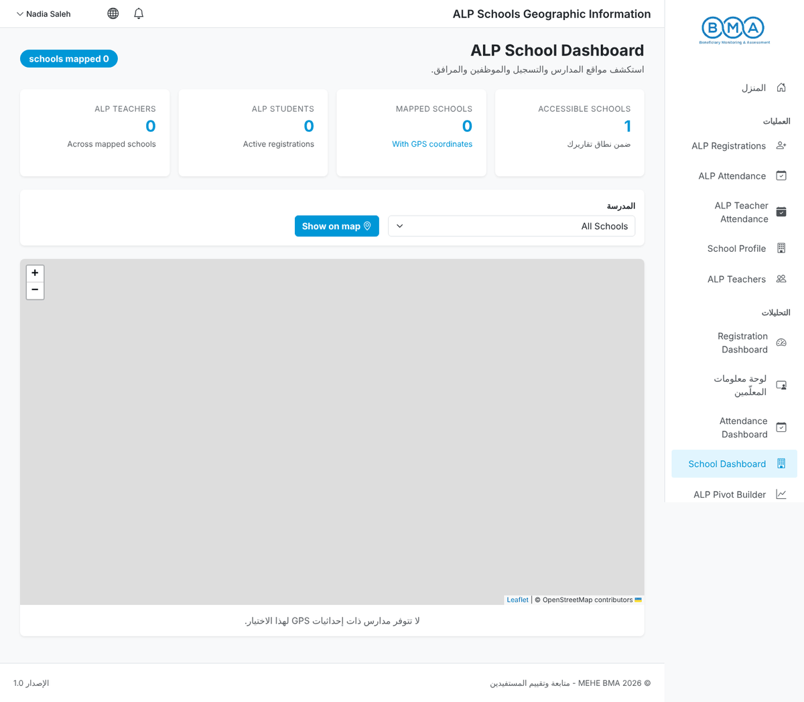

*الشكل 42 – لوحة معلومات المدارس*

5. **منشئ الجداول المحورية** – اسحب الحقول إلى الصفوف والأعمدة لبناء جداولك ورسومك الخاصة.

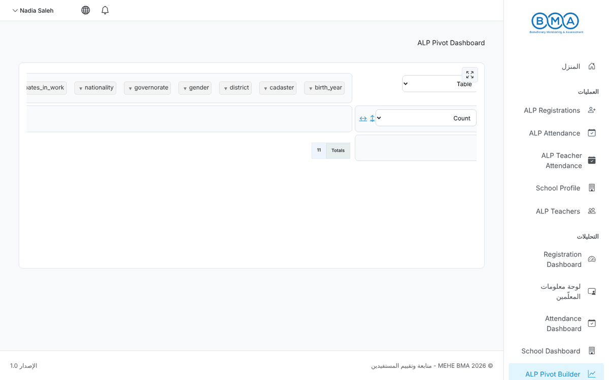

*الشكل 43 – منشئ الجداول المحورية*

## 11. حسابك

1. **تغيير كلمة المرور** (قائمة المستخدم): أدخل كلمة المرور الحالية ثم الجديدة مرتين، واضغط **تغيير كلمة المرور**.

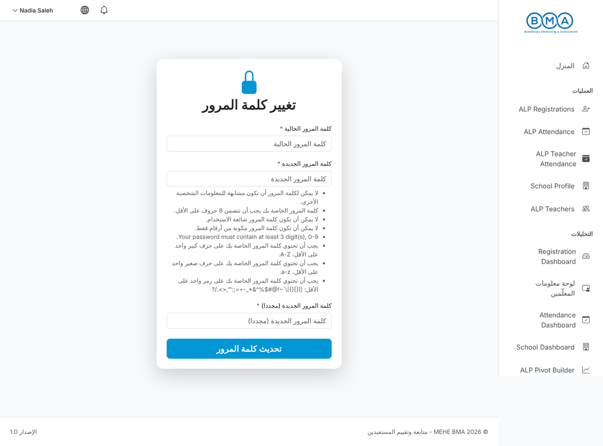

*الشكل 44 – نموذج تغيير كلمة المرور*

2. **تسجيل الخروج** (قائمة المستخدم) ينهي الجلسة. سجّل الخروج دائماً على الحاسوب المشترك.

| قاعدة كلمة المرور | المتطلّب |
|---|---|
| الطول | 8 أحرف على الأقل |
| الأرقام | 3 أرقام على الأقل |
| الأحرف | حرف كبير وحرف صغير على الأقل |
| الرموز | رمز واحد على الأقل مثل ! @ # $ % & * |
| غير شائعة | ليست كلمة شائعة ولا تشبه اسم المستخدم |

## 12. الأسئلة الشائعة

| السؤال | الجواب |
|---|---|
| القوائم فارغة ويظهر تنبيه. | حسابك غير مرتبط بمدرسة. اطلب ذلك من المدير. |
| زر الخطوة التالية معطّل. | تم العثور على تكرار محتمل؛ راجع لوحة المطابقات المحتملة قبل المتابعة. |
| تُمسح الأسماء عند مغادرة الحقل. | يجب كتابة الأسماء بالأحرف العربية فقط. |
| رقم الهاتف أو رقم الهوية مرفوض. | اتّبع الصيغة الظاهرة تحت الحقل (الهاتف: XX-XXXXXX). |
| طالب غير موجود في قائمة الحضور. | تحقّق من البرنامج والدورة والشعبة في التسجيل (تبويبة تفاصيل البرنامج). |
| نموذج الدرجات لا يحتوي على مواد. | يحدّد المدير تعريفات الدرجات؛ اطلب إضافة المادة الناقصة. |
| هل يستطيع المدير إدخال البيانات بدلاً مني؟ | لا. يمكن لمديري النظام الاطّلاع على بيانات البرنامج لكن لا يمكنهم إضافتها أو تعديلها؛ إدخال البيانات مسؤولية المدرسة. |
| نسيت كلمة المرور. | لا توجد إعادة تعيين ذاتية. تواصل مع مدير النظام. |

