

# لوحة الإدارة – إدارة المستخدمين والصلاحيات

**منصة BMA – دليل المدير**

_آخر تحديث: 26 October 2026_

يشرح هذا الدليل كيفية استخدام **لوحة الإدارة** في منصة BMA. ويركّز على **إدارة المستخدمين والصلاحيات**: إنشاء الحسابات، وتعيين الأدوار والمركز أو الشريك أو المدرسة التي يمكن لكل حساب رؤيتها، وإعادة تعيين كلمات المرور، وتعطيل الحسابات، وفهم ما يستطيع كل دور القيام به. كما يغطّي الجداول المرجعية التي يصونها المدير (الشركاء، المراكز، المدارس، الدورات، البرامج) وصفحات المراقبة.

لوحة الإدارة مخصّصة للحسابات التي تحمل **صفة موظف (Staff)**. **المستخدم الخارق (Superuser)** يملك كل الصلاحيات؛ أمّا حساب الموظف من دون صفة المستخدم الخارق فلا يرى إلا الصفحات الممنوحة له صراحةً (انظر القسم 10). التغييرات هنا تُطبَّق **فوراً** على المستخدمين الميدانيين، لذا تحقّق دائماً قبل الحفظ.

كل خطوة مرفقة بلقطة شاشة مأخوذة من النظام. البيانات الظاهرة هي بيانات تجريبية فقط.

## المحتويات

1. الدخول إلى لوحة الإدارة
2. كيف تعمل الصلاحيات
3. المركز أم الشريك أم المدرسة – اختيار الارتباط
4. قائمة المستخدمين
5. إنشاء حساب
6. وصفات الأدوار
7. تعديل حساب
8. إعادة تعيين كلمة المرور
9. تعطيل الحسابات وإعادة تفعيلها وحذفها
10. المجموعات والصلاحيات
11. البيانات المرجعية
12. المراقبة
13. ممارسات جيدة
14. الأسئلة الشائعة

## 1. الدخول إلى لوحة الإدارة

افتح عنوان المنصة متبوعاً بـ **/admin/** (مثلاً `https://<platform>/admin/`). يمكنك أيضاً فتحها من قائمة المستخدم في التطبيق عبر عنصر **الإدارة** إذا كان حسابك يحمل صفة موظف.

1. أدخل **اسم المستخدم** و**كلمة المرور** في صفحة دخول لوحة الإدارة.

    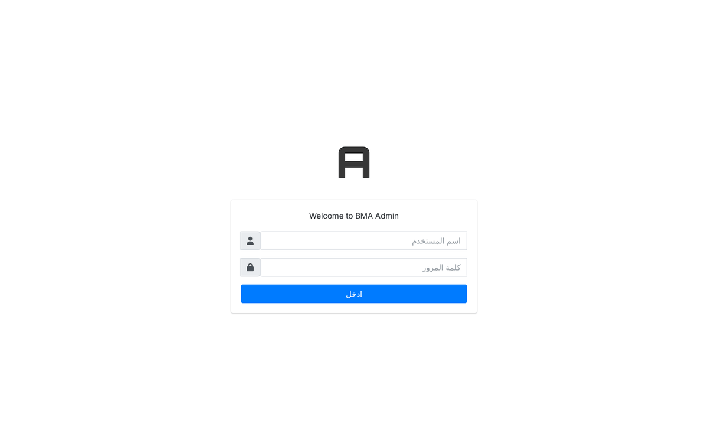

    *الشكل 1 – صفحة دخول لوحة الإدارة*

2. اضغط **تسجيل الدخول**. تُقبل حسابات الموظفين فقط؛ تتلقّى الحسابات الأخرى رسالة خطأ.

    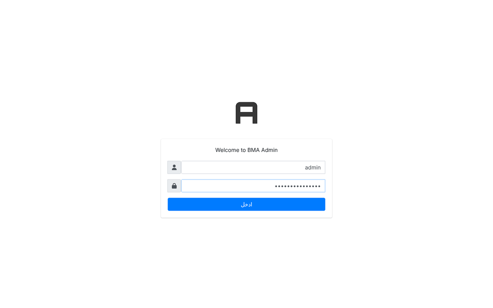

    *الشكل 2 – نموذج الدخول بعد تعبئته*

3. تعرض **لوحة التحكّم** كل جداول البيانات التي يمكنك إدارتها مجمّعة بحسب المجال: بيانات التعليم غير النظامي، الحضور، إعدادات بيانات الطفل، المدارس، المواقع، المستخدمون، المراقبة، ALP والإعدادات. يعرض قسم **الإجراءات الأخيرة** على الجانب آخر التغييرات التي أجراها حسابك.

    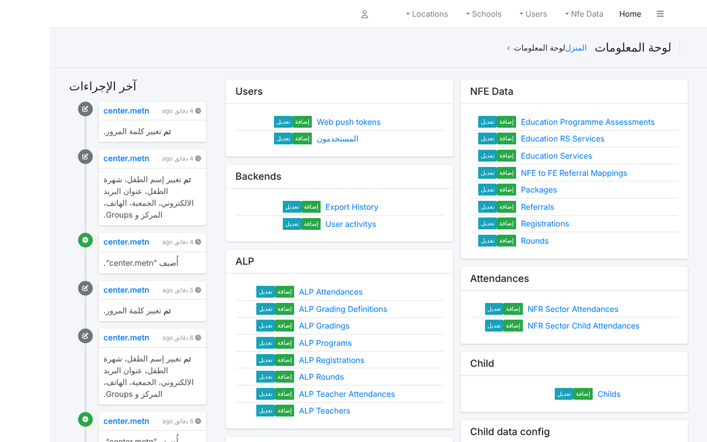

    *الشكل 3 – لوحة تحكّم الإدارة*

4. تعرض **القائمة الجانبية** الجداول نفسها؛ ويتيح **الشريط العلوي** وصولاً سريعاً إلى المستخدمين والمدارس والمواقع. تفتح الأيقونة في أعلى الصفحة قائمة المستخدم: **عرض الموقع** (العودة إلى التطبيق)، **تغيير كلمة المرور** و**تسجيل الخروج**.

    

    *الشكل 4 – قائمة المستخدم في لوحة الإدارة*

> **ملاحظة:** تتبع لوحة الإدارة اللغة المختارة في التطبيق (أيقونة الكرة الأرضية). الواجهة ومعظم التسميات مترجمة؛ أمّا أسماء المجموعات والمعرّفات التقنية فتظهر دائماً كما هي مخزّنة.

## 2. كيف تعمل الصلاحيات

يحدَّد ما يراه المستخدم وما يستطيع فعله بـ **ثلاثة عناصر** في سجل المستخدم. يجب أن تكون العناصر الثلاثة متّسقة، وإلا رأى المستخدم قوائم فارغة أو صفحة "غير مسموح".

| الإعداد | مكانه | الأثر |
|---|---|---|
| **علامات الحالة** | تبويبة الصلاحيات | **نشط** يسمح بتسجيل الدخول. **صفة موظف** تفتح لوحة الإدارة. **مستخدم خارق** يمنح كل الصلاحيات في كل مكان. |
| **المجموعات (الأدوار)** | تبويبة الصلاحيات | كل اسم مجموعة يفتح مجموعة من صفحات التطبيق: صفحات NFE أو ALP أو CLM، التصدير، القوائم على مستوى القطاع. |
| **الارتباط** | تبويبة المعلومات الشخصية | **المركز** أو **الشريك** أو **المدرسة** المرتبطة بالحساب. تُصفّى القوائم ولوحات المعلومات والتصدير بحسبها. |

يتحقّق التطبيق من **اسم المجموعة** كما هو مكتوب بالضبط. أنشئ الحسابات بالمجموعات الموجودة أدناه؛ لا تُعد تسميتها ولا تُنشئ مجموعات جديدة ما لم يضف فريق التطوير الكود المقابل.

| اسم المجموعة | ما تمنحه |
|---|---|
| `MSCC` | إدخال بيانات التعليم غير النظامي: التسجيلات والخدمات والتقييمات والحضور للمركز المرتبط |
| `MSCC_CENTER` | يحصر قوائم التعليم غير النظامي بالمركز المرتبط بالحساب. يُستخدم مع `MSCC` |
| `MSCC_PARTNER` | اطّلاع على جميع مراكز المنظمة الشريكة المرتبطة بالحساب |
| `MSCC_FULL` | يزيل فلتر المركز/الشريك من قائمة المستفيدين (عرض على مستوى القطاع) |
| `MSCC_UNICEF` | تحليلات وتقارير وتصدير على مستوى القطاع لموظفي اليونيسف |
| `EXPORT` | يفعّل أزرار التصدير في القوائم التي تقيّدها |
| `YOUTH` | يميّز حسابات مسار الشباب (يستخدمه فلتر "فئة المستخدم" في لوحة الإدارة) |
| `ALP_SCHOOL` | نقطة اتصال مدرسة التعليم المسرّع. مطلوبة لكل صفحات ALP؛ البيانات محصورة بالمدرسة المرتبطة |
| `CLM_Bridging`, `CLM_BRIDGING_ALL`, `CLM_ATTENDANCE`, `CLM_TEACHER`, `CLM_Inclusion` | أدوار وحدة التعلّم المجتمعي (الجسر) |

- **مستخدم المركز** يحتاج `MSCC` + `MSCC_CENTER` و**مركزاً** و**الشريك** الذي يديره. أضف `EXPORT` إذا كان يجوز له تحميل البيانات.
- **منسّق الشريك** يحتاج `MSCC_PARTNER` و**الشريك**؛ من دون مركز.
- **نقطة اتصال مدرسة ALP** تحتاج `ALP_SCHOOL` و**مدرسة**. من دون المدرسة تبقى كل قوائم ALP فارغة.
- **قارئ اليونيسف أو الوزارة** يحتاج `MSCC_UNICEF` (أو `MSCC_FULL` مع `MSCC_CENTER` للقائمة على مستوى القطاع)؛ لا يلزم ارتباط.
- يستطيع المستخدمون الخارقون **عرض** بيانات ALP لكن لا يمكنهم **أبداً إضافتها أو تعديلها**: إدخال بيانات ALP محصور بحسابات المدارس.
- مربّع **صلاحيات المستخدم** (صلاحيات النماذج الفردية) لا يؤثّر على التطبيق؛ يهمّ فقط حسابات الموظفين التي تستخدم لوحة الإدارة من دون صفة المستخدم الخارق (القسم 10).

## 3. المركز أم الشريك أم المدرسة – اختيار الارتباط

تحتوي تبويبة **المعلومات الشخصية** على ثلاثة حقول ارتباط: **الشريك** و**المركز** و**المدرسة**. يعتمد ما تملؤه على نوع الحساب، ويجب أن تتطابق المجموعات معه. هذا هو المصدر الأكثر شيوعاً لمشاكل "القوائم الفارغة" و"غير مسموح"، لذا استخدم الجدول أدناه في كل مرة تنشئ أو تعدّل حساباً.

| الحساب | المجموعات | حقل الشريك | حقل المركز | حقل المدرسة |
|---|---|---|---|---|
| مستخدم إدخال بيانات في مركز (يعمل في مركز واحد) | `MSCC` + `MSCC_CENTER` | **نعم** – الشريك الذي يدير المركز | **نعم** – المركز الواحد | فارغ |
| منسّق الشريك (يتابع جميع مراكز المنظمة) | `MSCC_PARTNER` | **نعم** – المنظمة | فارغ | فارغ |
| قارئ اليونيسف / الوزارة (القطاع كله) | `MSCC_UNICEF` | فارغ | فارغ | فارغ |
| نقطة اتصال مدرسة ALP | `ALP_SCHOOL` | فارغ | فارغ | **نعم** – المدرسة الواحدة |
| المدير | لا شيء (صفة موظف + مستخدم خارق) | فارغ | فارغ | فارغ |

ينتمي الدوران إلى وحدة التعليم غير النظامي، لكنهما يخدمان أشخاصاً مختلفين ويمنحان صلاحيات مختلفة:

|  | `MSCC_CENTER` (مع `MSCC`) | `MSCC_PARTNER` |
|---|---|---|
| من | موظف إدخال بيانات أو ميسّر يعمل **في مركز واحد** | منسّق أو مسؤول متابعة وتقييم في **المنظمة الشريكة** |
| نطاق البيانات | أطفال وحضور ومعلّمو **المركز** المرتبط بالحساب فقط | أطفال وحضور ومعلّمو **جميع مراكز** **الشريك** المرتبط بالحساب |
| تسجيل الأطفال وتوثيق الخدمات والامتحانات والحضور | **نعم** | **لا** – اطّلاع فقط على التسجيلات؛ يمكنه عرض القوائم وتصفيتها |
| إدارة المعلّمين | نعم، للمركز | نعم، لجميع مراكز الشريك |
| تصدير بيانات المستفيدين | تسجيلات المركز (مع مجموعة `EXPORT` حيث تتطلّبها القائمة) | جميع تسجيلات الشريك |
| لوحات المعلومات والخرائط الحرارية | المركز | جميع مراكز الشريك |
| الارتباط المطلوب | المركز **و**الشريك | الشريك فقط |

- لكل حساب في التعليم غير النظامي تابع لمنظمة: مستخدمو المراكز **و**منسّقو الشركاء.
- يُكتب الشريك على كل تسجيل ينشئه المستخدم، وهو الذي يحدّد ما يراه مستخدم `MSCC_PARTNER`.
- لمستخدم المركز اختر الشريك الذي **يشغّل المركز**. إذا نُقل المركز لاحقاً إلى شريك آخر، حدّث حسابات ذلك المركز أيضاً.

- فقط للحسابات التي **تُدخل بيانات في مركز محدّد** (`MSCC` + `MSCC_CENTER`).
- تُصفّى صفحة الحضور ونموذج التسجيل وقائمة المستفيدين بحسب هذا المركز؛ مستخدم المركز من دون مركز يرى تنبيهاً وقوائم فارغة.
- لا تعطِ مركزاً أبداً لمنسّق `MSCC_PARTNER`: يُتجاهل في قوائمه ويسبّب الالتباس فقط. الشخص الذي يعمل في مركزين يحتاج حسابين، أو حساباً على مستوى الشريك إذا كان الاطّلاع كافياً.

- فقط لحسابات **ALP** (`ALP_SCHOOL`). المدرسة هي ما يعادل المركز في وحدة ALP: التسجيلات والحضور والمعلّمون والدرجات ولوحات المعلومات محصورة بها.
- اترك الشريك والمركز فارغين في حساب ALP؛ لا أثر لهما على صفحات ALP.
- لا يعرض الحقل إلا المدارس غير المغلقة. إذا كانت المدرسة غير موجودة، أنشئها أو أعد فتحها تحت **المدارس** أولاً (القسم 11).

> **ملاحظة:** قاعدة بسيطة: **المركز = يُدخل بيانات مركز واحد**، **الشريك = يتابع جميع مراكز منظمة**، **المدرسة = نقطة اتصال ALP**. يجب أن ينطبق على كل حساب سطر واحد بالضبط من الجدول الأول.

## 4. قائمة المستخدمين

افتح **المستخدمون ← المستخدمون** من القائمة الجانبية (أو عنصر **المستخدمون** في الشريط العلوي).

1. تعرض القائمة اسم المستخدم والأسماء وعلامة النشاط والبريد الإلكتروني والمدرسة والمركز والشريك والهاتف و**فئة المستخدم** (المشتقّة من المجموعات). اضغط عنوان العمود للفرز. زر **إضافة مستخدم** ينشئ حساباً؛ **استيراد** و**تصدير** يتبادلان قائمة المستخدمين كملف.

    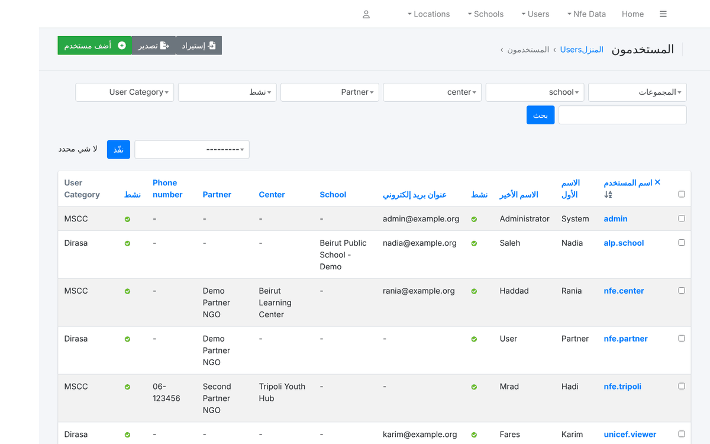

    *الشكل 5 – قائمة المستخدمين*

2. اكتب اسم مستخدم أو اسماً أو مدرسة في مربّع البحث واضغط **بحث**.

    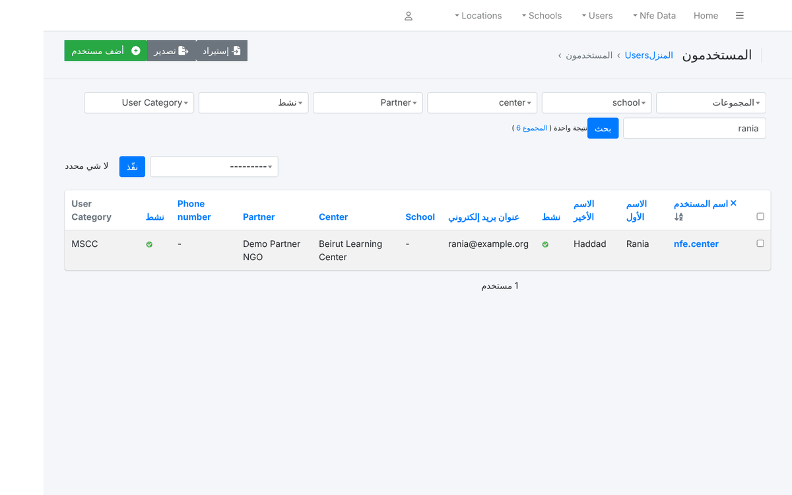

    *الشكل 6 – البحث عن مستخدمين*

3. استخدم قوائم التصفية فوق الجدول (**المجموعات**، **المدرسة**، **المركز**، **الشريك**، **نشط**، **فئة المستخدم**) لتضييق القائمة، مثلاً كل حسابات مركز واحد أو كل الحسابات غير النشطة.

    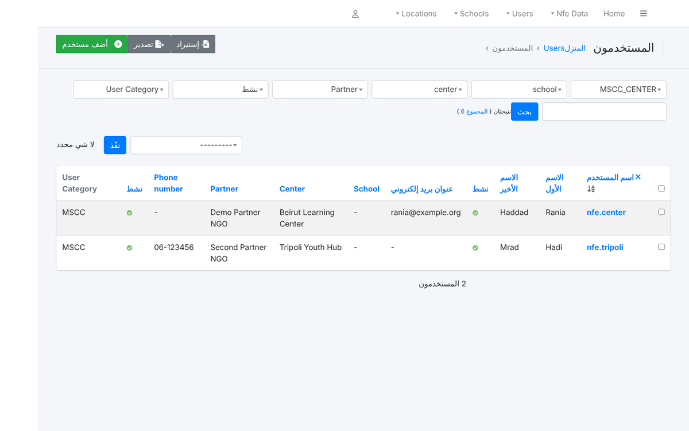

    *الشكل 7 – المستخدمون مصفّون بحسب المجموعة*

4. **تصدير** يحمّل القائمة (CSV، XLSX، JSON...) مع الأسماء والارتباطات وعلامة النشاط وفئة كل مستخدم. استخدمه للمراجعات الدورية للصلاحيات.

    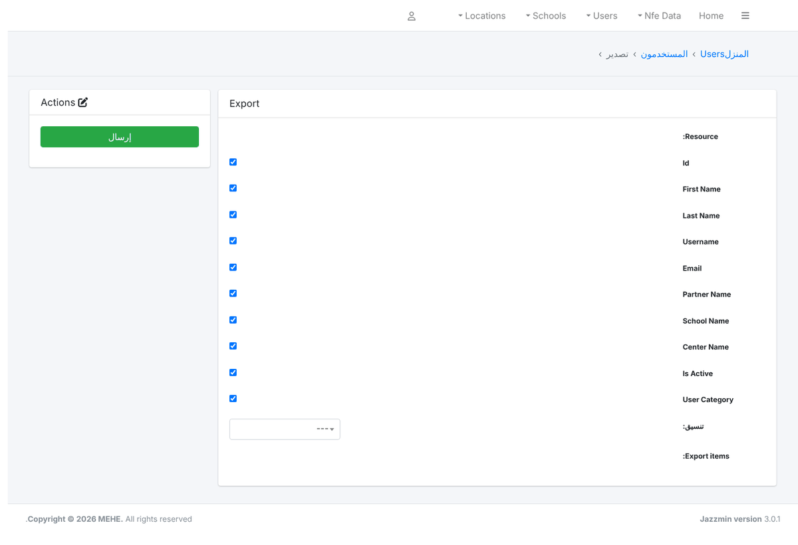

    *الشكل 8 – تصدير قائمة المستخدمين*

5. **استيراد** يحمّل ملفاً بالتخطيط نفسه لإنشاء أو تحديث حسابات كثيرة دفعة واحدة. استخدم **المعاينة** أولاً وتحقّق من الفروقات قبل التأكيد.

    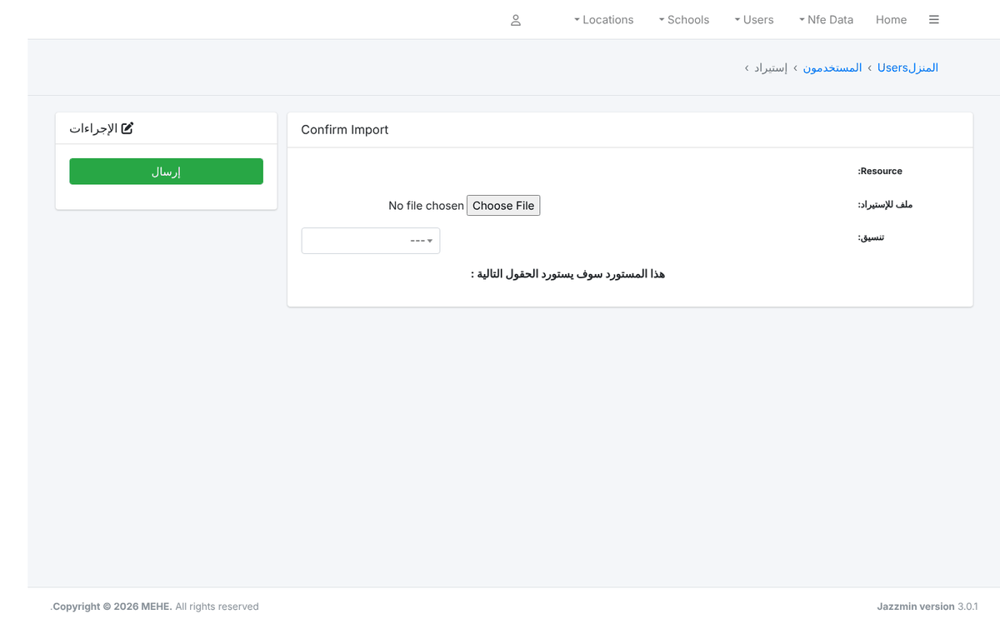

    *الشكل 9 – استيراد المستخدمين*

> **ملاحظة:** لا تُصدَّر كلمات المرور أبداً. الحسابات المستوردة ليس لها كلمة مرور صالحة حتى تعيد تعيينها (القسم 8).

## 5. إنشاء حساب

يتم إنشاء الحساب عبر شاشتين: أولاً اسم المستخدم وكلمة المرور، ثم المعلومات الشخصية والارتباط والأدوار.

1. اضغط **إضافة مستخدم**. أدخل **اسم المستخدم** (أحرف وأرقام و @ . + - _ فقط؛ يصعب تغييره لاحقاً) و**كلمة المرور** مرتين. اتّبع اصطلاح التسمية المتّفق عليه، مثلاً `firstname.lastname` أو `center.city`.

    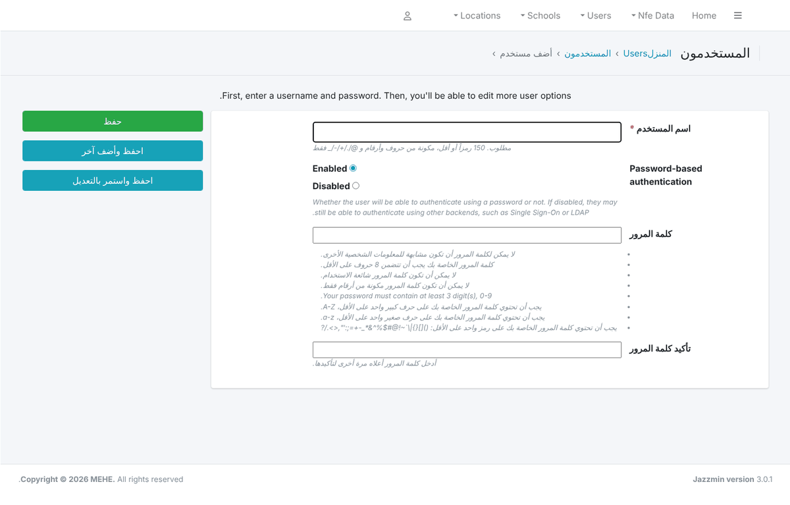

    *الشكل 10 – نموذج إضافة مستخدم*

2. اضغط **حفظ**. يُنشأ الحساب ويُفتح نموذج المستخدم الكامل مع رسالة "تمت الإضافة بنجاح".

    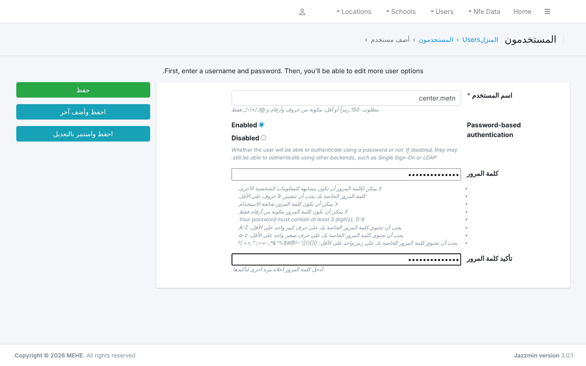

    *الشكل 11 – اسم المستخدم وكلمة المرور بعد التعبئة*

3. في تبويبة **المعلومات الشخصية** أدخل الاسم الأول والأخير والبريد الإلكتروني والهاتف، ثم الارتباط: **الشريك** و**المركز** لحساب التعليم غير النظامي، أو **المدرسة** لحساب ALP (اكتب جزءاً من اسم المدرسة واخترها من القائمة).

    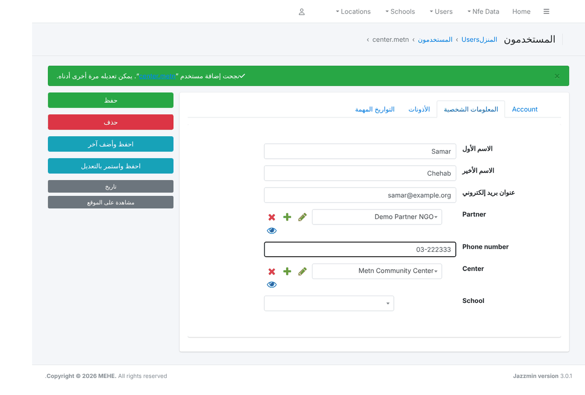

    *الشكل 12 – المعلومات الشخصية والارتباط*

4. في تبويبة **الصلاحيات** أبقِ **نشط** معلَّماً. علّم **صفة موظف** للمديرين فقط. في **المجموعات** اختر الأدوار في المربّع الأيسر وانقلها إلى المربّع الأيمن بالسهم (النقر المزدوج يعمل أيضاً). اترك **صلاحيات المستخدم** فارغة.

    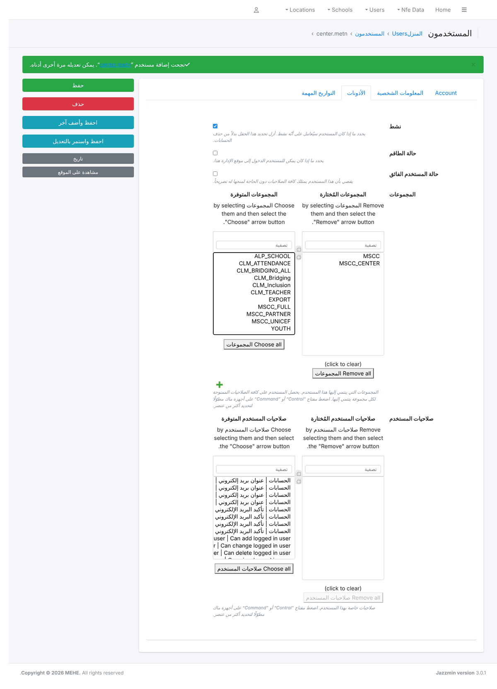

    *الشكل 13 – المجموعات المختارة لحساب إدخال بيانات في مركز*

5. اضغط **حفظ**. تُعاد القائمة مع رسالة تأكيد. سلّم بيانات الدخول للمستخدم عبر قناة آمنة واطلب منه تغيير كلمة المرور عند أول دخول.

    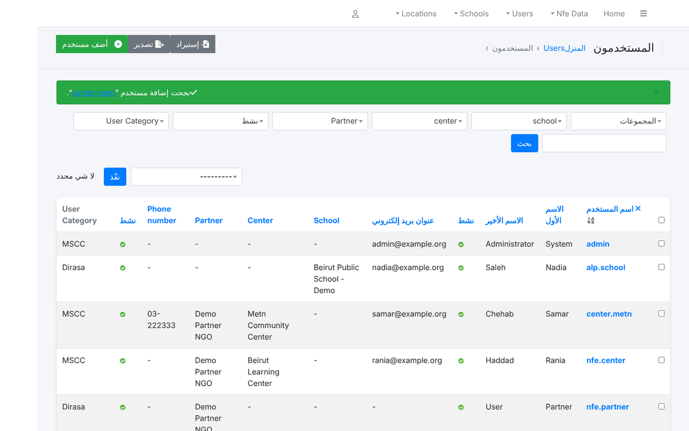

    *الشكل 14 – تم حفظ الحساب*

| قاعدة كلمة المرور | المتطلّب |
|---|---|
| الطول | 8 أحرف على الأقل |
| الأرقام | 3 أرقام على الأقل |
| الأحرف | حرف كبير وحرف صغير على الأقل |
| الرموز | رمز واحد على الأقل مثل ! @ # $ % & * |
| غير شائعة | ليست كلمة شائعة ولا تشبه اسم المستخدم |

## 6. وصفات الأدوار

استخدم هذه التركيبات عند إنشاء الحسابات. يجب أن تتطابق أسماء المجموعات تماماً.

| نوع الحساب | المجموعات | الارتباط | علامات الحالة |
|---|---|---|---|
| إدخال بيانات مركز التعليم غير النظامي | `MSCC`، `MSCC_CENTER` (+ `EXPORT` للسماح بالتحميل) | المركز والشريك | نشط |
| منسّق الشريك | `MSCC_PARTNER` | الشريك | نشط |
| قارئ على مستوى القطاع (اليونيسف / الوزارة) | `MSCC_UNICEF` | لا شيء | نشط |
| قائمة المستفيدين على مستوى القطاع | `MSCC`، `MSCC_CENTER`، `MSCC_FULL` | المركز والشريك | نشط |
| نقطة اتصال مدرسة ALP | `ALP_SCHOOL` | المدرسة | نشط |
| موظفو الجسر (CLM) | `CLM_Bridging` (+ `CLM_BRIDGING_ALL`، `CLM_TEACHER`، `CLM_ATTENDANCE` بحسب الحاجة) | بحسب تعليمات فريق CLM | نشط |
| مدير النظام | لا يلزم | لا شيء | نشط، صفة موظف، مستخدم خارق |
| مدير محدود (مثلاً إدارة المستخدمين فقط) | لا يلزم | لا شيء | نشط، صفة موظف + صلاحيات النماذج (القسم 10) |

1. في تبويبة **المعلومات الشخصية** اكتب اسم المدرسة في حقل **المدرسة** واخترها من الاقتراحات. لا تعرض القائمة إلا المدارس المفتوحة.

    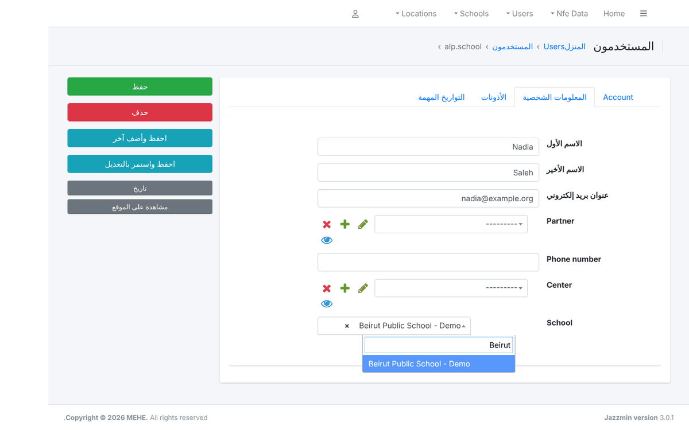

    *الشكل 15 – اختيار مدرسة حساب ALP*

2. تظهر المدرسة المختارة في الحقل. يرتبط كل حساب بمدرسة واحدة بالضبط.

    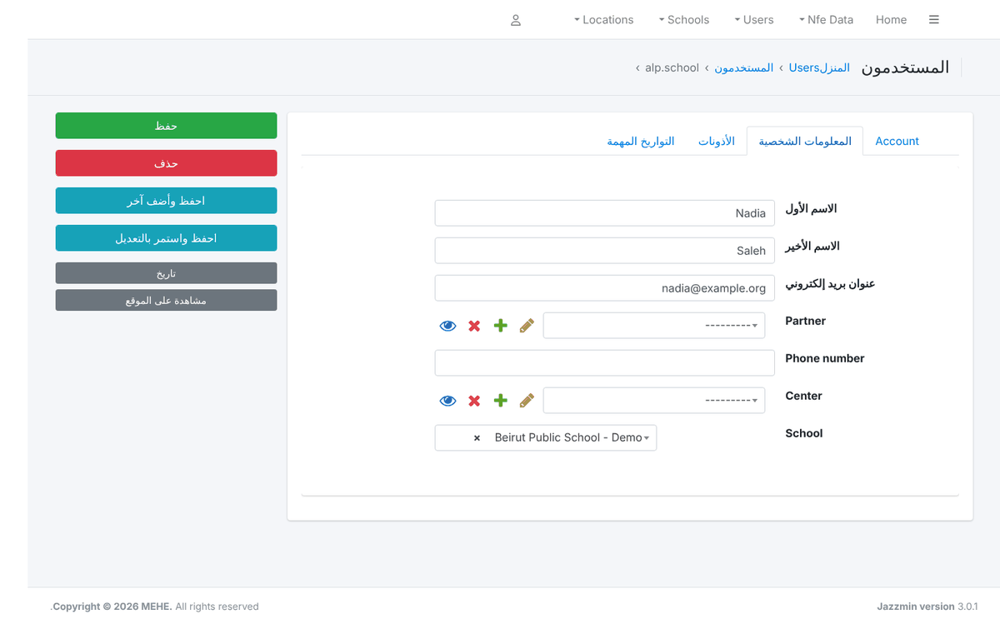

    *الشكل 16 – حساب ALP مع مدرسته*

3. في تبويبة **الصلاحيات** المجموعة الوحيدة المطلوبة هي `ALP_SCHOOL`.

    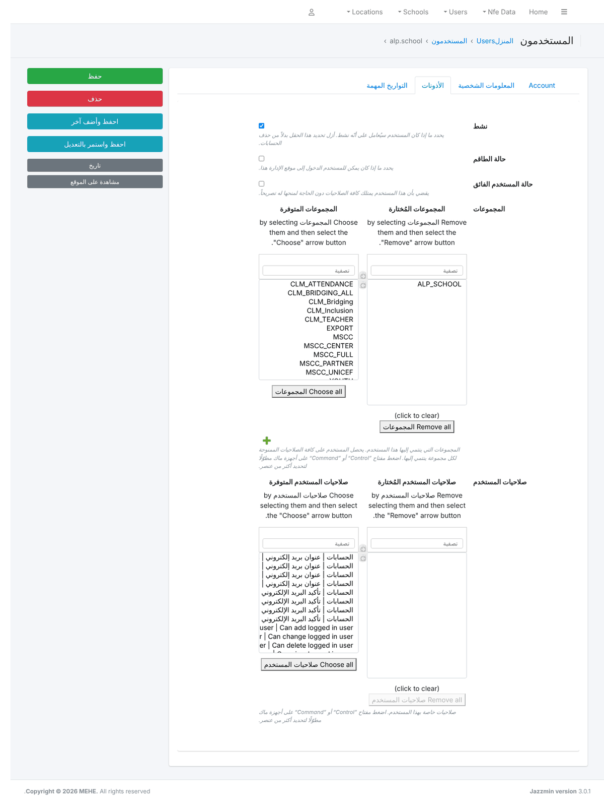

    *الشكل 17 – مجموعات حساب ALP*

## 7. تعديل حساب

1. افتح المستخدم من القائمة (اضغط اسم المستخدم). غيّر القيم في تبويبات **الحساب** أو **المعلومات الشخصية** أو **الصلاحيات** واضغط **حفظ**، أو **حفظ ومتابعة التعديل** للبقاء في الصفحة.

    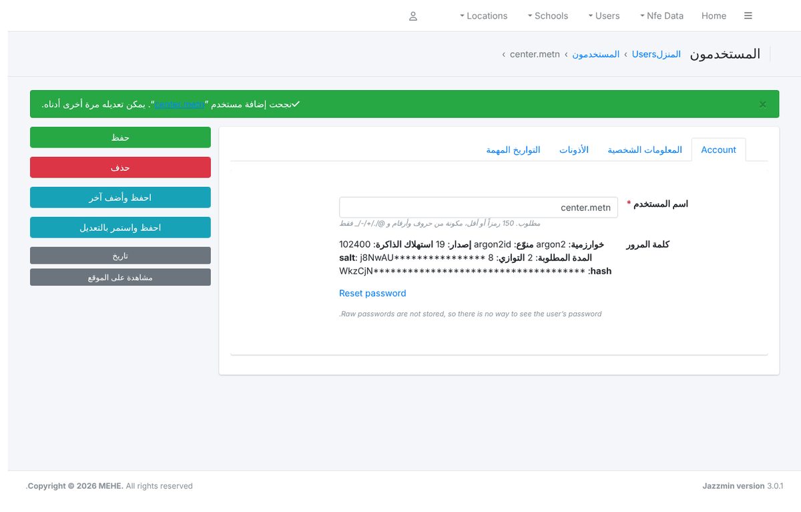

    *الشكل 18 – نموذج المستخدم*

2. عندما ينتقل موظف إلى مركز أو مدرسة أخرى، حدّث **الارتباط** و**المجموعات** معاً، ثم اطلب من المستخدم تسجيل الخروج والدخول مجدداً.
3. **السجل** (الأزرار الجانبية) يعرض كل تغيير أُجري على الحساب من لوحة الإدارة مع التاريخ والمدير الذي أجراه.

    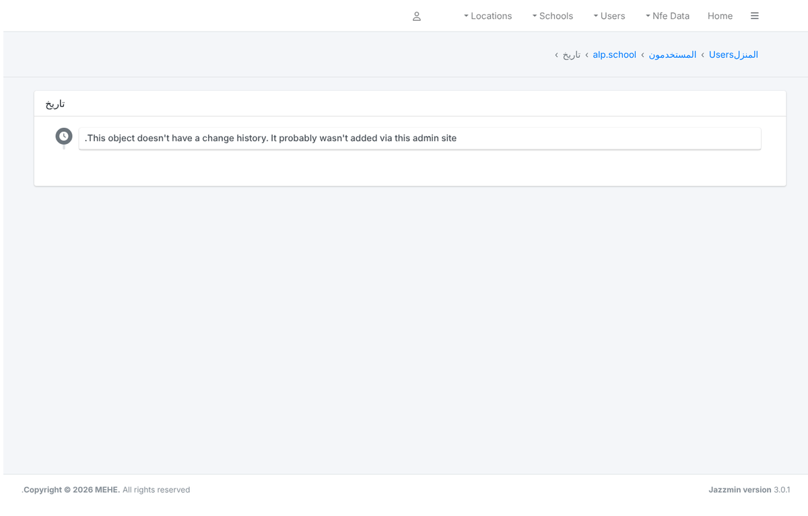

    *الشكل 19 – سجل تغييرات حساب*

> **ملاحظة:** لا تُعد استخدام حساب قديم لشخص جديد: أنشئ حساباً جديداً وعطّل القديم، لتبقى السجلات التي أنشأها كل شخص قابلة للتتبّع.

## 8. إعادة تعيين كلمة المرور

لا توجد إعادة تعيين ذاتية لكلمة المرور في التطبيق: يتواصل المستخدمون الذين نسوا كلمة المرور مع المدير.

1. افتح المستخدم واضغط **إعادة تعيين كلمة المرور** في تبويبة **الحساب** (تحت بصمة كلمة المرور).

    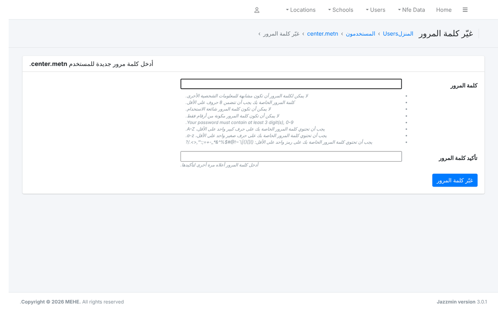

    *الشكل 20 – نموذج إعادة تعيين كلمة المرور*

2. أدخل كلمة المرور الجديدة مرتين. يجب أن تتّبع قواعد كلمة المرور في القسم 5.

    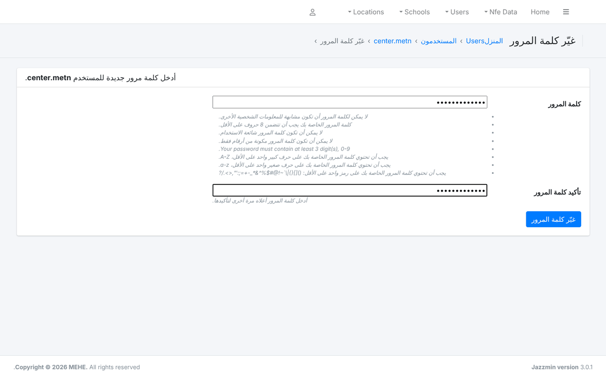

    *الشكل 21 – كلمة المرور الجديدة بعد الإدخال*

3. اضغط **تغيير كلمة المرور**. يظهر تأكيد؛ أبلغ كلمة المرور بشكل آمن واطلب من المستخدم تغييرها بعد الدخول.

    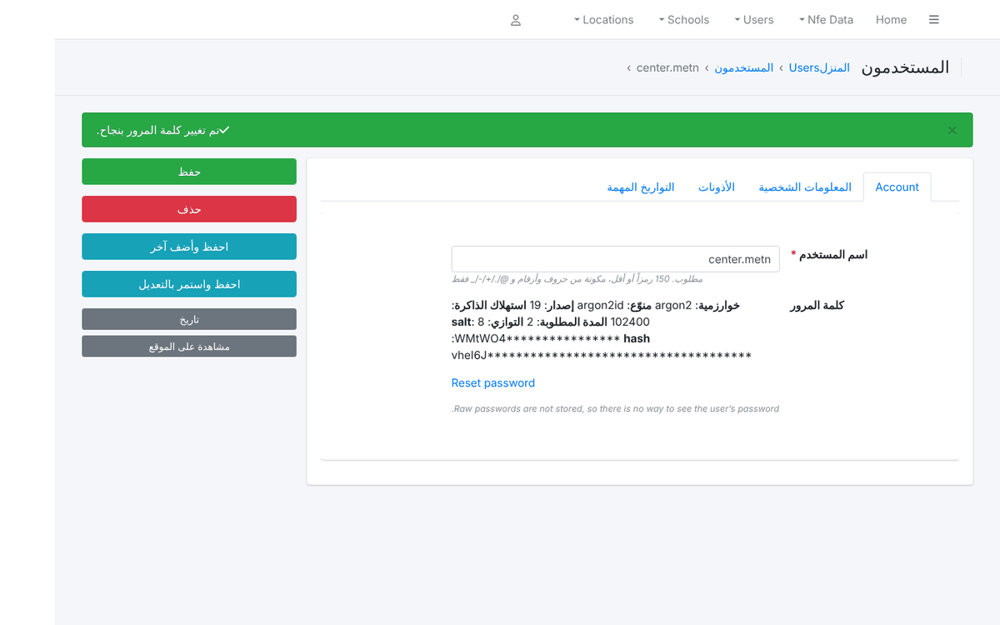

    *الشكل 22 – تم تغيير كلمة المرور*

> **ملاحظة:** بعد خمس محاولات دخول فاشلة خلال خمس دقائق يُقفل الحساب مؤقتاً. يُرفع القفل تلقائياً بعد بضع دقائق؛ لا يلزم إعادة تعيين كلمة المرور.

## 9. تعطيل الحسابات وإعادة تفعيلها وحذفها

**عطّل** حسابات من يغادرون؛ لا تحذفها. الحساب المعطَّل لا يستطيع الدخول، لكن التسجيلات والحضور والتصديرات التي أنشأها تحتفظ بمؤلّفها.

1. في قائمة المستخدمين علّم الحسابات، اختر **تعطيل** من قائمة الإجراءات واضغط **تنفيذ**. لإعادة التفعيل استخدم **تفعيل**. يمكنك أيضاً إلغاء تعليم **نشط** في تبويبة الصلاحيات لمستخدم واحد.

    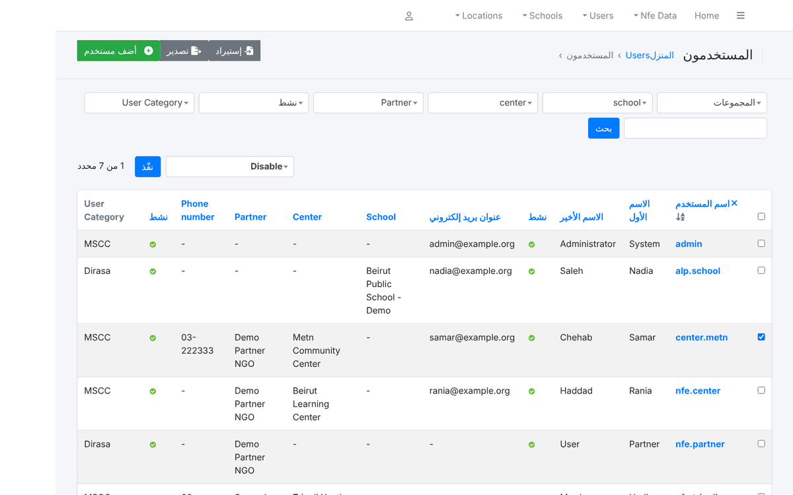

    *الشكل 23 – الإجراء الجماعي "تعطيل"*

2. يعرض عمود **نشط** أيقونة حمراء للحسابات المعطَّلة. استخدم فلتر **نشط** لعرضها.

    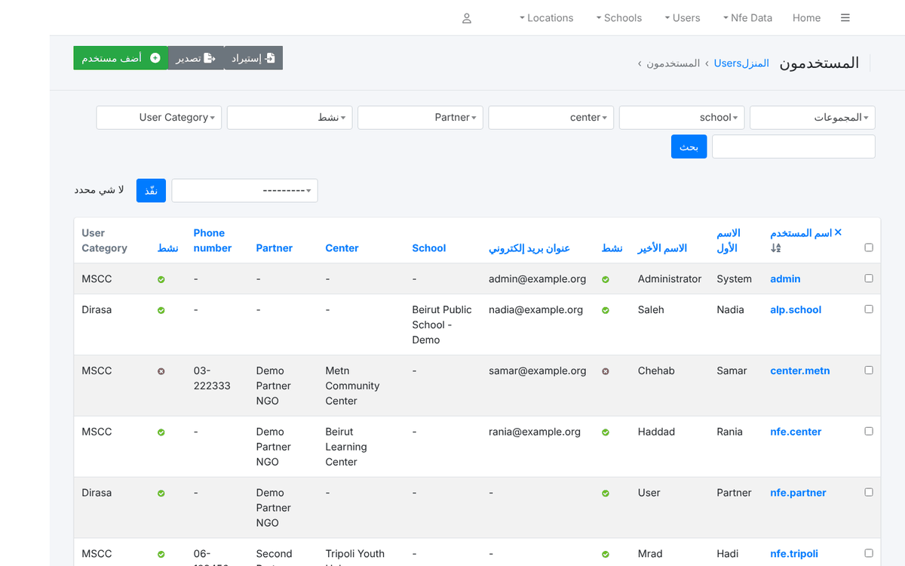

    *الشكل 24 – حساب معطَّل*

3. **حذف** (الزر الأحمر في نموذج المستخدم، أو إجراء **حذف المستخدمين المحدّدين**) يعرض أولاً صفحة تأكيد تسرد كل ما سيُزال مع الحساب. لا يمكن التراجع عن الحذف؛ احتفظ به للحسابات التي أُنشئت خطأً ولم تُدخل بيانات قط.

    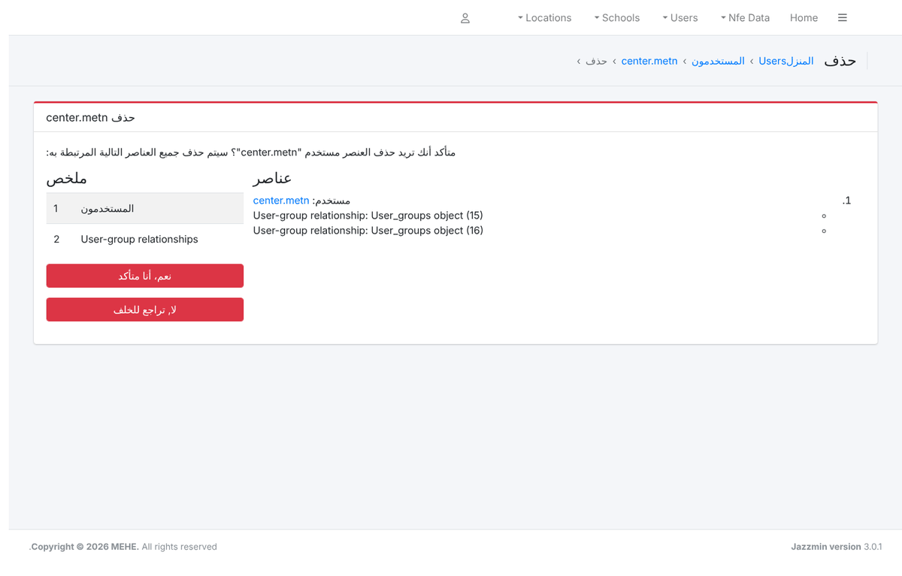

    *الشكل 25 – صفحة تأكيد الحذف*

## 10. المجموعات والصلاحيات

تُدار المجموعات تحت **المصادقة والتفويض ← المجموعات** (يمكن الوصول إليها من بحث لوحة التحكّم أو العنوان `/admin/auth/group/`).

1. تعرض القائمة المجموعات الموجودة. يتعرّف التطبيق على الأسماء الواردة في القسم 2؛ المجموعة بأي اسم آخر لا أثر لها في التطبيق.

    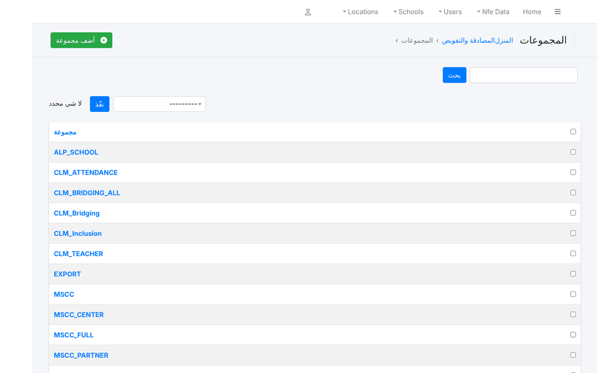

    *الشكل 26 – قائمة المجموعات*

2. فتح مجموعة يعرض **صلاحيات النماذج** الخاصة بها (إضافة / تعديل / حذف / عرض لكل جدول). تهمّ هذه الصلاحيات فقط حسابات الموظفين التي تستخدم لوحة الإدارة من دون صفة المستخدم الخارق. تعمل أدوار القسم 2 من دون أي صلاحية نموذج.

    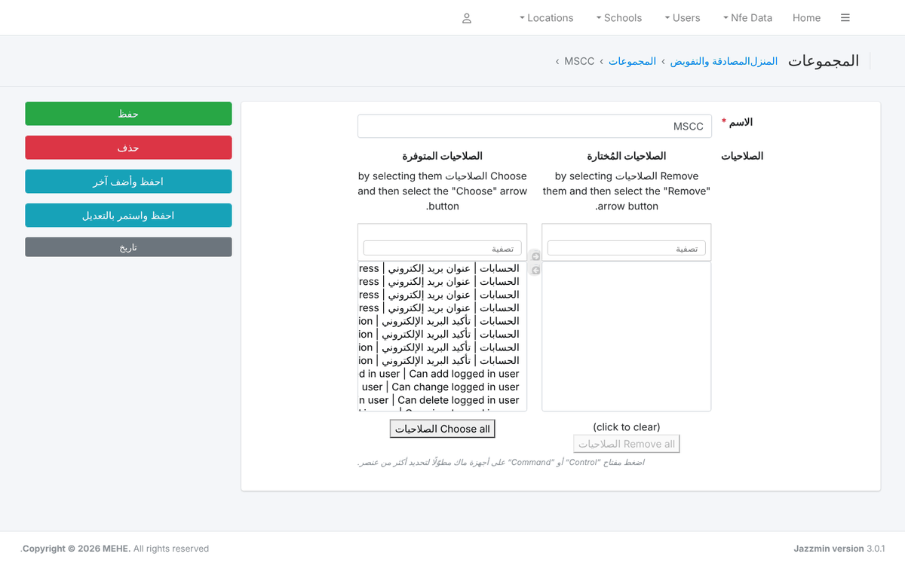

    *الشكل 27 – مجموعة وصلاحيات نماذجها*

- علّم **صفة موظف** (وليس مستخدم خارق) على المستخدم.
- أنشئ مجموعة مثل `ADMIN_USERS` بالصلاحيات **عرض مستخدم**، **تعديل مستخدم**، **إضافة مستخدم** وأضف المستخدم إليها، أو انقل الصلاحيات نفسها إلى مربّع **صلاحيات المستخدم** الخاص به.
- يرى الشخص عندها جدول المستخدمين فقط في لوحة الإدارة. افعل الشيء نفسه بصلاحيات المراكز أو المدارس أو الدورات لمديري البيانات المرجعية.

> **ملاحظة:** لا تمنح أبداً **صفة المستخدم الخارق** لحساب يُستخدم لإدخال البيانات اليومي، وأبقِ عدد المستخدمين الخارقين صغيراً.

## 11. البيانات المرجعية

تغذّي القوائم أدناه القوائم المنسدلة في التطبيق. أضف أو صحّح المدخلات هنا؛ لا تحذف مدخلات مستخدمة في تسجيلات موجودة.

1. **المدارس ← المنظمات الشريكة**: الشركاء المنفّذون. يجب أن يوجد الشريك قبل ربط المراكز والحسابات به.

    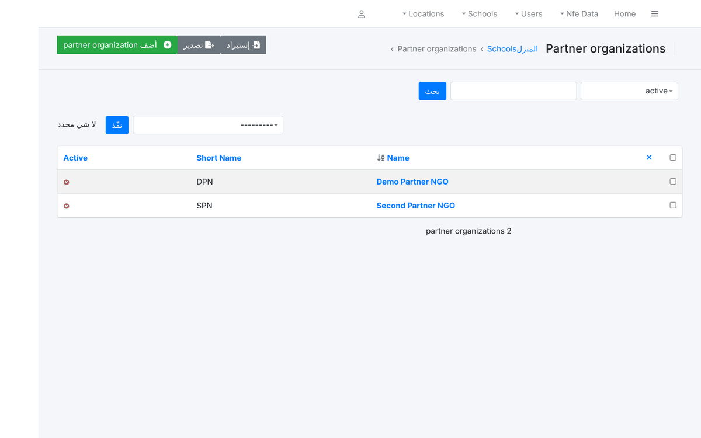

    *الشكل 28 – المنظمات الشريكة*

2. يحتوي نموذج الشريك على الاسم المختصر ونقاط الاتصال (المتابعة والتقييم، مدير البرنامج).

    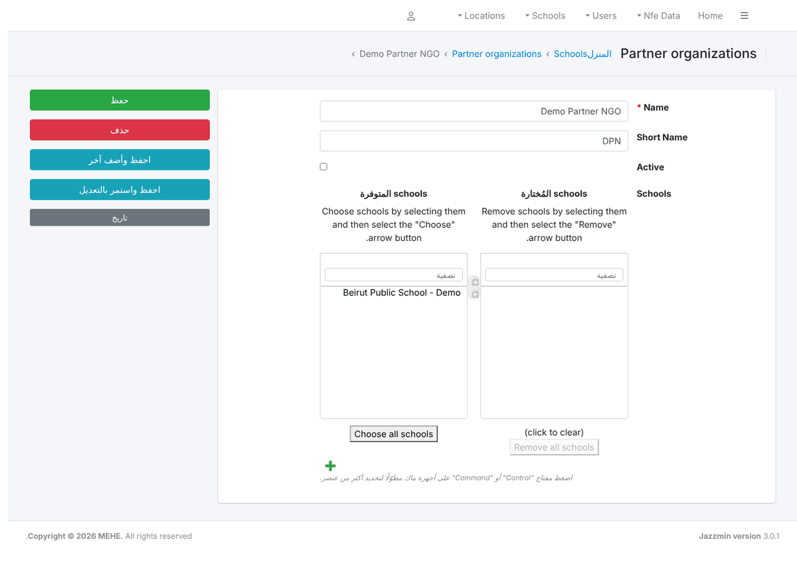

    *الشكل 29 – نموذج المنظمة الشريكة*

3. **المواقع ← المراكز**: مراكز التعليم غير النظامي مع الشريك والنوع والمحافظة والقضاء والمنطقة العقارية.

    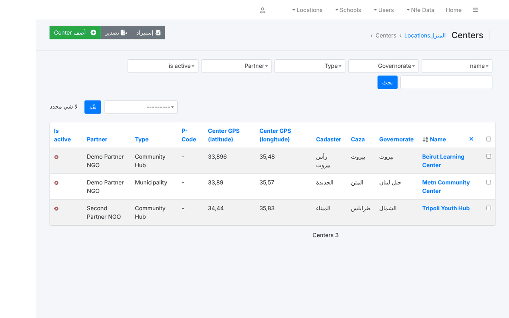

    *الشكل 30 – المراكز*

4. يسجّل نموذج المركز أيضاً المدير والهاتف والإحداثيات (تستخدمها خريطة المراكز) وإمكانية الوصول والحزم المقدَّمة.

    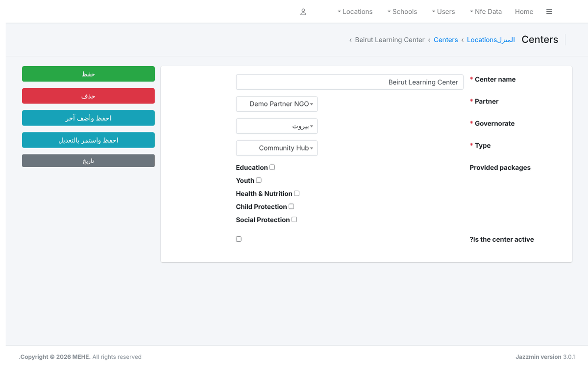

    *الشكل 31 – نموذج المركز*

5. **المدارس ← المدارس**: المدارس الرسمية لوحدة ALP. يرتبط كل حساب ALP بإحداها؛ لا تُعرض المدارس المغلقة عند ربط الحسابات.

    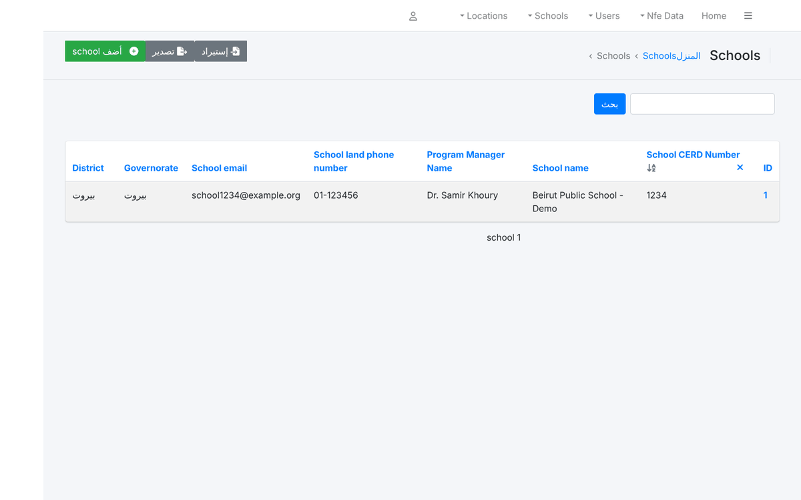

    *الشكل 32 – المدارس*

6. نموذج المدرسة: رقم المركز التربوي، الاسم، النوع، الدوام، بيانات الاتصال، الموقع والخدمات. تصون نقاط اتصال المدارس معظمه بأنفسها من التطبيق.

    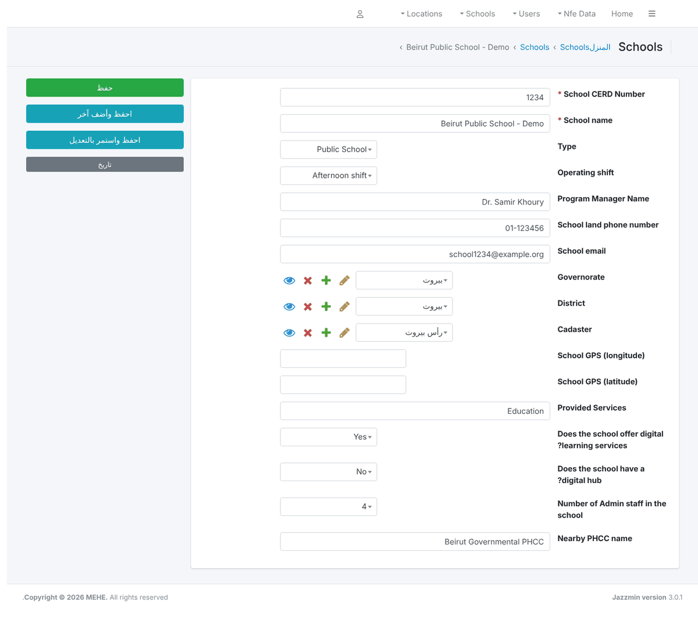

    *الشكل 33 – نموذج المدرسة*

7. **بيانات التعليم غير النظامي ← الدورات**: دورات البرنامج (السنوات). علّم **السنة الحالية** على الدورة (الدورات) المفتوحة للتسجيل: لا تُعرض في نماذج الالتحاق والحضور إلا الدورات الحالية.

    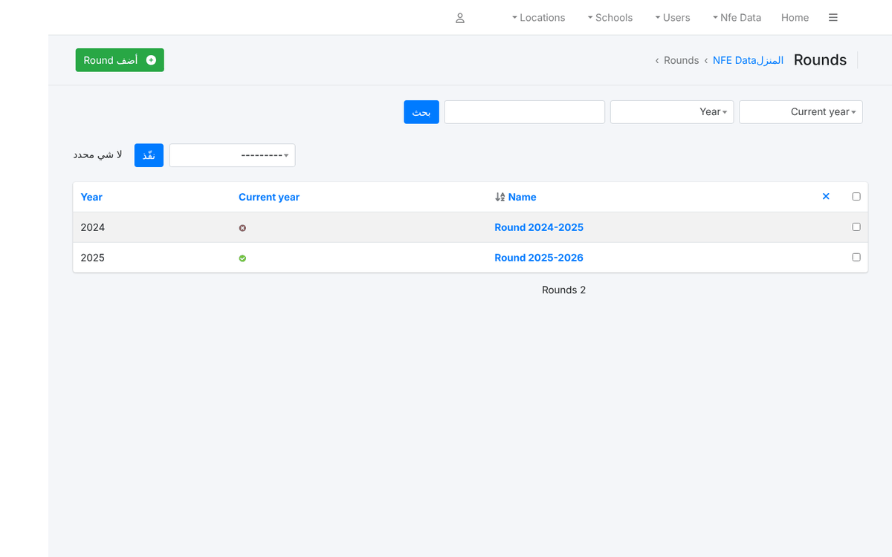

    *الشكل 34 – الدورات*

8. للدورة اسم وسنة وعلامة السنة الحالية. أنشئ الدورة الجديدة قبل بداية السنة وألغِ تعليم الدورة السابقة عند إقفالها.

    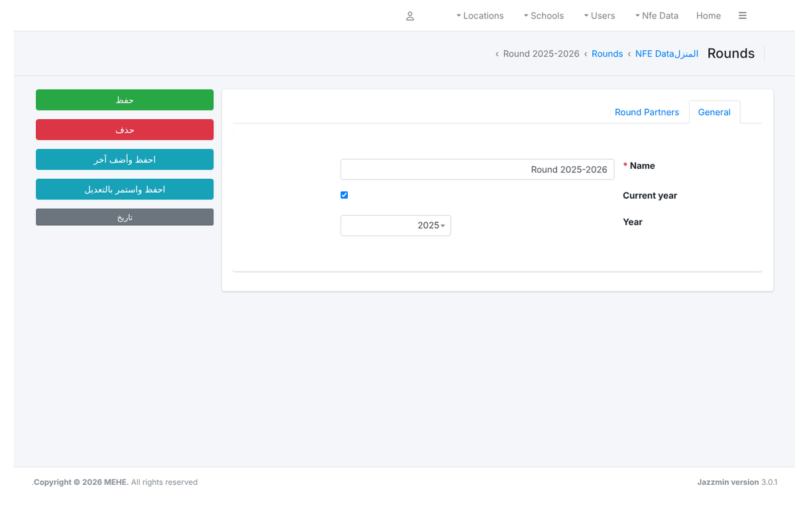

    *الشكل 35 – نموذج الدورة*

9. **ALP ← دورات ALP** و**برامج ALP**: السنوات الدراسية ومستويات البرنامج المعروضة في تسجيل ALP.

    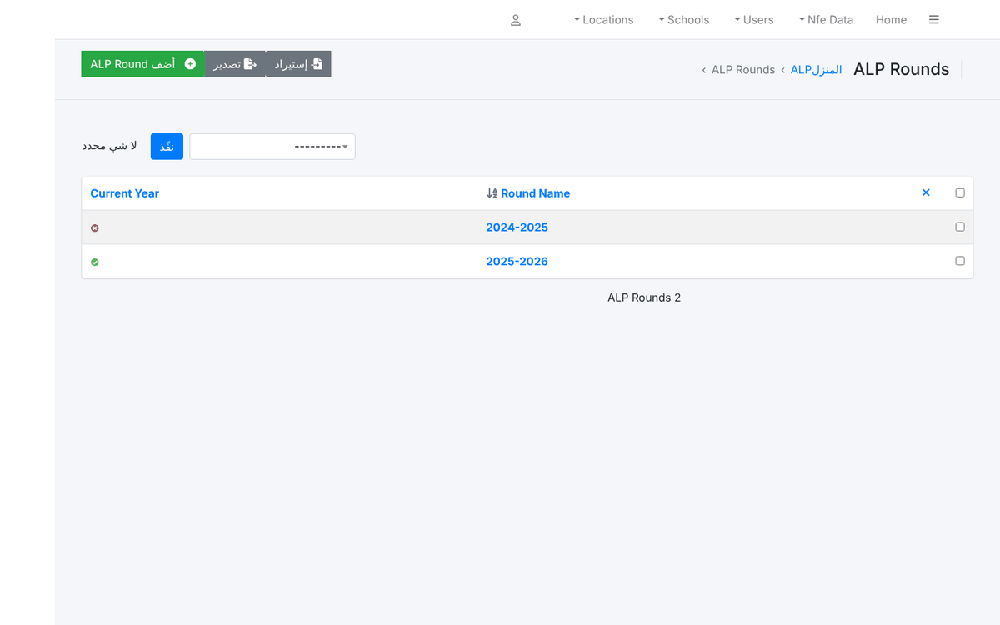

    *الشكل 36 – دورات ALP*

10. **ALP ← تعريفات درجات ALP**: سطر لكل مادة مع الحدّ الأدنى والأقصى للدرجة. يُبنى نموذج الدرجات في ALP من هذه القائمة.

    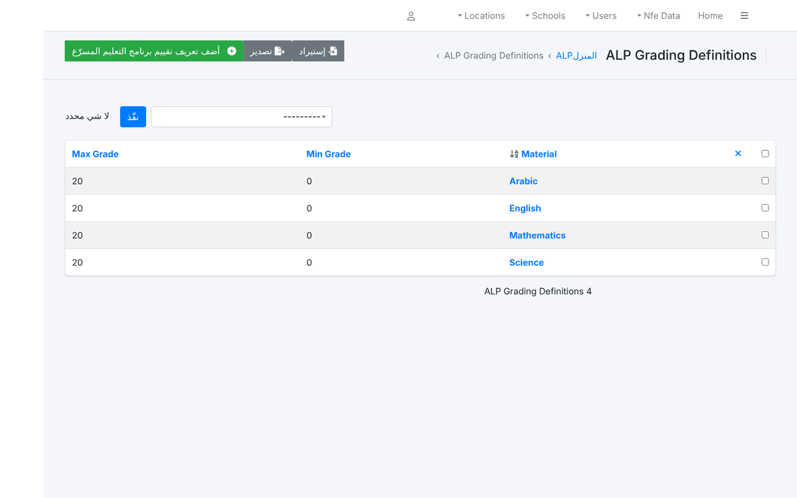

    *الشكل 37 – تعريفات درجات ALP*

11. **بيانات التعليم غير النظامي ← الحزم**: البرامج التعليمية مع الفئة العمرية التي تقبلها. لا يرى الطفل إلا البرامج التي يشمل نطاقها العمري عمره؛ تعرض صفحة الحضور حزم فئة "Education".

    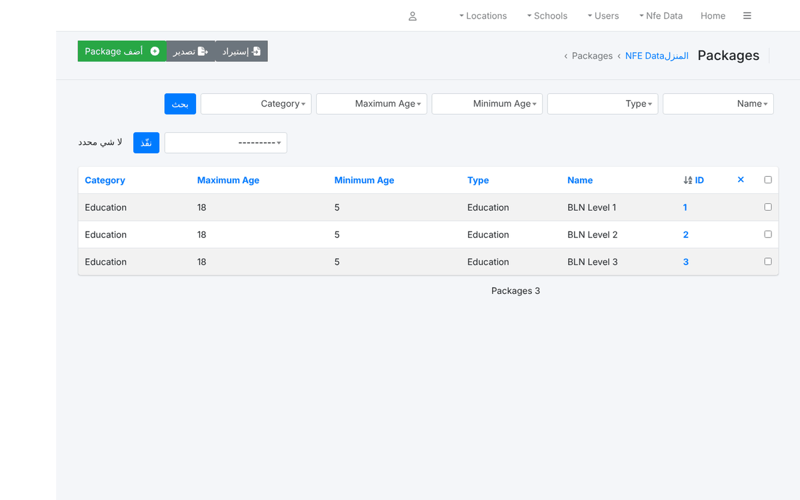

    *الشكل 38 – الحزم*

12. **إعدادات بيانات الطفل ← الجنسيات، أنواع الهوية، أنواع المرفقات، مواضيع تدريب المعلّمين** و**المدارس ← المستويات التعليمية**: قيم القوائم في نماذج التسجيل والمعلّمين.

    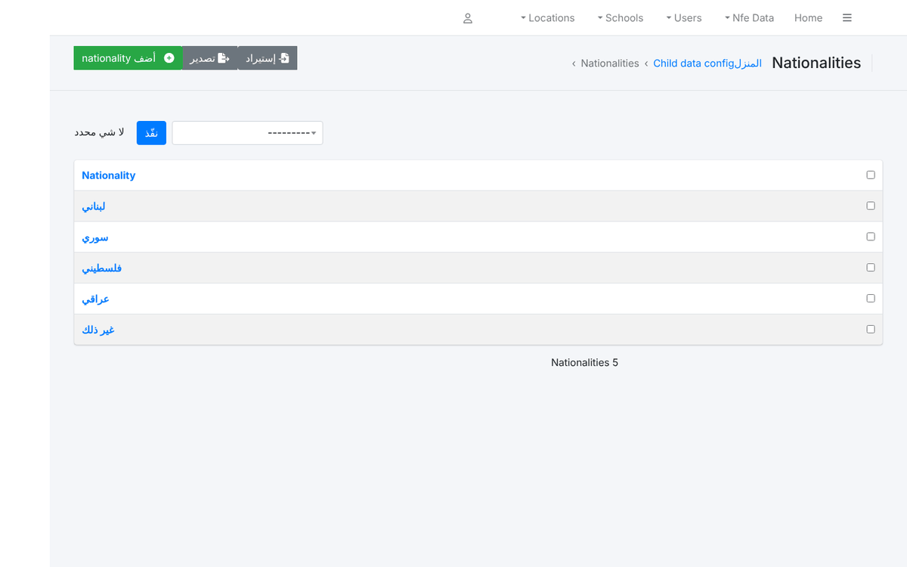

    *الشكل 39 – الجنسيات*

13. **المواقع ← المواقع**: التسلسل محافظة / قضاء / منطقة عقارية (أنواع المواقع 1 و2 و3). أبقِ الأسماء العربية والإنكليزية معبّأة؛ تُطابَق مع قائمة قرى الامتحان.

    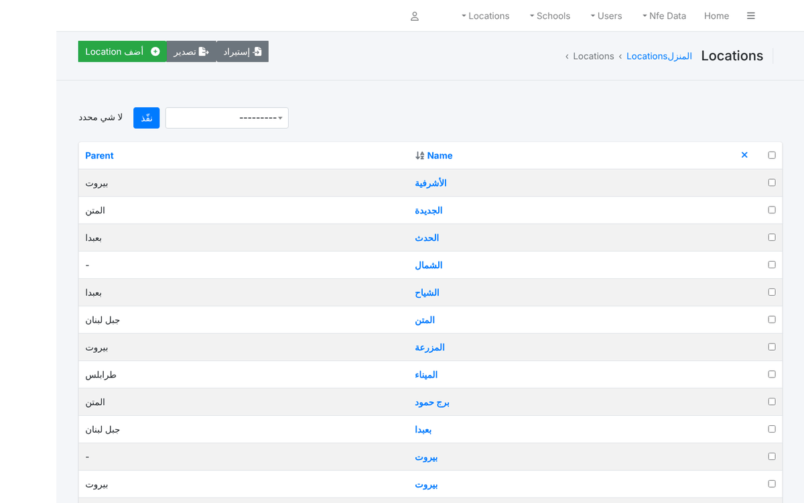

    *الشكل 40 – المواقع*

## 12. المراقبة

1. **المراقبة ← نشاط المستخدمين** يسجّل من فعل ماذا ومتى في التطبيق. صفِّ بحسب المستخدم أو التاريخ عند التحقيق في مسألة.

    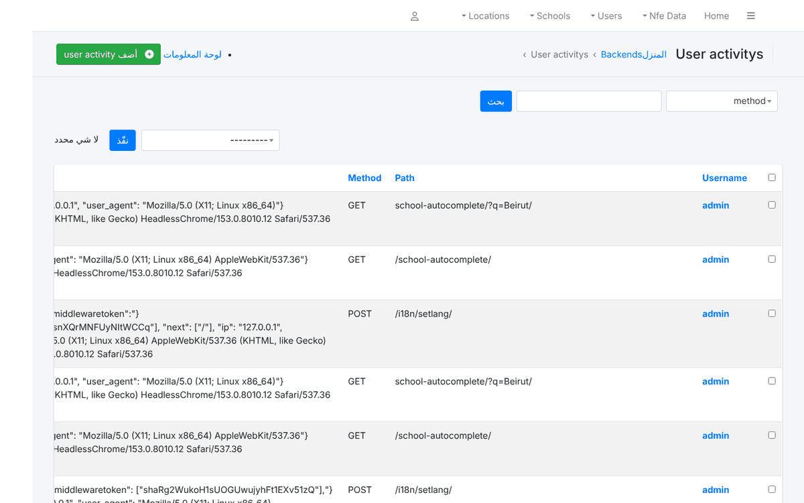

    *الشكل 41 – سجل نشاط المستخدمين*

2. **المراقبة ← سجل التصدير** يعرض كل تصدير طُلب وحالته وملفه. تظهر هنا عمليات التصدير الفاشلة.

    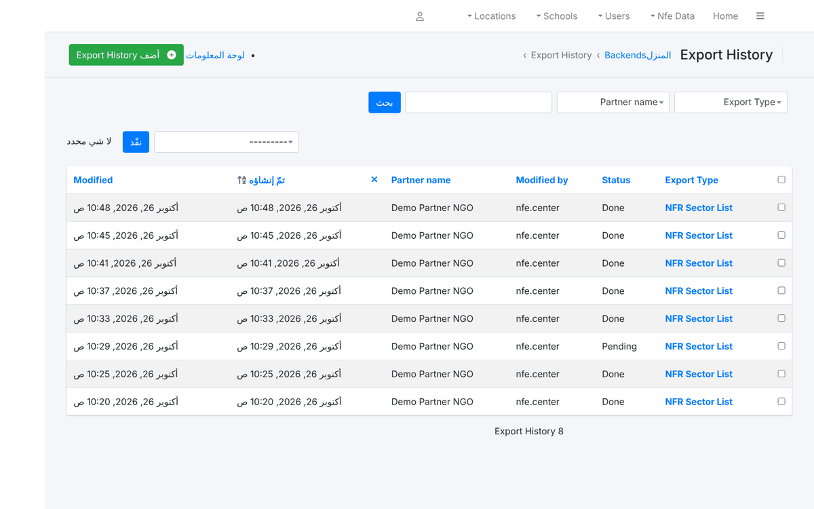

    *الشكل 42 – سجل التصدير*

3. **إعدادات Celery ← سجلات تشغيل المهام** يعرض المهام الخلفية (التصدير، المهام المجدولة) ونتائجها.

    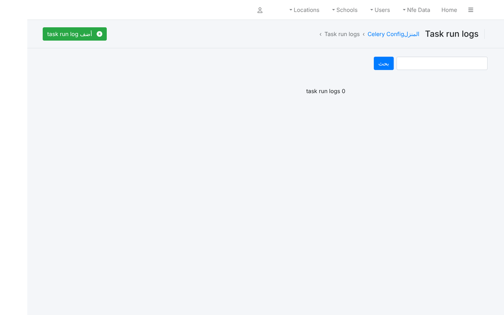

    *الشكل 43 – سجلات تشغيل المهام*

4. **بيانات التعليم غير النظامي ← التسجيلات** و**الطفل ← الأطفال** يتيحان الوصول المباشر إلى السجلات. استخدمهما للتصحيحات التي لا يسمح بها التطبيق (مثلاً إلغاء تسجيل) وبعد التحقّق مع المركز فقط.

    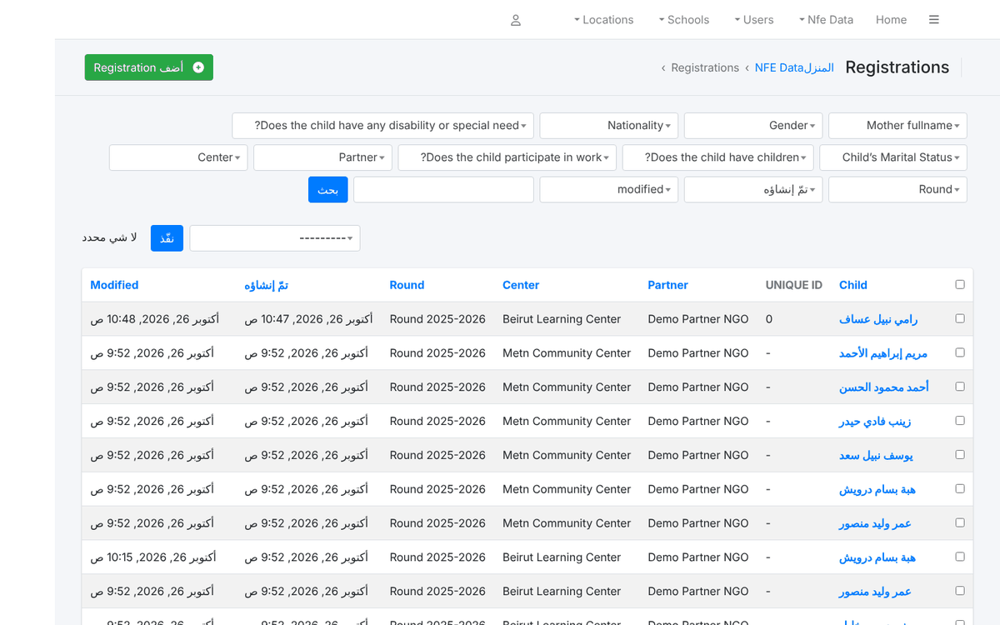

    *الشكل 44 – التسجيلات في لوحة الإدارة*

## 13. ممارسات جيدة

- **شخص واحد، حساب واحد.** لا تشارك بيانات الدخول بين الموظفين؛ أنشئ حساباً منفصلاً لكل شخص.
- **الحدّ الأدنى من الصلاحيات.** امنح فقط المجموعات والارتباط التي يحتاجها الشخص. تجنّب `MSCC_FULL` وصفة المستخدم الخارق ما لم تكن مطلوبة.
- **راجع الحسابات بانتظام.** صدّر قائمة المستخدمين كل ثلاثة أشهر، وعطّل المغادرين، وتحقّق من الارتباطات.
- **عطّل ولا تحذف** للحفاظ على مسار التدقيق.
- **أمّن بيانات الدخول.** أرسل كلمات المرور الأولية عبر قناة آمنة واطلب تغييرها عند أول دخول.
- **سجّل الخروج** من لوحة الإدارة عند مغادرة الحاسوب؛ تنتهي الجلسة أيضاً تلقائياً بعد فترة من عدم النشاط.

## 14. الأسئلة الشائعة

| السؤال | الجواب |
|---|---|
| يسجّل المستخدم الدخول لكن كل القوائم فارغة. | الارتباط ناقص: حدّد المركز (والشريك) أو المدرسة في تبويبة المعلومات الشخصية بما يتوافق مع المجموعات. |
| يتلقّى المستخدم "403 / غير مسموح" في صفحة. | يفتقر الحساب إلى المجموعة التي تفتح تلك الصفحة. قارن بوصفات الأدوار في القسم 6. |
| لا يستطيع المستخدم فتح لوحة الإدارة. | علّم صفة موظف، وامنح صلاحيات النماذج أو صفة المستخدم الخارق (القسم 10). |
| لا يستطيع المستخدم الخارق إضافة تسجيل ALP. | هذا مقصود: تُدخل بيانات ALP من حسابات المدارس فقط. |
| أي دورة تُعرض في النماذج؟ | الدورات التي تحمل علامة السنة الحالية فقط (NFE) أو دورة ALP الحالية. |
| برنامج غير موجود في تسجيل الطفل. | تحقّق من النطاق العمري للحزمة وتاريخ ولادة الطفل. |
| هل يمكنني إعادة تسمية مجموعة؟ | لا. يتحقّق التطبيق من الأسماء بالضبط؛ إعادة تسمية مجموعة تزيل صلاحيات جميع أعضائها. |
| كيف أعرف من عدّل سجلاً؟ | افتح السجل واضغط السجل (History)، أو راجع سجل نشاط المستخدمين. |

