

# دليل المستخدم – وحدة التعليم غير النظامي (NFE)

**منصة BMA – قطاع التعليم غير النظامي**

_آخر تحديث: 26 October 2026_

يشرح هذا الدليل خطوةً بخطوة كيفية استخدام **وحدة التعليم غير النظامي (NFE)** في منصة BMA. وهو موجّه لموظفي المراكز الذين يسجّلون الأطفال، ويوثّقون الخدمات المقدَّمة لهم، ويتابعون الحضور اليومي، ويديرون بيانات المعلّمين، ويطّلعون على لوحات المعلومات. لا يتطلّب الدليل أي معرفة تقنية.

كل خطوة مرفقة بلقطة شاشة مأخوذة من النظام. قد تختلف الشاشات قليلاً بحسب دورك: **مستخدم المركز** يرى أطفال مركزه فقط، و**مستخدم الشريك** يرى جميع مراكز منظمته، و**مستخدمو اليونيسف** لديهم صلاحية اطّلاع فقط على جميع الشركاء.

البيانات الظاهرة في لقطات الشاشة هي بيانات تجريبية فقط.

## المحتويات

1. البدء – تسجيل الدخول والتنقّل
2. قائمة المستفيدين
3. تسجيل طفل جديد
4. ملف الطفل
5. الوضع التعليمي والالتحاق بالدورة
6. الامتحان الاستثنائي
7. الحضور اليومي
8. المعلّمون
9. المراكز
10. تصدير البيانات
11. لوحات المعلومات والتحليلات
12. حسابك
13. الأسئلة الشائعة

## 1. البدء – تسجيل الدخول والتنقّل

افتح متصفّح Google Chrome أو Mozilla Firefox وادخل إلى عنوان المنصة الذي زوّدك به المنسّق. يُنشئ مدير النظام الحسابات؛ لا يوجد تسجيل ذاتي.

1. افتح صفحة تسجيل الدخول. أدخل **اسم المستخدم** و**كلمة المرور**.

    

    *الشكل 1 – صفحة تسجيل الدخول*

2. اضغط **تسجيل الدخول**. إذا كانت البيانات صحيحة تُنقل إلى صفحتك الرئيسية.

    

    *الشكل 2 – نموذج تسجيل الدخول بعد تعبئته*

3. تعرض **الصفحة الرئيسية** تسجيلات اليوم، وتسجيلات هذا الأسبوع، والمراكز التي ترسل بيانات، ومعدّل الحضور، ومنحنى التسجيلات خلال 14 يوماً، وعمليات تصدير البيانات الأخيرة. بطاقة **تسجيل جديد** تفتح نموذج التسجيل مباشرة.

    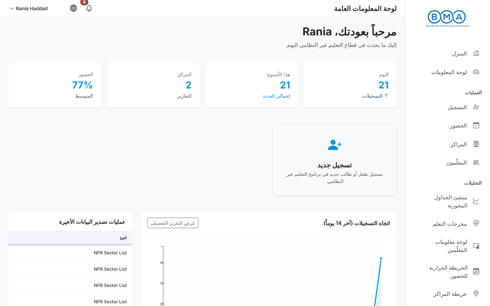

    *الشكل 3 – الصفحة الرئيسية بعد تسجيل الدخول*

4. لتغيير لغة الواجهة اضغط **أيقونة الكرة الأرضية** في الشريط العلوي واختر **العربية** أو **English**. تُعاد الصفحة بتحميل اللغة المختارة، مع تخطيط من اليمين إلى اليسار للعربية.

    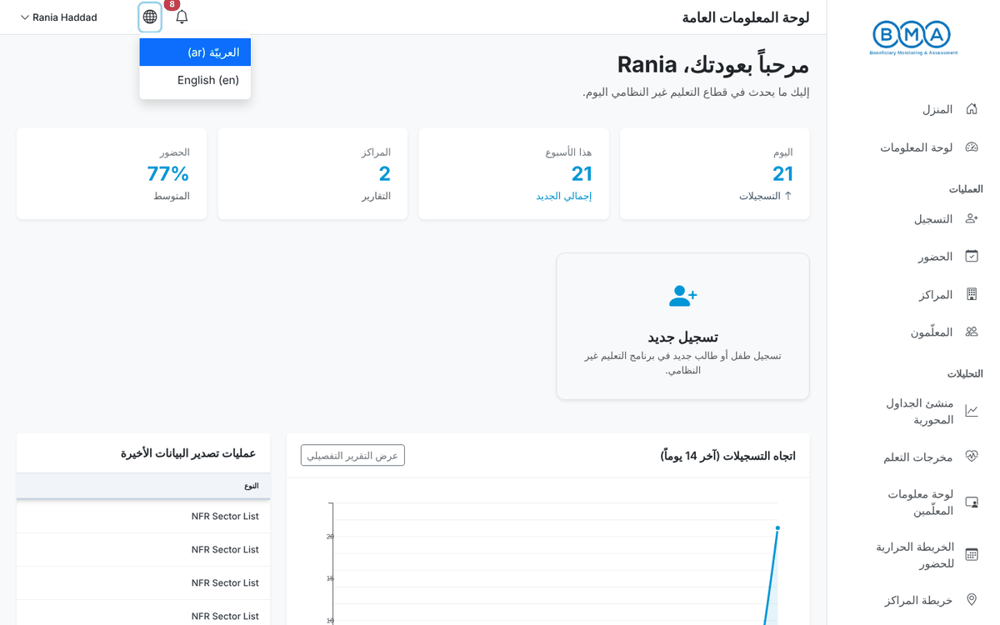

    *الشكل 4 – قائمة اللغة*

5. اضغط على **اسمك** في أعلى الصفحة لفتح قائمة المستخدم: **الملف الشخصي**، **تغيير كلمة المرور**، **تسجيل الخروج**.

    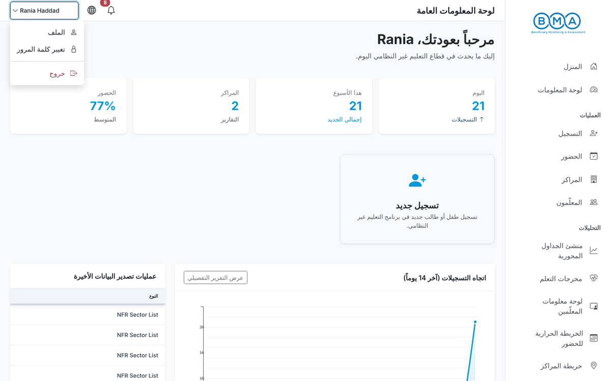

    *الشكل 5 – قائمة المستخدم*

| عنصر القائمة | ما يفتحه |
|---|---|
| المنزل | الصفحة الرئيسية مع بطاقات الملخّص اليومي |
| لوحة المعلومات | لوحة المعلومات التشغيلية (التسجيلات، الجنس، الجنسية، الفئات العمرية...) |
| التسجيل | قائمة المستفيدين ونموذج التسجيل وملفات الأطفال |
| الحضور | إدخال الحضور اليومي لمركزك |
| المراكز | قائمة المراكز التي يمكنك الوصول إليها |
| المعلّمون | قائمة المعلّمين ونموذج المعلّم |
| منشئ الجداول المحورية | بناء جداولك المتقاطعة الخاصة من بيانات التسجيل |
| مخرجات التعلّم | تحليل مخرجات التعلّم والوضع الاجتماعي والاقتصادي |
| لوحة معلومات المعلّمين | بيانات المعلّمين وتكليفاتهم وتدريبهم |
| الخريطة الحرارية للحضور | أنماط الحضور على مدار السنة |
| خريطة المراكز | خريطة المراكز وملفاتها |
| دليل المستخدم | التوثيق داخل النظام |

> **ملاحظة:** لأسباب أمنية يُخرجك النظام تلقائياً بعد فترة من عدم النشاط، لذا احفظ عملك بانتظام. بعد خمس محاولات دخول فاشلة خلال خمس دقائق يُقفل الحساب مؤقتاً: انتظر بضع دقائق ثم أعد المحاولة.

## 2. قائمة المستفيدين

تعرض قائمة المستفيدين كل طفل مسجّل في مركزك (أو في جميع مراكز منظمتك الشريكة). افتحها من **التسجيل** في القائمة الجانبية.

1. تعرض القائمة سطراً لكل تسجيل: الدورة، الرقم الفريد، الأسماء، الجنس، العمر، تاريخ الولادة، الجنسية والبرنامج. اضغط على عنوان أي عمود للفرز بحسبه. مرّر أفقياً لرؤية جميع الأعمدة.

    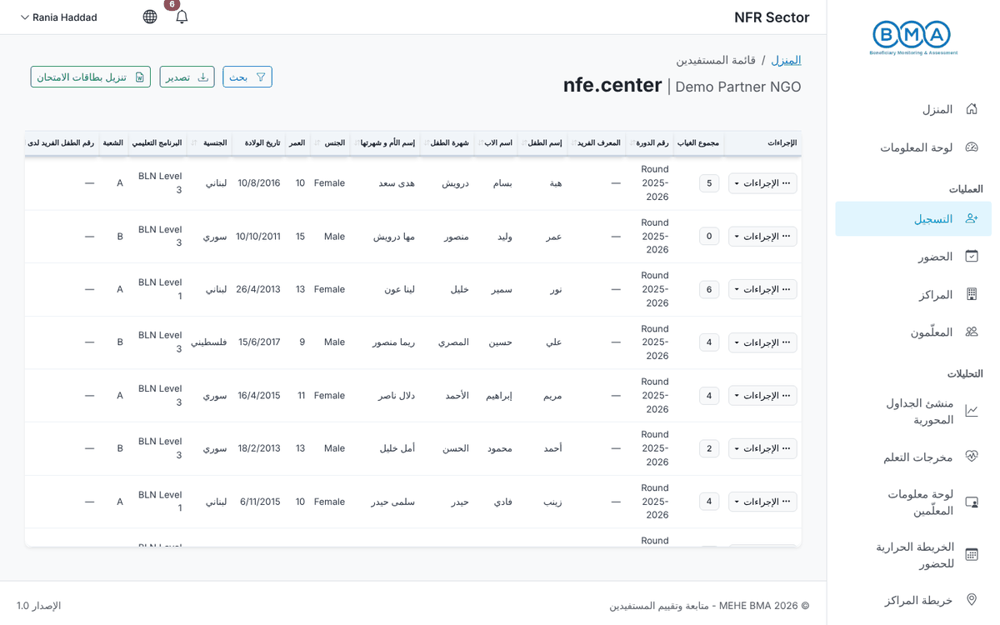

    *الشكل 6 – قائمة المستفيدين*

2. اضغط **بحث** لفتح لوحة التصفية. صفِّ بحسب الاسم الأول أو اسم الأب أو اسم العائلة أو اسم الأم، أو الرقم الفريد، أو الجنس، أو الجنسية، أو الدورة، أو البرنامج، ثم اضغط **تطبيق الفلاتر**. **مسح الكل** يزيل الفلاتر.

    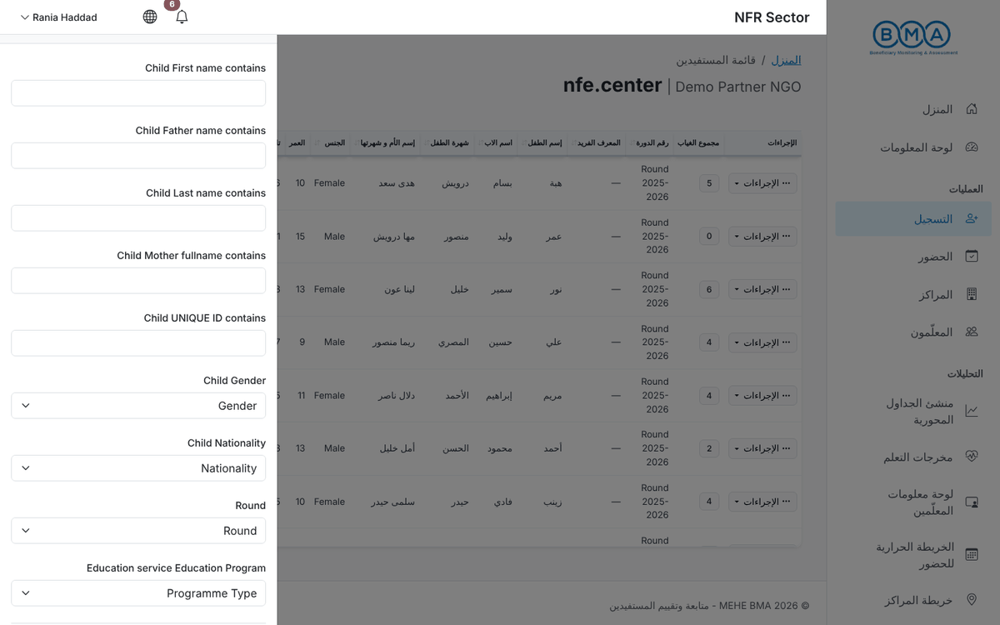

    *الشكل 7 – لوحة البحث والتصفية*

3. اضغط **الإجراءات** في أي سطر لفتح قائمة السطر: **عرض الملف**، **رفع صورة**، **تعديل المعلومات** و**حذف السجل**. يطلب الحذف تأكيداً ولا يمكن التراجع عنه.

    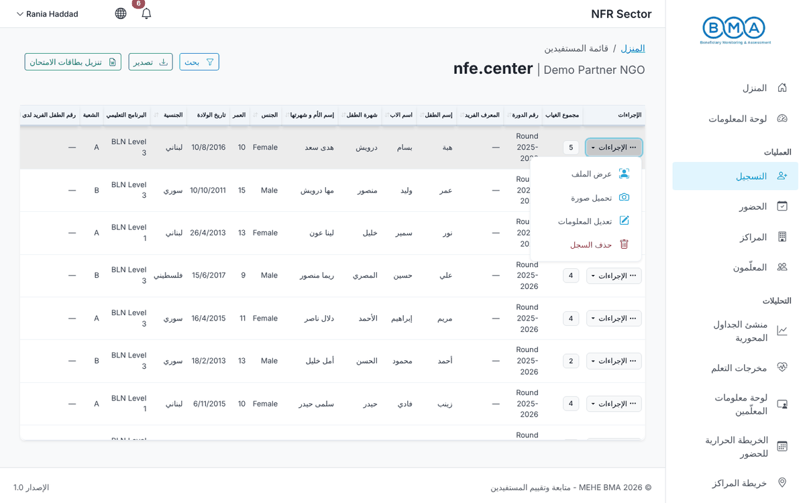

    *الشكل 8 – قائمة الإجراءات الخاصة بتسجيل*

> **ملاحظة:** يعرض عمود **إجمالي الغياب** عدد الأيام التي سُجّل فيها الطفل غائباً في الدورة الحالية، وهو وسيلة سريعة لرصد الأطفال المعرّضين للتسرّب.

## 3. تسجيل طفل جديد

يتم التسجيل عبر **معالج من 3 خطوات**: الهوية، مقدّمو الرعاية، المراجعة. لا يُحفظ الطفل إلا عند الضغط على **إكمال التسجيل** في الخطوة الأخيرة. الحقول المعلَّمة بنجمة حمراء (*) إلزامية.

افتح النموذج من بطاقة **تسجيل جديد** في الصفحة الرئيسية، أو من قائمة المستفيدين.

بمجرّد كتابة اسم الطفل وتاريخ ولادته، تبحث لوحة **مطابقات محتملة** أعلى النموذج في السجلات الموجودة. إذا كان الطفل مسجّلاً سابقاً تتحوّل اللوحة إلى اللون الأحمر وتعرض السجل الموجود وتعطّل زر **الخطوة التالية**. في هذه الحالة **لا** تُنشئ سجلاً جديداً: افتح الملف الموجود، أو استخدم **اختيار وإعادة التسجيل** لإضافة الطفل إلى دورة جديدة.

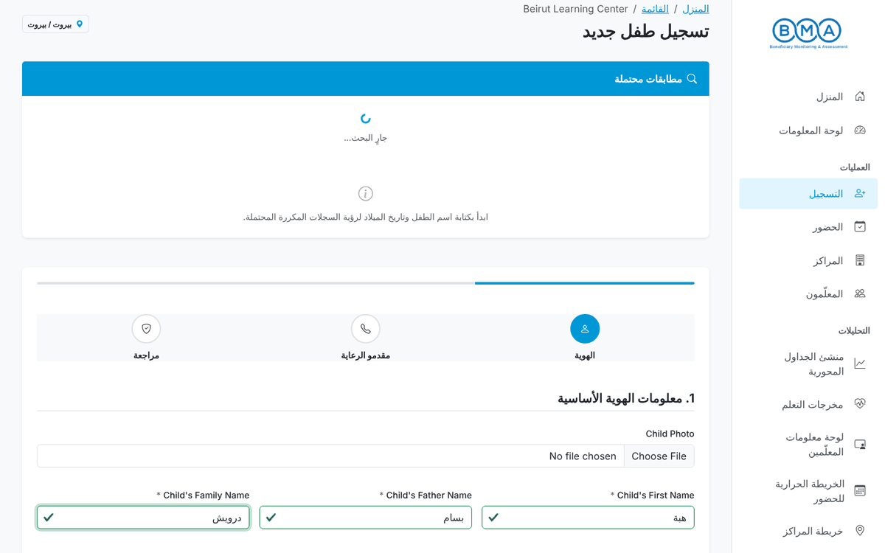

*الشكل 9 – يعمل فحص التكرار أثناء كتابة بيانات الهوية*

1. املأ **معلومات الهوية الأساسية**: صورة الطفل (اختيارية)، الاسم الأول، اسم الأب، اسم العائلة، تاريخ الولادة (اليوم، الشهر، السنة)، بلد ومكان الولادة، الجنس، اسم الأم الكامل، الجنسية و**برنامج التعليم غير النظامي** (BLN المستوى 1 أو 2 أو 3). يجب كتابة الأسماء **بالأحرف العربية** كما هي في الوثيقة الرسمية.

    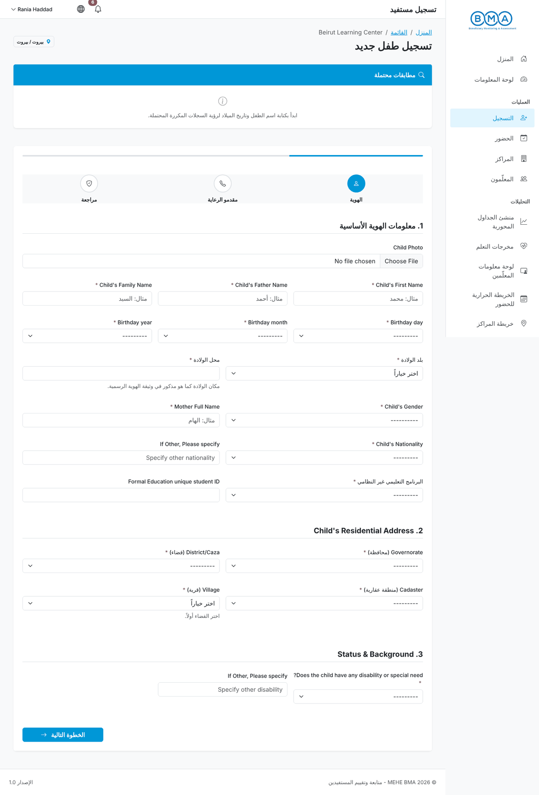

    *الشكل 10 – الخطوة 1 – نموذج الهوية الفارغ*

2. املأ **عنوان السكن**: المحافظة، القضاء، المنطقة العقارية والقرية. تُحمَّل كل قائمة بعد اختيار المستوى السابق. ثم أجب عن سؤال **الإعاقة** في قسم الوضع والخلفية.
3. راجع البيانات واضغط **الخطوة التالية**. إذا نقص حقل إلزامي يُظلَّل الحقل بالأحمر وتعرض رسالة **التحقق مطلوب** ما يجب تصحيحه.

    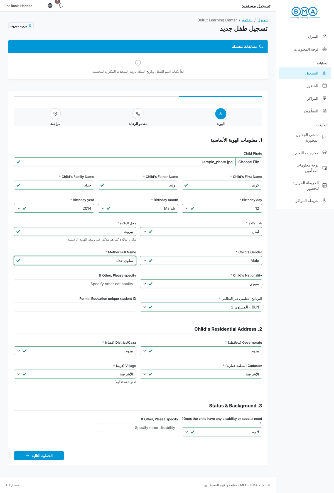

    *الشكل 11 – الخطوة 1 بعد التعبئة*

| الحقل | الإرشاد |
|---|---|
| الاسم الأول / اسم الأب / اسم العائلة | بالأحرف العربية كما هي مكتوبة في وثيقة الهوية |
| تاريخ الولادة | اختر اليوم والشهر والسنة من القوائم |
| بلد ومكان الولادة | كما هو مكتوب في الوثيقة الرسمية |
| اسم الأم الكامل | إلزامي، بالأحرف العربية |
| الجنسية | اختر من القائمة؛ إذا اخترت "غير ذلك" حدّدها في الحقل التالي |
| برنامج التعليم غير النظامي | BLN المستوى 1 أو المستوى 2 أو المستوى 3 |
| الرقم الفريد في التعليم النظامي | اختياري – الرقم المستخدم في المدرسة الرسمية إن وُجد |
| المحافظة / القضاء / المنطقة العقارية / القرية | مكان إقامة الطفل الحالي |
| الإعاقة أو الاحتياج الخاص | إلزامي؛ إذا اخترت "غير ذلك" صِفه |

1. أدخل **رقم الهاتف الأساسي** لمقدّم الرعاية بالصيغة **XX-XXXXXX** (مثلاً 03-123456). هذا هو الرقم الذي يستخدمه المركز للتواصل مع العائلة.

    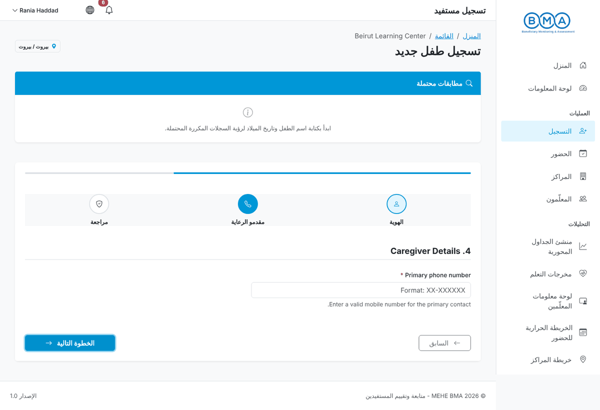

    *الشكل 12 – الخطوة 2 – بيانات الاتصال بمقدّم الرعاية*

2. اضغط **الخطوة التالية**. يمكنك في أي وقت الضغط على **السابق** للرجوع وتصحيح قيمة.

    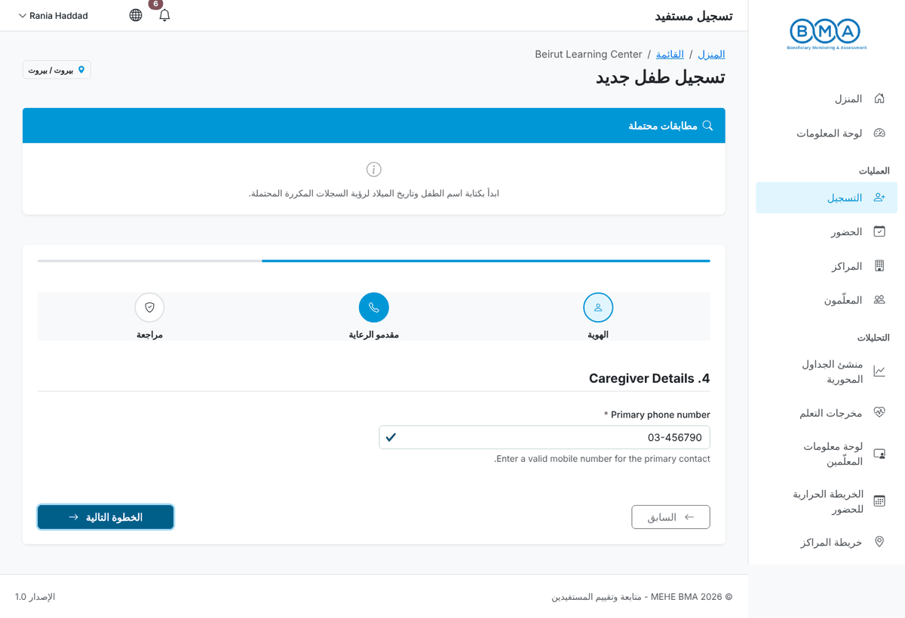

    *الشكل 13 – الخطوة 2 بعد التعبئة*

1. راجع الملخّص: الاسم الكامل، تاريخ الولادة، بلد ومكان الولادة، الجنسية، الجنس، رقم الهاتف، البرنامج والعنوان. إذا كان هناك خطأ اضغط **السابق** وصحّحه. **إعادة ضبط النموذج** يمسح كل شيء.

    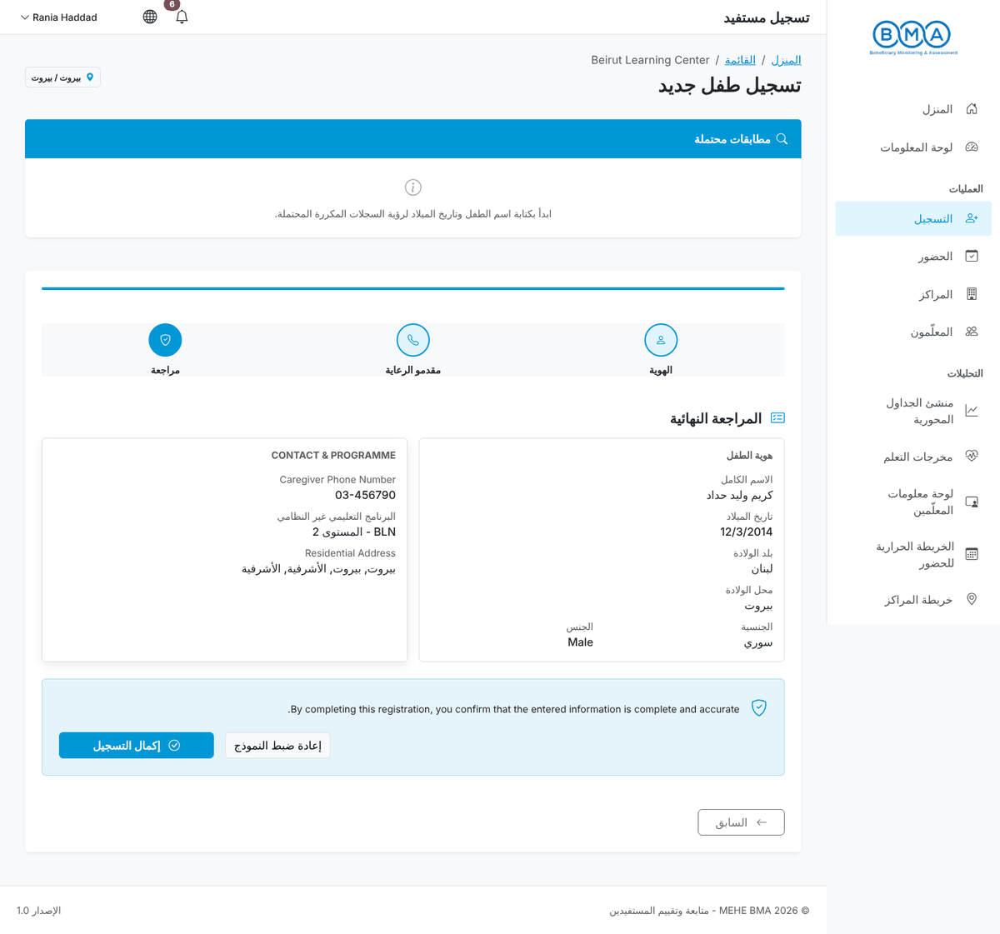

    *الشكل 14 – الخطوة 3 – المراجعة النهائية*

2. اضغط **إكمال التسجيل**. تؤكّد رسالة "تم إرسال البيانات بنجاح" التسجيل وتُفتح **صفحة ملف** الطفل.

    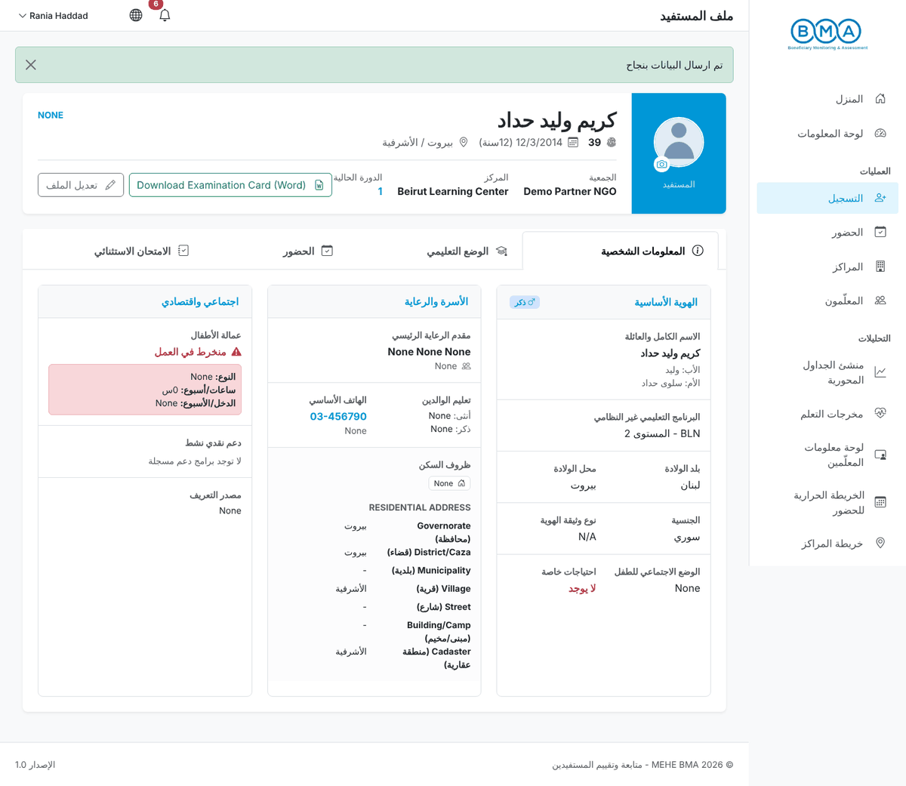

    *الشكل 15 – صفحة الملف مباشرة بعد التسجيل*

> **ملاحظة:** يُملأ المركز والشريك والدورة تلقائياً من حسابك. إذا لم يكن لحسابك مركز مرتبط يظهر تنبيه في القائمة: اطلب من المدير ربط حسابك بمركز.

## 4. ملف الطفل

الملف هو السجل المركزي للطفل. افتحه من قائمة المستفيدين عبر **الإجراءات ← عرض الملف**.

1. يعرض **رأس الصفحة** الصورة، الاسم الكامل، الرقم الفريد، تاريخ الولادة مع العمر، العنوان، الشريك، المركز والدورة الحالية. الأزرار على الجانب تفتح **تحميل بطاقة الامتحان (Word)** و**تعديل الملف**.

    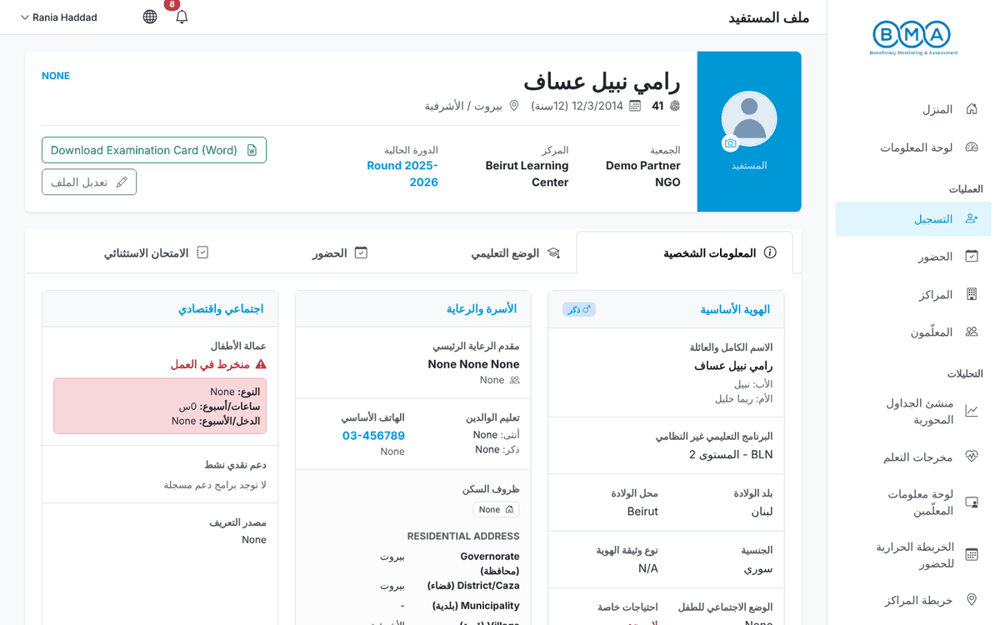

    *الشكل 16 – رأس صفحة الملف*

2. تجمع تبويبة **المعلومات الشخصية** الهوية الأساسية، ومعلومات الأسرة والرعاية، والوضع الاجتماعي والاقتصادي.

    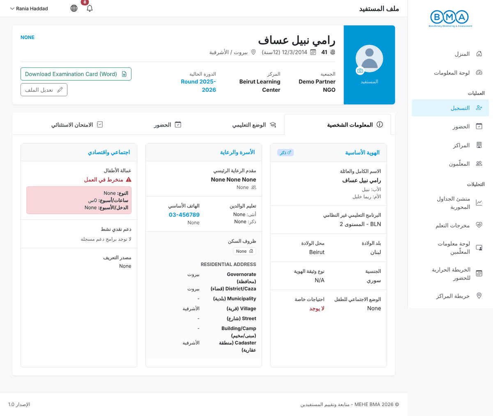

    *الشكل 17 – تبويبة المعلومات الشخصية*

3. تعرض تبويبة **الوضع التعليمي** الالتحاق الحالي (المستوى التعليمي، البرنامج، الدورة، الشعبة، تاريخ التسجيل)، وسجل التعليم، وتقييم البرنامج القبلي والبعدي، وبطاقة الإحالة.

    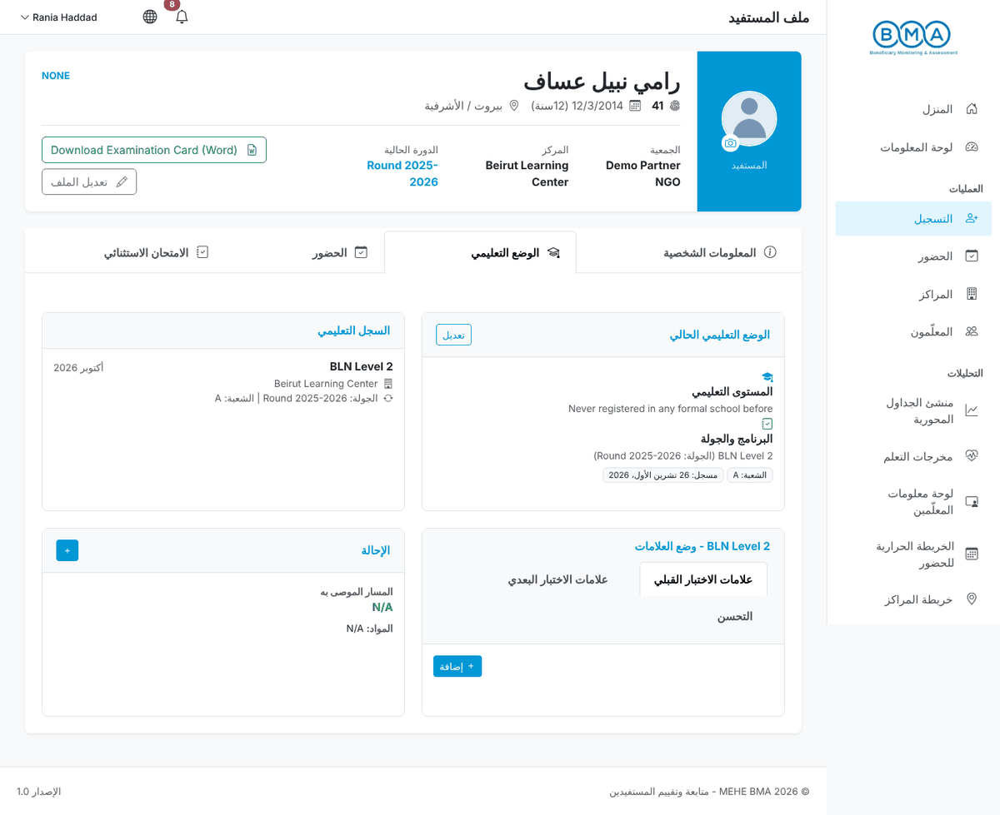

    *الشكل 18 – تبويبة الوضع التعليمي*

4. تعرض تبويبة **الحضور** إجمالي أيام التدريس، وأيام الحضور، والغياب، وغياب الشهر الحالي. اضغط على شهر في **السجل الشهري** لرؤية السجلات اليومية.

    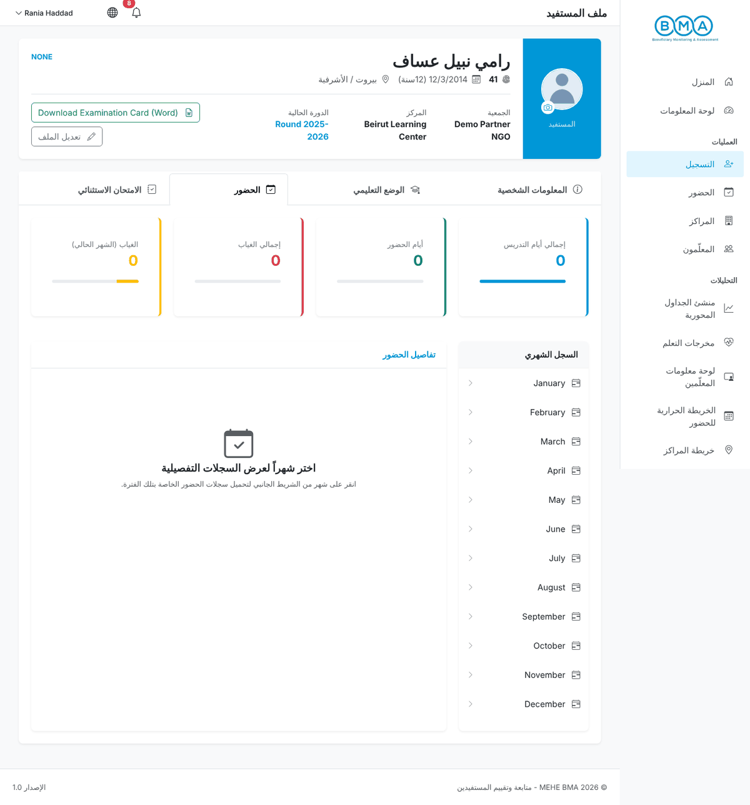

    *الشكل 19 – تبويبة الحضور*

5. تعرض تبويبة **الامتحان الاستثنائي** تفاصيل الامتحان المسجّلة لهذا التسجيل، أو زراً لإضافتها (انظر القسم 6).

    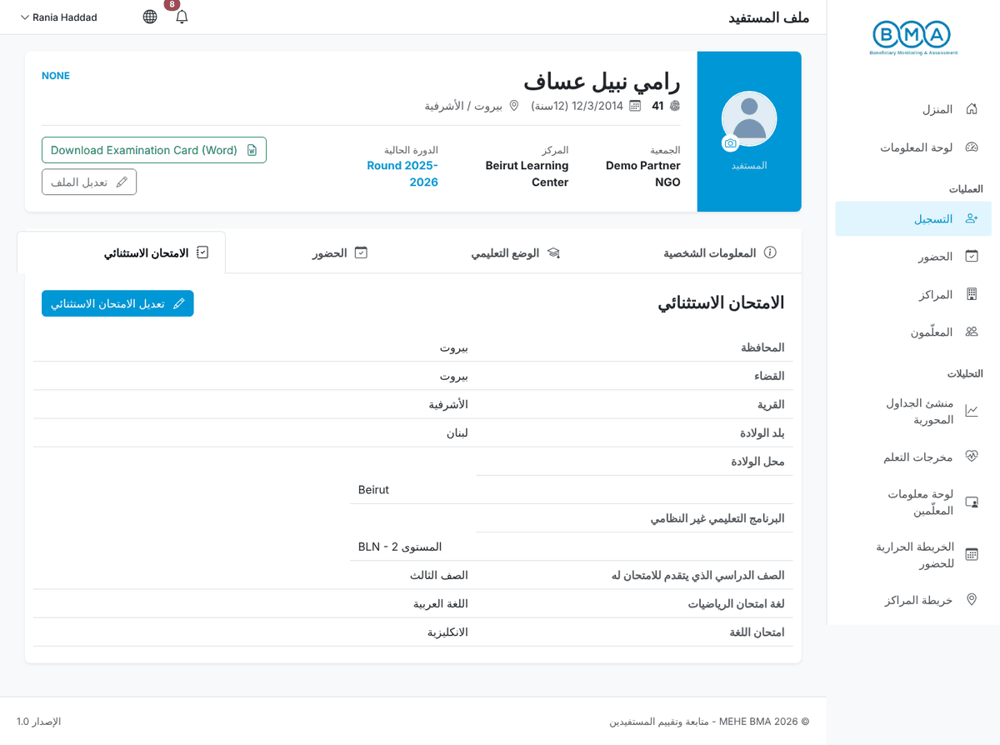

    *الشكل 20 – تبويبة الامتحان الاستثنائي*

1. اضغط **تعديل الملف** (أو **الإجراءات ← تعديل المعلومات** في القائمة). يُفتح النموذج نفسه من 3 خطوات بالقيم المحفوظة. غيّر ما يلزم، وانتقل عبر الخطوات، ثم اضغط **إكمال التسجيل** للحفظ.

    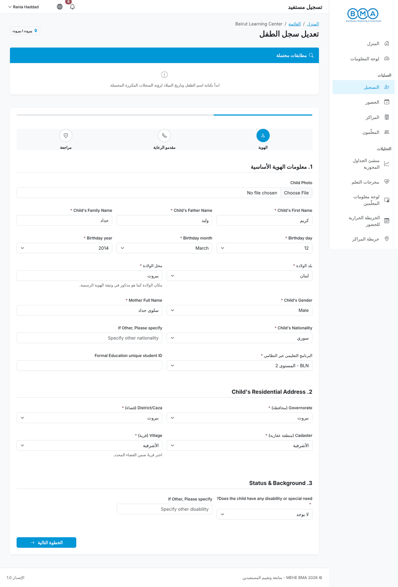

    *الشكل 21 – تعديل تسجيل*

1. اضغط **أيقونة الكاميرا** على صورة الملف، أو **الإجراءات ← رفع صورة** في القائمة. اختر صورة واضحة وحديثة للطفل (JPG أو PNG) واضغط **حفظ**.

    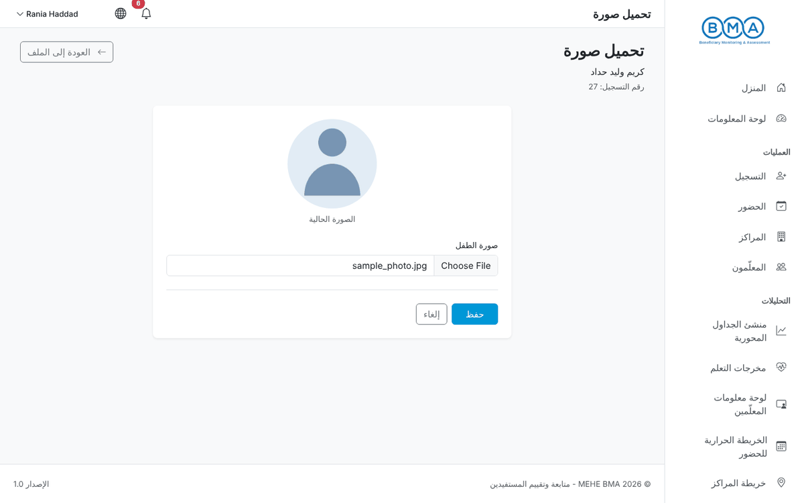

    *الشكل 22 – نموذج رفع الصورة*

2. يُعاد فتح الملف بالصورة الجديدة. تُدرج الصورة أيضاً في تصدير Excel وتُطبع على بطاقة الامتحان.

    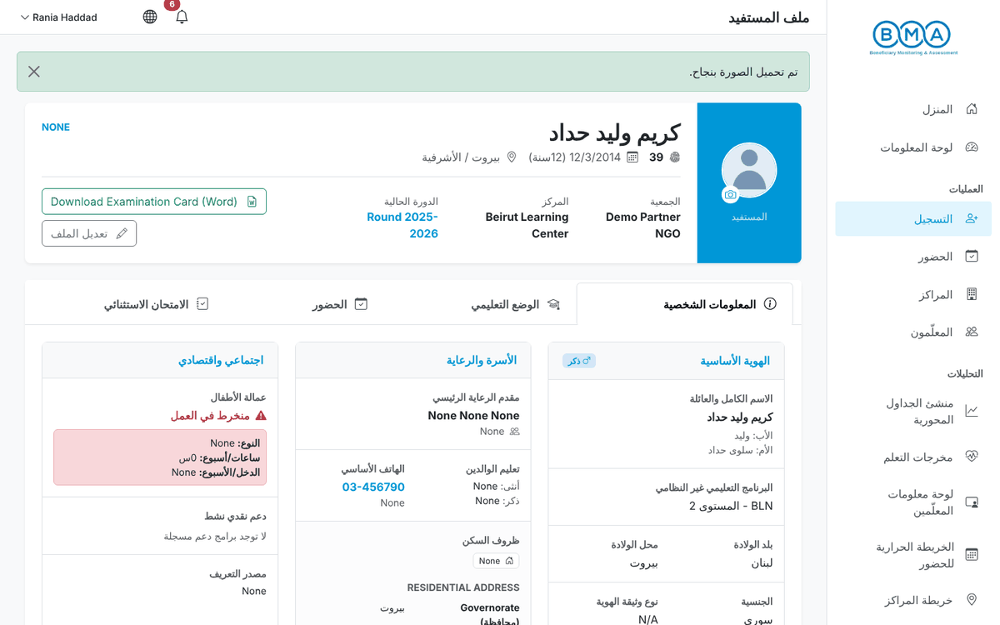

    *الشكل 23 – تم حفظ الصورة*

اضغط **تحميل بطاقة الامتحان (Word)** في رأس الملف لتحميل بطاقة Word قابلة للتعديل تتضمّن صورة الطفل والدورة ورقم التسجيل والشريك والاسم الكامل وتاريخ الولادة والجنسية والمحافظة. صحّح الملف أولاً إذا كان هناك خطأ، لأن كل تحميل يقرأ السجل المحفوظ من جديد.

## 5. الوضع التعليمي والالتحاق بالدورة

يسجّل **الوضع التعليمي** مستوى الطفل التعليمي عند التسجيل، والبرنامج والدورة والشعبة التي يلتحق بها. وهو مطلوب قبل أن يظهر الطفل في لوائح الحضور.

1. افتح الملف، انتقل إلى تبويبة **الوضع التعليمي** واضغط **إضافة** (أو **تعديل** إن وُجد وضع سابق).

    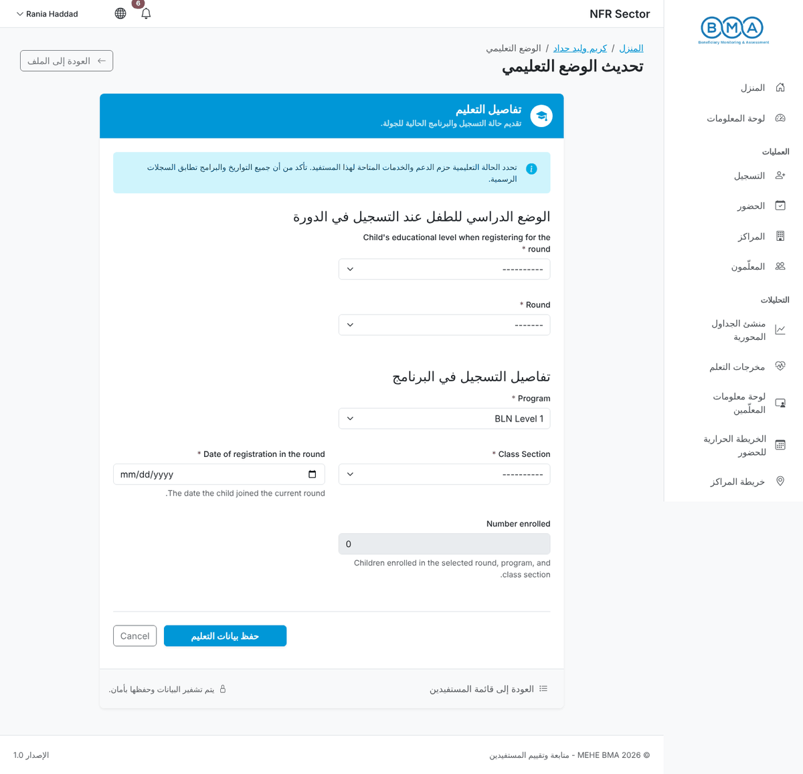

    *الشكل 24 – نموذج الوضع التعليمي*

2. اختر **المستوى التعليمي عند التسجيل**، و**الدورة**، و**البرنامج**، و**الشعبة**، و**تاريخ التسجيل في الدورة**. إذا تسرّب الطفل من مدرسة، أدخل تاريخ التسرّب.

    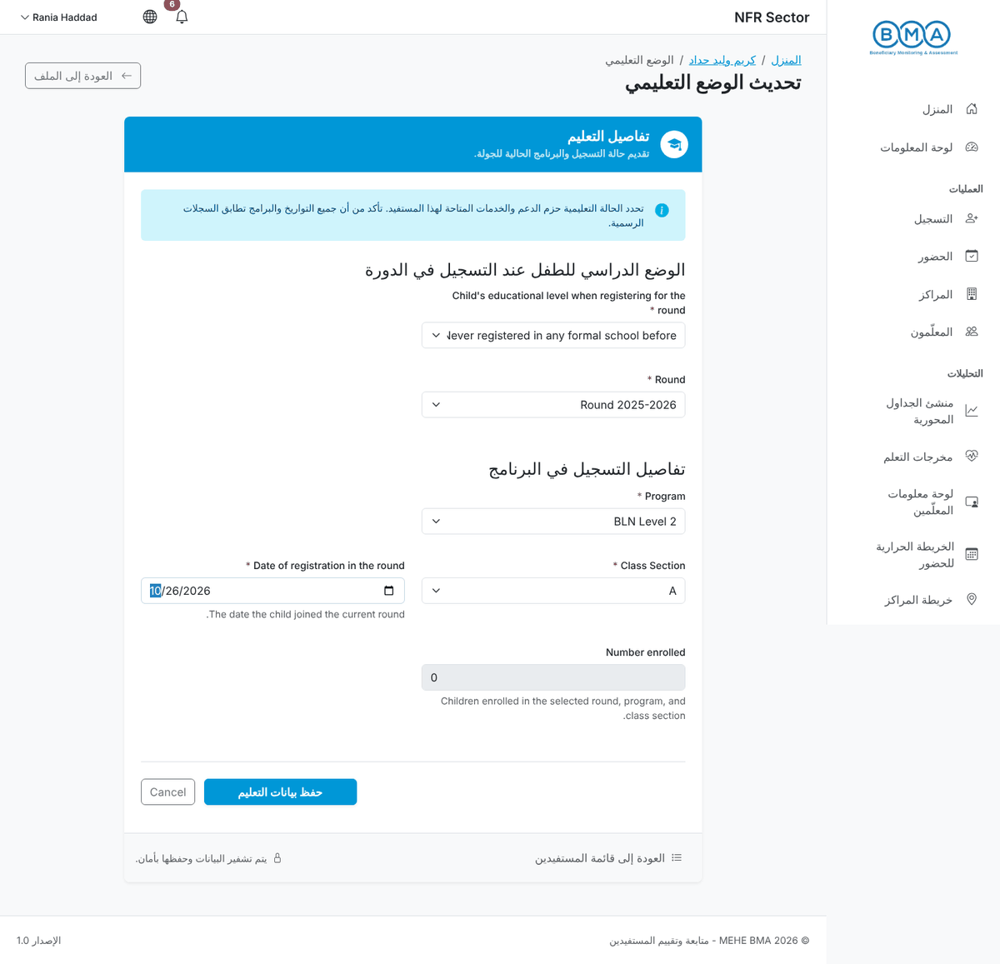

    *الشكل 25 – الوضع التعليمي بعد التعبئة*

3. اضغط **حفظ البيانات التعليمية**. يُعاد فتح الملف على تبويبة الوضع التعليمي مع الالتحاق الجديد وسطر جديد في **سجل التعليم**.

    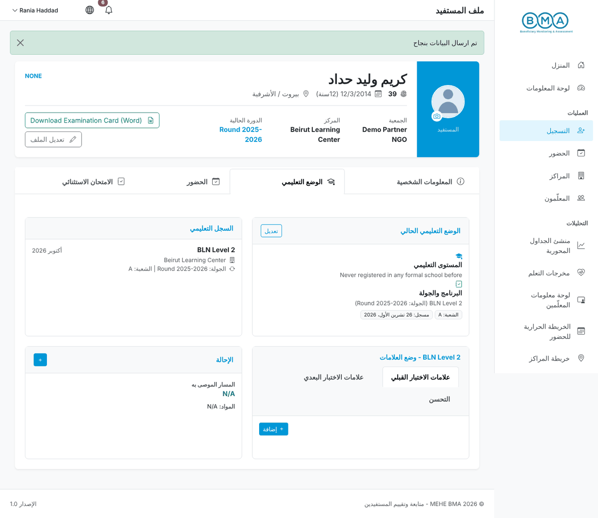

    *الشكل 26 – الوضع التعليمي المحفوظ*

1. عند بدء دورة جديدة افتح صفحة **التسجيل في دورة جديدة** للطفل (من زر **اختيار وإعادة التسجيل** في تنبيه التكرار، أو من زر **دورة جديدة** في رأس الملف إذا كان دورك يتيحه). يعرض **سجل التسجيل** الدورات التي التحق بها الطفل سابقاً.

    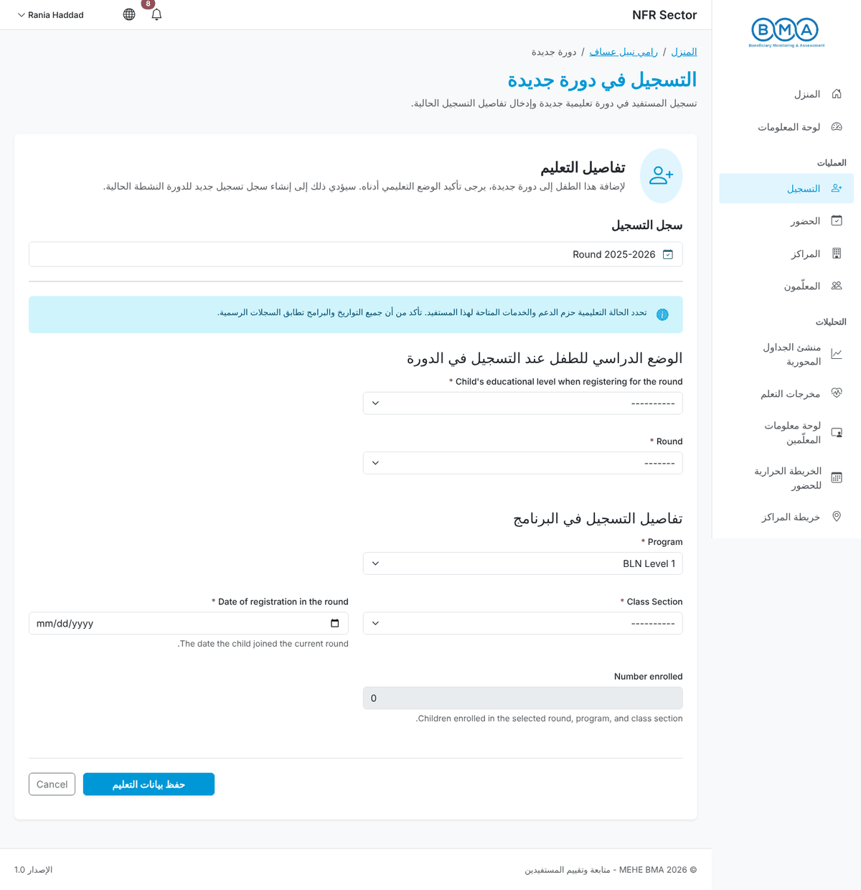

    *الشكل 27 – التسجيل في دورة جديدة*

2. املأ الوضع التعليمي للدورة الجديدة واضغط **حفظ البيانات التعليمية**. يُنشأ سجل تسجيل جديد للدورة الحالية وتبقى الدورات السابقة في السجل.

> **ملاحظة:** تعتمد البرامج المتاحة على عمر الطفل. إذا لم يظهر البرنامج المطلوب في القائمة، تحقّق من تاريخ الولادة.

## 6. الامتحان الاستثنائي

يحتاج الأطفال الذين يتقدّمون للامتحان الاستثنائي إلى سجل امتحان على تسجيلهم. لكل تسجيل سجل امتحان واحد.

1. افتح الملف، انتقل إلى تبويبة **الامتحان الاستثنائي** واضغط **إضافة امتحان استثنائي**. تؤخذ الإقامة وبلد ومكان الولادة والبرنامج من التسجيل وتظهر باللون الرمادي.

    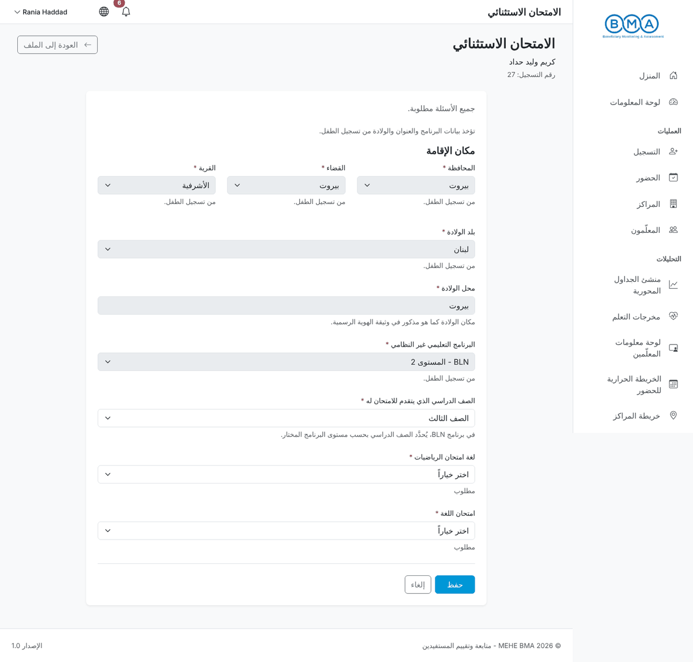

    *الشكل 28 – نموذج الامتحان الاستثنائي*

2. تحقّق من **الصف الذي يتقدّم للامتحان له** (يُشتق من مستوى البرنامج)، واختر **لغة امتحان الرياضيات** (عربية، إنكليزية أو فرنسية) و**امتحان اللغة** (إنكليزية أو فرنسية).

    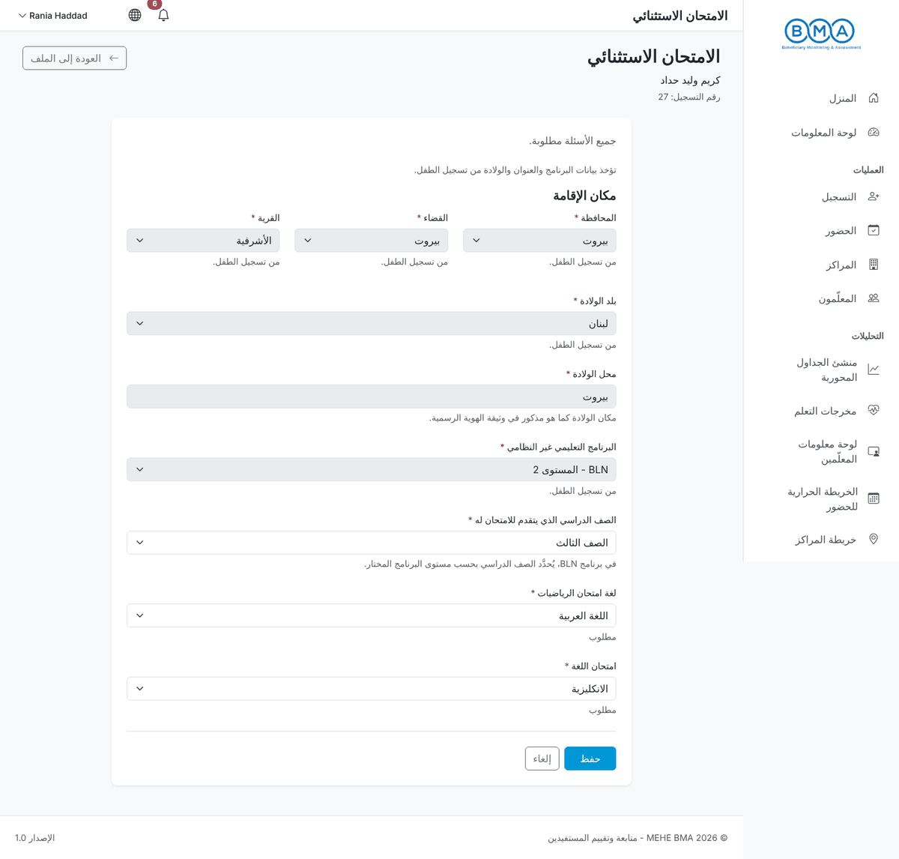

    *الشكل 29 – نموذج الامتحان بعد التعبئة*

3. اضغط **حفظ**. تظهر رسالة "تم حفظ الامتحان الاستثنائي" وتعرض التبويبة الإجابات المسجّلة. استخدم **تعديل الامتحان الاستثنائي** لتصحيحها لاحقاً.

    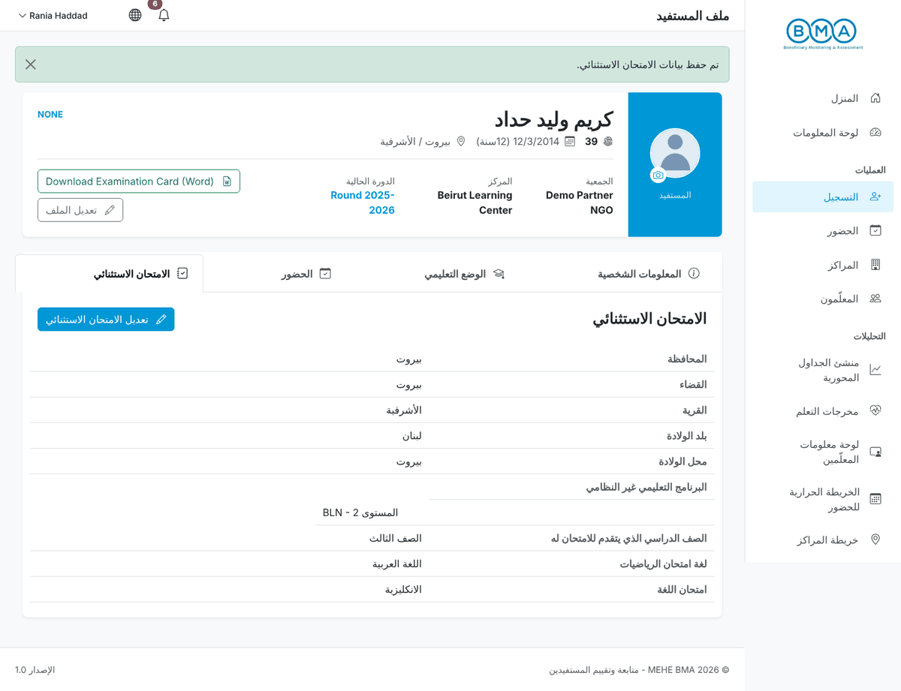

    *الشكل 30 – تفاصيل الامتحان المحفوظة*

> **ملاحظة:** إذا كانت الإقامة أو البرنامج الظاهران غير صحيحين، صحّح تسجيل الطفل أولاً (تعديل الملف) ثم عُد إلى نموذج الامتحان.

## 7. الحضور اليومي

يُسجَّل الحضور لكل يوم ولكل برنامج وشعبة. افتحه من **الحضور** في القائمة الجانبية.

1. التاريخ الافتراضي هو **اليوم**. اختر **البرنامج التعليمي** و**الدورة** و**الشعبة**.

    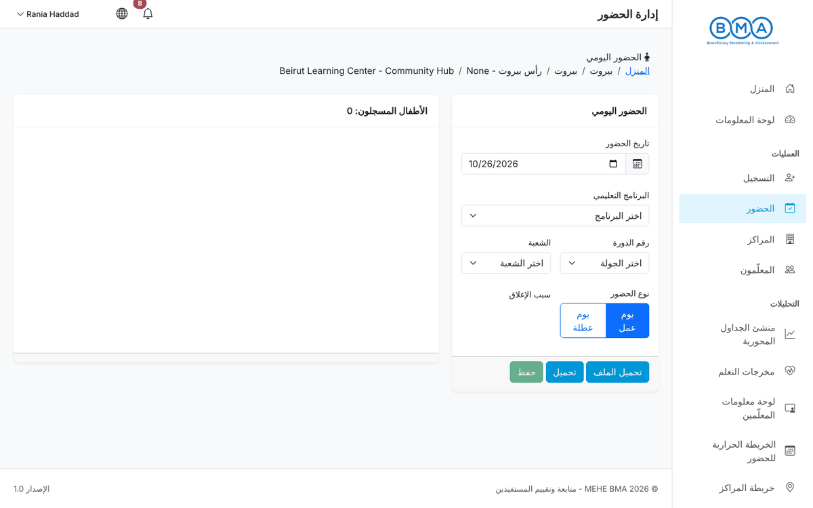

    *الشكل 31 – صفحة الحضور*

2. اضغط **تحميل**. يظهر الأطفال الملتحقون بهذا البرنامج والشعبة على الجانب، ولكل منهم زرا **حضر** و**غائب**.

    

    *الشكل 32 – الأطفال المحمَّلون للصف المختار*

3. يُعلَّم الأطفال **حضر** افتراضياً. لكل طفل غائب اضغط **غائب** واختر **سبب الغياب** (مرض، نقل، أو غير ذلك – مع وصفه في مربّع النص).

    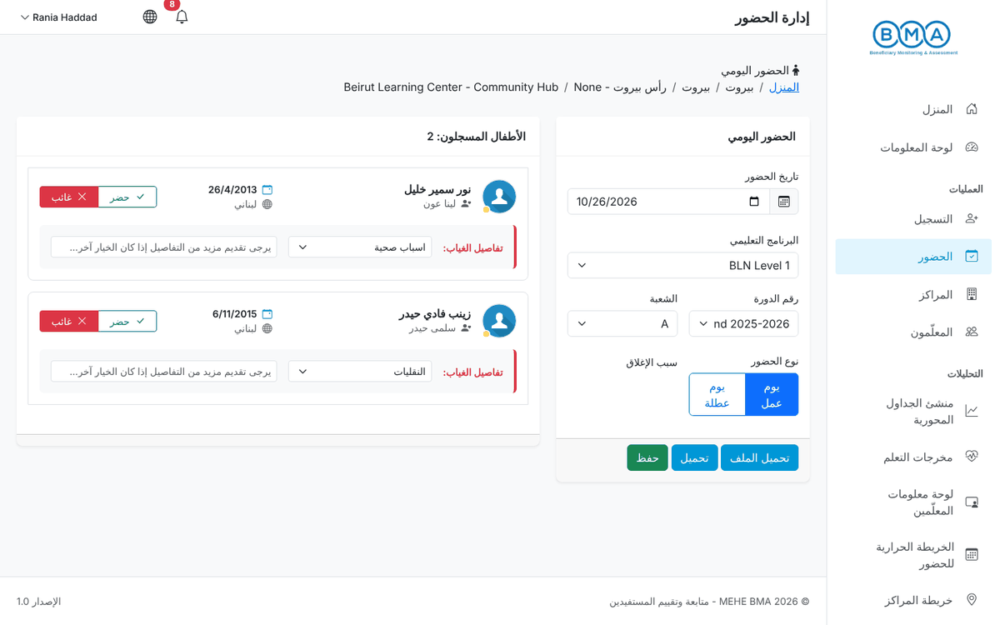

    *الشكل 33 – الغياب معلَّم مع سببه*

4. اضغط **حفظ**. تؤكّد رسالة **نجاح** حفظ الحضور. يمكنك إعادة تحميل اليوم نفسه لاحقاً لتصحيحه.

    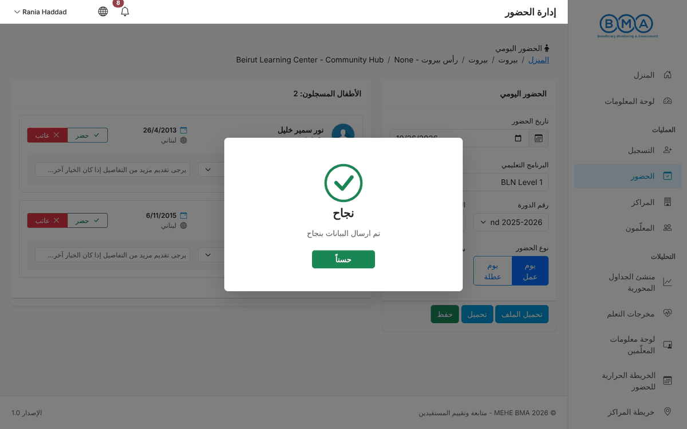

    *الشكل 34 – تم حفظ الحضور*

5. إذا كان المركز مغلقاً اختر **يوم عطلة** بدلاً من تعليم الأطفال، واختر **سبب الإغلاق** ثم احفظ.

    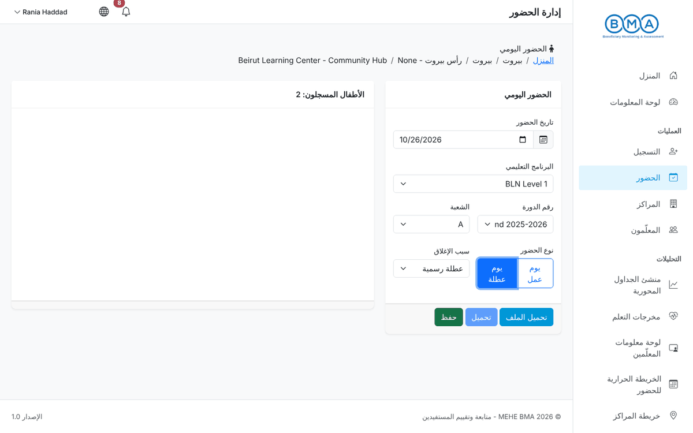

    *الشكل 35 – تسجيل يوم عطلة*

- يمكن تسجيل الحضور لليوم أو لتاريخ سابق؛ **التواريخ المستقبلية مرفوضة**.
- الطفل الذي لا يظهر في القائمة ليس لديه وضع تعليمي لهذا البرنامج والشعبة (انظر القسم 5)، أو أن تسجيله غير نشط.
- **تحميل الملف** يعطي ملف CSV للقائمة المحمَّلة حالياً على الشاشة.

## 8. المعلّمون

يجب تسجيل كل معلّم أو ميسّر في المركز. افتح **المعلّمون** من القائمة الجانبية.

1. تعرض قائمة المعلّمين الأسماء والجنس ورقم الهاتف والمركز والدورة ومن أنشأ السجل. استخدم **بحث** للتصفية و**تصدير** لتحميل القائمة. اضغط **إضافة معلّم** لإنشاء سجل.

    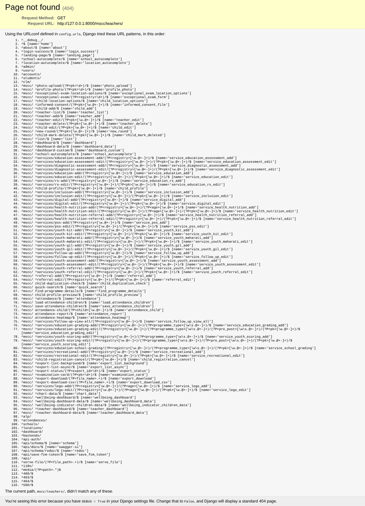

    *الشكل 36 – قائمة المعلّمين*

2. املأ **الهوية والاتصال**: الأسماء بالأحرف العربية، الجنس، تاريخ الولادة، الجنسية، نوع ورقم الهوية، الهاتف (بالصيغة XX-XXXXXX) والبريد الإلكتروني.

    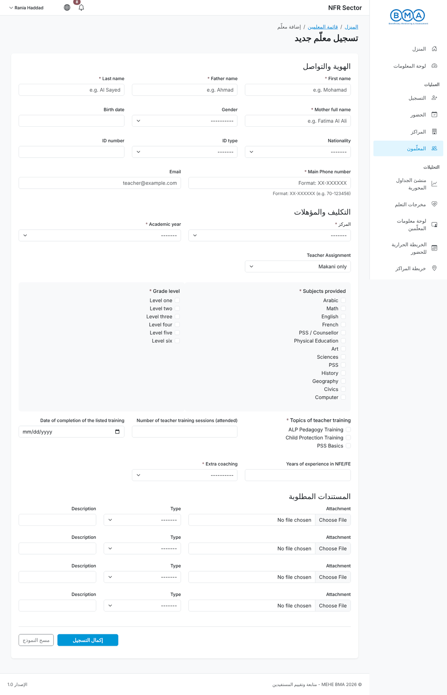

    *الشكل 37 – نموذج المعلّم*

3. املأ **التكليف والمؤهّلات**: المركز، السنة الدراسية، التكليف، ساعات التدريس، المواد، المستويات، مواضيع التدريب، سنوات الخبرة والتدريب الإضافي. أضف حتى أربع وثائق داعمة في **الوثائق المطلوبة**.

    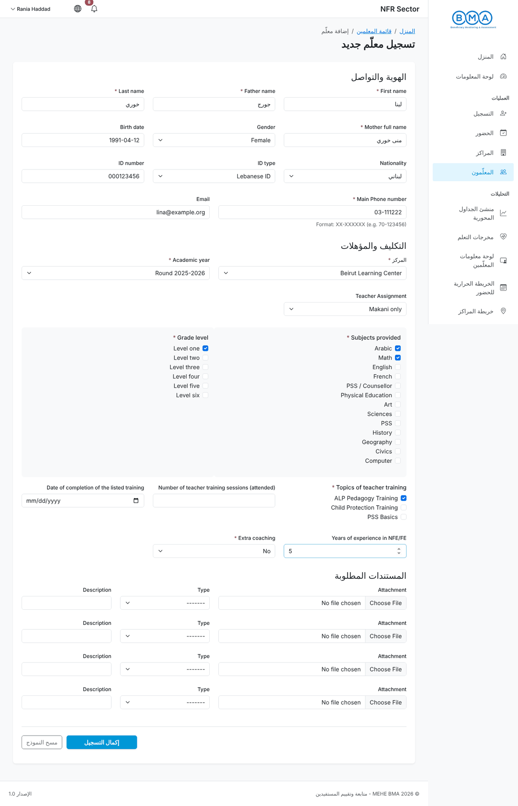

    *الشكل 38 – نموذج المعلّم بعد التعبئة*

4. اضغط **إكمال التسجيل**. يظهر المعلّم في القائمة.

    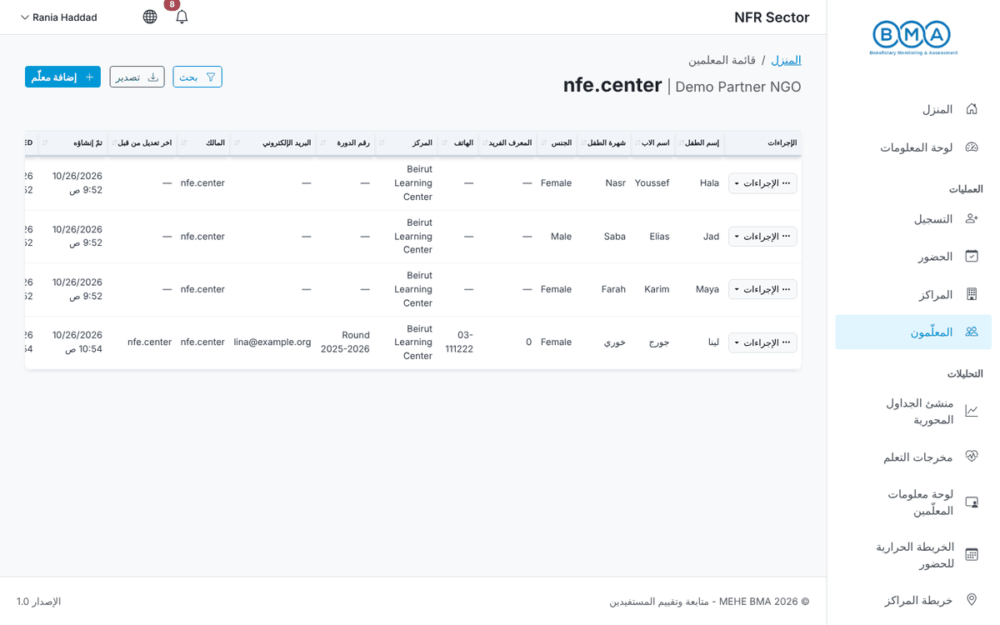

    *الشكل 39 – تم حفظ المعلّم*

5. لتحديث بيانات معلّم استخدم **الإجراءات ← تعديل** في القائمة، غيّر القيم واحفظ. **حذف** يزيل المعلّم بعد التأكيد.

    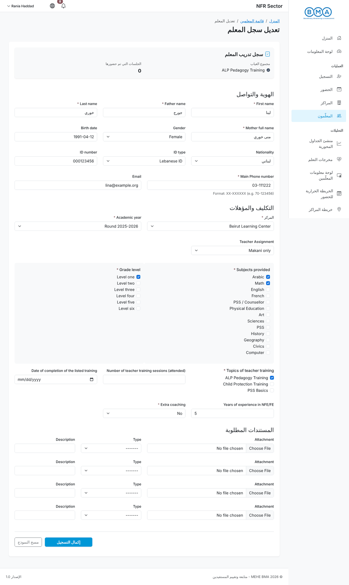

    *الشكل 40 – تعديل معلّم*

## 9. المراكز

1. يعرض عنصر **المراكز** في القائمة الجانبية المراكز التي يمكنك الوصول إليها مع الشريك والنوع والموقع. يرى مستخدم المركز مركزه فقط، ويرى مستخدم الشريك جميع مراكز منظمته. استخدم إجراءات السطر لفتح أو تحديث ملف المركز (الاسم، النوع، العنوان، الإحداثيات، الخدمات المقدَّمة).

    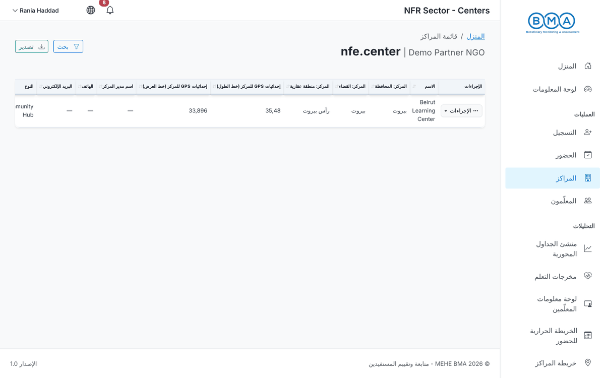

    *الشكل 41 – قائمة المراكز*

## 10. تصدير البيانات

تبدأ عمليات التصدير من قائمة المستفيدين وتُحضَّر في الخلفية، لذا يمكنك متابعة عملك.

1. في قائمة المستفيدين اضغط **تصدير**. اختر **الأطفال المراد تصديرهم** (جميع الأطفال الذين يمكنك الوصول إليهم، أو نتائج الفلتر الحالية فقط) و**الصيغة**: CSV (نص فقط)، أو Excel مع الصور، أو بطاقات الامتحان Word (ZIP).

    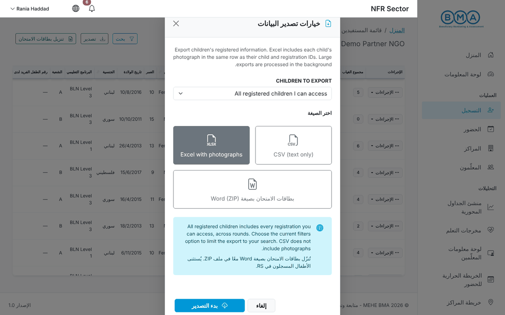

    *الشكل 42 – خيارات التصدير*

2. اضغط **بدء التصدير**. عندما يصبح الملف جاهزاً تخبرك رسالة بأن التحميل يبدأ تلقائياً.

    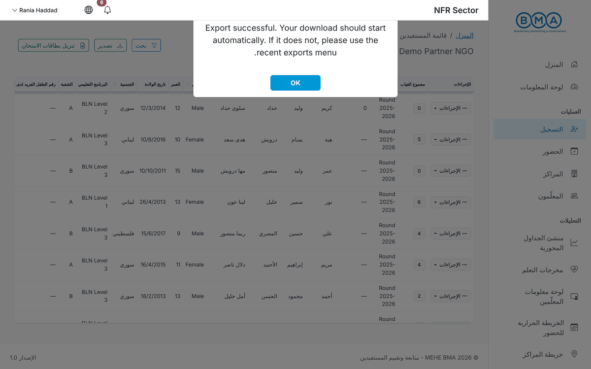

    *الشكل 43 – اكتمل التصدير*

3. اضغط **أيقونة الجرس** في الشريط العلوي لفتح **عمليات التصدير الأخيرة**. يعرض كل عنصر حالته ويتيح تحميل الملف مجدداً. **عرض كل السجل** يفتح سجل التصدير الكامل.

    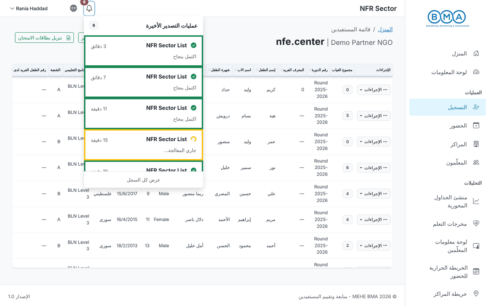

    *الشكل 44 – قائمة عمليات التصدير الأخيرة*

- يُدرج تصدير Excel صورة كل طفل في السطر نفسه مع رقم الطفل ورقم التسجيل.
- ملفات CSV بترميز UTF-8 مع علامة ترتيب البايتات، لذا تُفتح الأسماء العربية بشكل صحيح في Excel.
- لا يمكن تحميل ملف التصدير إلا للمستخدم الذي طلبه.
- **تحميل بطاقات الامتحان** في القائمة يحضّر بطاقات Word للأطفال المختارين في ملف ZIP واحد.

## 11. لوحات المعلومات والتحليلات

تعطي عناصر **التحليلات** في القائمة الجانبية نظرة عامة على بياناتك. جميع اللوحات محصورة بالمراكز التي يمكنك الوصول إليها.

1. **لوحة المعلومات** – إجمالي التسجيلات، المراكز النشطة، الشركاء والدورات، تليها رسوم بيانية عن الجنس والفئات العمرية والجنسية ومصدر التعريف والتسجيلات في كل دورة والحالة الأسرية والإعاقة والدعم النقدي والأطفال المنتقلين بين الدورات. استخدم **الفلاتر** لتضييق البيانات.

    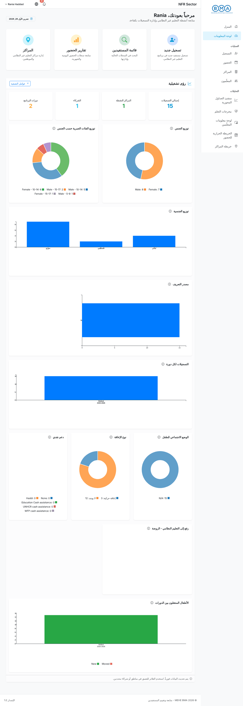

    *الشكل 45 – لوحة المعلومات التشغيلية*

2. **مخرجات التعلّم** – معدّل الحضور، معدّل عمالة الأطفال، الانتقال إلى التعليم النظامي، تحسّن الدرجات والتسرّب، مع رسوم اجتماعية-اقتصادية ورسوم الأثر.

    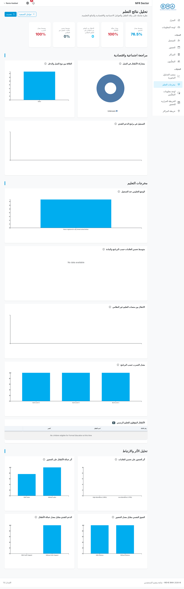

    *الشكل 46 – تحليل مخرجات التعلّم*

3. **لوحة معلومات المعلّمين** – عدد المعلّمين والجنس والجنسية والتكليفات والمواد والتدريب.

    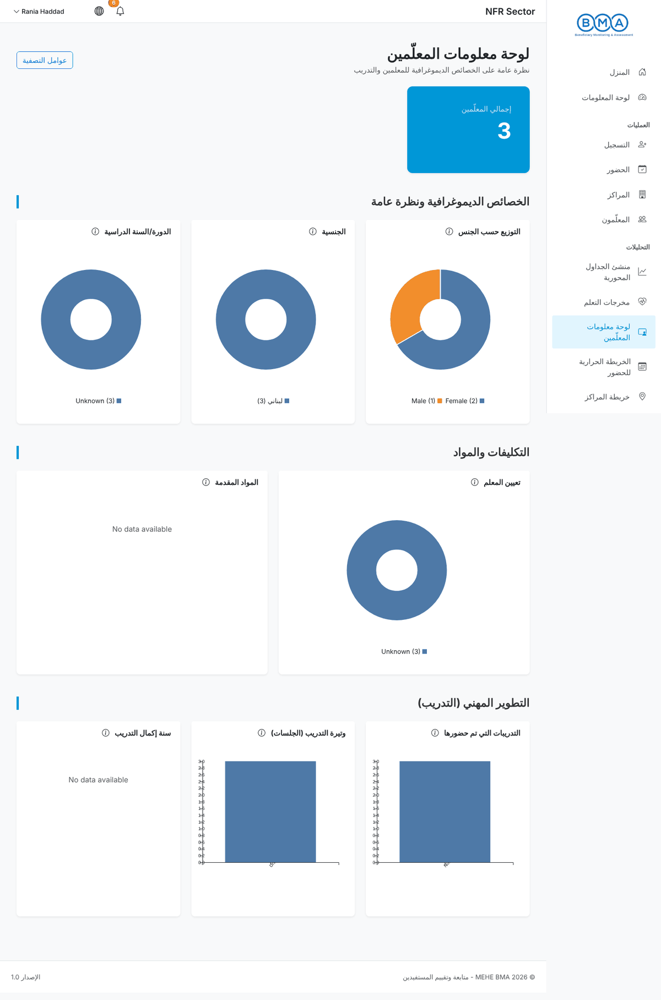

    *الشكل 47 – لوحة معلومات المعلّمين*

4. **الخريطة الحرارية للحضور** – مربّع لكل يوم ملوّن بحسب معدّل الحضور، إجمالاً ولكل برنامج. الأخضر الداكن حضور مرتفع؛ المربّعات الفاتحة أيام تستحق المتابعة.

    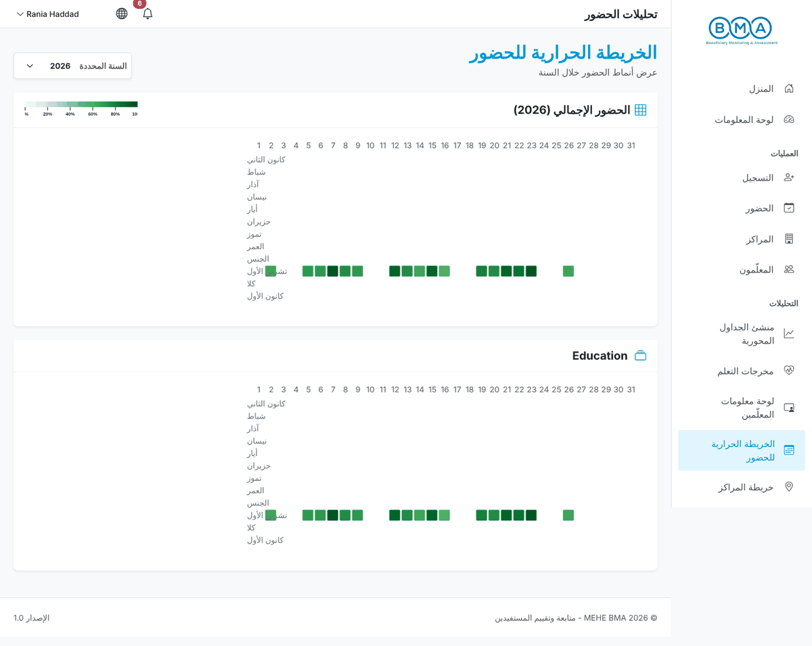

    *الشكل 48 – الخريطة الحرارية للحضور*

5. **خريطة المراكز** – المراكز على خريطة مع خصائصها وقائمة الأطفال المسجّلين. صفِّ بحسب الشريك والمركز.

    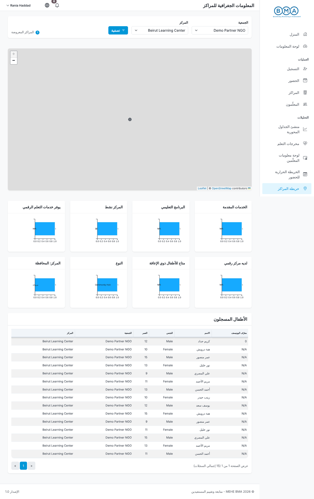

    *الشكل 49 – خريطة المراكز*

6. **منشئ الجداول المحورية** – اسحب الحقول (المركز، القضاء، الجنس، المحافظة، الجنسية، الشريك، البرنامج...) إلى الصفوف والأعمدة لبناء جدولك أو رسمك؛ اختر طريقة التجميع (عدد، مجموع...) من القائمة الجانبية.

    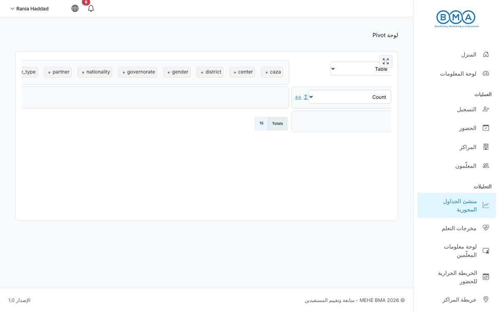

    *الشكل 50 – منشئ الجداول المحورية*

## 12. حسابك

1. **الملف الشخصي** (قائمة المستخدم) يعرض منظمتك الشريكة ومركزك والمعلومات المرتبطة بحسابك. تواصل مع المدير لتغيير هذه الارتباطات.

    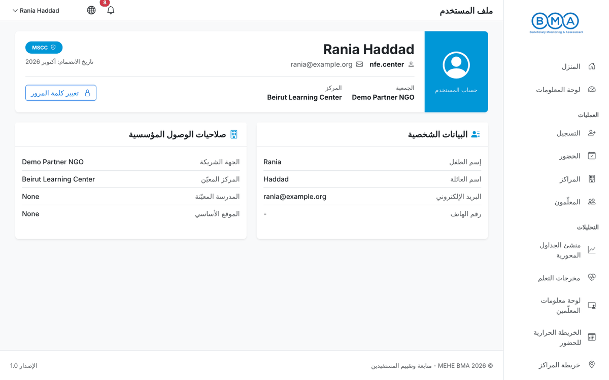

    *الشكل 51 – صفحة الملف الشخصي*

2. **تغيير كلمة المرور** (قائمة المستخدم): أدخل كلمة المرور الحالية ثم الجديدة مرتين، واضغط **تغيير كلمة المرور**.

    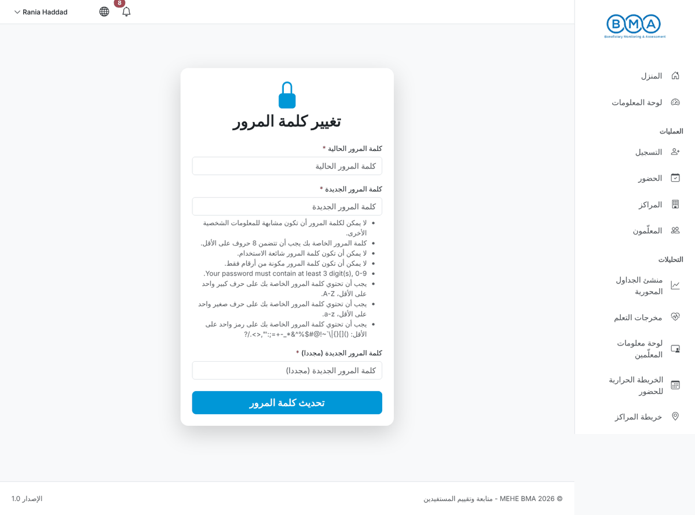

    *الشكل 52 – نموذج تغيير كلمة المرور*

3. **تسجيل الخروج** (قائمة المستخدم) ينهي جلستك. سجّل الخروج دائماً عند مغادرة حاسوب مشترك.

    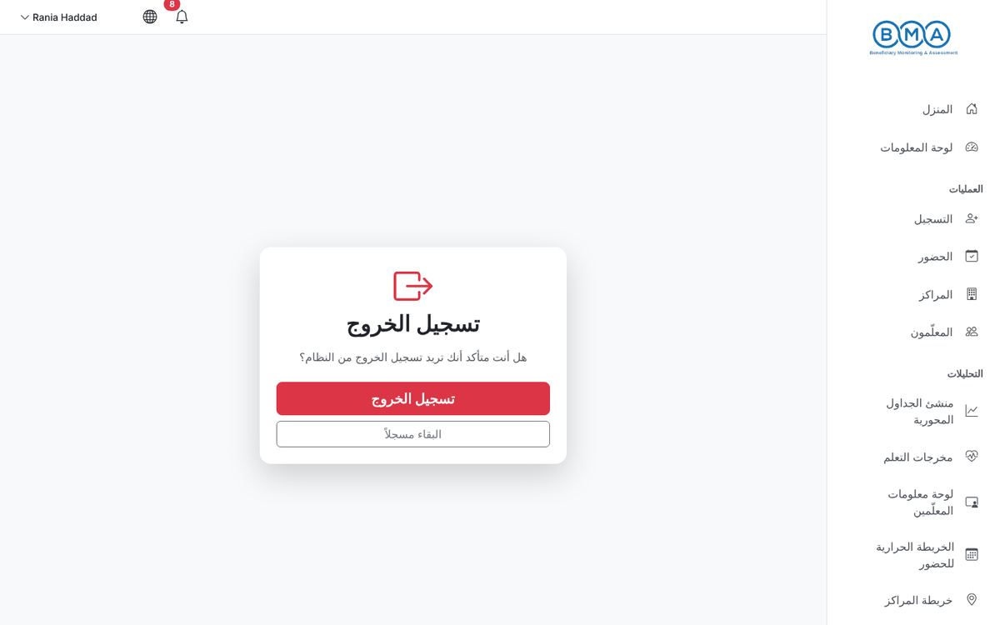

    *الشكل 53 – تسجيل الخروج*

| قاعدة كلمة المرور | المتطلّب |
|---|---|
| الطول | 8 أحرف على الأقل |
| الأرقام | 3 أرقام على الأقل |
| الأحرف | حرف كبير وحرف صغير على الأقل |
| الرموز | رمز واحد على الأقل مثل ! @ # $ % & * |
| غير شائعة | ليست كلمة شائعة ولا تشبه اسم المستخدم |

## 13. الأسئلة الشائعة

| السؤال | الجواب |
|---|---|
| زر الخطوة التالية معطّل في نموذج التسجيل. | تم العثور على تكرار محتمل. راجع لوحة المطابقات المحتملة: افتح الملف الموجود أو أعد تسجيل الطفل في دورة جديدة بدلاً من إنشاء سجل جديد. |
| تُمسح الأسماء عند مغادرة الحقل. | يجب كتابة الأسماء بالأحرف العربية فقط. تُزال الأحرف اللاتينية والأرقام تلقائياً. |
| رقم الهاتف مرفوض. | استخدم الصيغة XX-XXXXXX، مثلاً 03-123456. |
| لا يظهر الطفل في قائمة الحضور. | أضف الوضع التعليمي (البرنامج والدورة والشعبة) في ملف الطفل ثم أعد تحميل لائحة الحضور. |
| قائمة القضاء أو القرية فارغة. | اختر المحافظة أولاً ثم القضاء. إذا لم تُحمَّل القوائم اضغط "حاول مجدداً" أو حدّث الصفحة. |
| لا أرى أطفال مركز آخر. | يرى مستخدم المركز مركزه فقط. اطلب من المنسّق إذا كنت بحاجة إلى نطاق أوسع. |
| نسيت كلمة المرور. | لا توجد إعادة تعيين ذاتية. تواصل مع مدير النظام. |
| بمن أتصل للدعم؟ | بنقطة الاتصال في منظمتك الشريكة أولاً، ثم بفريق دعم BMA عبر المنسّق. |

